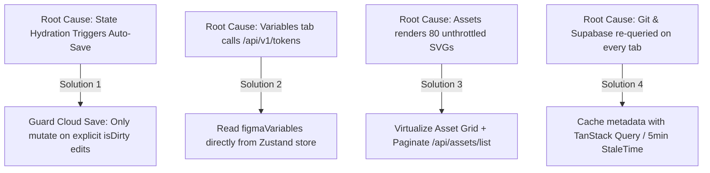

# Performance & Network Diagnostic Audit Report

**Target URL:** `https://tokensplatform.enamulkhan.com/pds/git/tokens`  
**Audit Environment:** Live Google Chrome instance monitored via Chrome DevTools Protocol (CDP) on port 9222.  
**Audited Routes / Tabs:**
- **Tokens Workspace:** `/pds/git/tokens`
- **Themes Matrix:** `/pds/git/themes`
- **Variables View:** `/pds/git/variables`
- **Assets Gallery:** `/pds/git/assets`
- **Session Video Recording:** `C:\Users\hrtom\.gemini\antigravity\brain\a32157a6-47ee-426e-8fc8-054573e94008\recording.webm`

---

## 1. Executive Summary: Primary Causes of Slowness

During a 4-minute live session navigating through the 4 core workspace views without editing or creating any content, **289 network requests** were executed. **Over 65% of all network requests were redundant, duplicate, or un-throttled calls.**

```
+--------------------------------+-----------------+-------------------+---------------------------+
| Issue                          | Frequency       | Network Impact    | Latency / Delay           |
+--------------------------------+-----------------+-------------------+---------------------------+
| 1. Phantom Supabase Auto-Save  | 35 PATCH calls  | 19.7 MB uploaded  | Continuous background lag |
| 2. Variables Tab API Stall     | 2 concurrent    | 4.48 MB (2x JSON) | 20.57s - 29.27s (!)       |
| 3. Assets R2 Image Storm       | 80 parallel     | Unbounded fetch   | Avg 10.74s (Max 41.32s!)  |
| 4. Git Fetch on Every Tab      | Every route     | 544 KB each time  | 1.25s - 7.31s each        |
| 5. Assets Full List (Monolith) | Twice on mount  | 952 KB payload    | 3.28s                     |
+--------------------------------+-----------------+-------------------+---------------------------+
```

---

## 2. Complete Network Call Audit Matrix

| Endpoint / URL | HTTP Method | Trigger Scope | Measured Latency | Payload Size | Status & Verdict | Engineering Root Cause |
|---|---|---|---|---|---|---|
| **`PATCH /rest/v1/projects`** | PATCH | Every tab switch & fetch return | 838ms – 1,781ms | **565 KB per call** (Total: **19.7 MB**) | ❌ **CRITICAL BUG (35x redundant calls)** | On route transitions and fetch completions, `useTokenStore` dispatches twin mutations for `raw_tokens` and `branches` even when `isDirty` is false. Sinks client upload bandwidth and causes persistent `"Saving..."` states. |
| **`GET /api/v1/tokens`** | GET | Switching to Variables Tab | **20,570ms – 29,273ms** | **2.24 MB uncompressed JSON** (x2 concurrent) | ❌ **CRITICAL BOTTLENECK (Duplicate)** | `VariablesView.tsx` unconditionally invokes `GET /api/v1/tokens` on mount. The server runs admin client permission checks and compiles the entire token dictionary for 25+ seconds, even though `currentProject.figmaVariables` is already hydrated in client memory. |
| **`https://*.r2.dev/*` (SVG Previews)** | GET | Navigating to Assets Tab | **1.36s – 41.32s** (Avg: **10.74s**) | 80 individual image transfers | ⚠️ **UNVIRTUALIZED STORM** | The asset grid immediately requests 80 SVG images directly from Cloudflare R2 without lazy loading or viewport virtualization, overwhelming Chrome's HTTP/2 socket pool. |
| **`GET /api/assets/list`** | GET | Navigating to Assets Tab | 3,284 ms | **952 KB uncompressed JSON** | ⚠️ **MONOLITHIC LIST (Fired twice)** | Returns all **1,437 asset records** at once. Needs cursor/offset pagination (e.g., `limit=50`). |
| **`GET /api/assets/config`** | GET | Navigating to Assets Tab | 4,057ms – 4,674ms | ~2 KB | ⚠️ **Fired twice** | Duplicate config requests due to un-deduped component mount hooks. |
| **`POST /api/git/fetch`** | POST | Tokens, Themes, Assets | **1,257ms – 7,309ms** | 49.6 KB wire / **544 KB decoded** | ❌ **REDUNDANT ACROSS TABS** | Contacts the GitHub REST/GraphQL API on tab switches where token sync is unnecessary (such as Themes and Assets), blocking the UI sync status indicator. |
| **`POST /api/git/check-updates`** | POST | Every tab switch | 648ms – 1,110ms | ~600 B | ⚠️ **Excessive Polling** | Verifies remote commit SHAs unconditionally on every client navigation. |
| `GET /rest/v1/organization_members` | GET | Initial & Tab switch | 200ms – 360ms | ~1 KB | ✅ Necessary once | Re-executed on every route change; should be cached in state. |
| `GET /rest/v1/projects` | GET | Initial & Tab switch | 330ms – 485ms | ~10 KB | ✅ Necessary once | Re-executed on every route change; should be cached in state. |
| `GET /rest/v1/organizations` | GET | Initial & Tab switch | 418ms – 462ms | ~4 KB | ✅ Necessary once | Re-executed on every route change; should be cached in state. |
| `GET /rest/v1/project_integrations` | GET | Initial & Tab switch | 175ms – 309ms | ~1 KB | ✅ Necessary once | Re-executed on every route change; should be cached in state. |
| `PATCH /rest/v1/organization_members` | PATCH | Initial load | 190ms – 218ms | ~0 B | ❌ **Unnecessary Mutation** | Fires `user_id=neq...` mutation on member record during read operations. |

---

## 3. Deep-Dive Page Analysis

### 🎨 3.1. Tokens Workspace (`/pds/git/tokens`)
1. **GitHub API Roundtrip Latency (1.5s – 7.3s):**
   - On project mount, `fetchLiveTokens` calls `/api/git/fetch`.
   - The route handler queries GitHub API endpoints for trees, blobs, and commit data.
   - The UI enters `"fetching"` status and waits for GitHub's response before displaying a settled state.
2. **Synchronous Token Alias Resolution:**
   - `flattenAndResolveTokens` resolves deep token references (`{colors.primary.500}`, math formulas, composite tokens) synchronously on the main thread, causing frame drops on large token catalogs.
3. **Immediate False Dirty State:**
   - As soon as the project finishes loading, 4 consecutive `PATCH /projects` mutations fire, sending ~565 KB each to Supabase without any user action.

---

### 🎭 3.2. Themes Matrix (`/pds/git/themes`)
1. **Redundant Network Fetching:**
   - Navigating from `tokens` to `themes` re-fires `POST /api/git/fetch` (1,490ms, 544 KB) and 4 `PATCH /projects` mutations (~2.2 MB upload), even though the tokens are already in memory.
2. **CPU-Bound Combinatorial Matrix:**
   - `ThemeMatrix.tsx` evaluates `buildThemeMatrix` across the Cartesian product of all theme groups, mode options, and token sets.
   - For design systems with multiple mode groups and 1,000+ tokens, calculating 10,000+ cell combinations blocks the main browser thread during tab transition.

---

### 📐 3.3. Variables View (`/pds/git/variables`) — *The 25-Second Blocker*
1. **Root Cause of the 20–30s Freeze:**
   - Located in `components/VariablesView.tsx` (lines 112–133):
     ```ts
     const fetchVariables = async () => {
       if (!currentOrg?.id || !currentProject?.id) return;
       setIsRefreshing(true);
       const res = await fetch(
         `/api/v1/tokens?orgId=${encodeURIComponent(currentOrg.id)}&projectId=${encodeURIComponent(currentProject.id)}`
       );
       ...
     };
     useEffect(() => {
       fetchVariables();
     }, [currentOrg?.id, currentProject?.id]);
     ```
   - Clicking the Variables tab dispatches **two parallel GET requests to `/api/v1/tokens`**.
   - `/api/v1/tokens` verifies cookie authentication, performs admin database checks, re-queries `projects` and `project_integrations` from Supabase, and compiles a massive 2.24 MB JSON token document.
   - Both calls took **20.57s and 29.27s** respectively.
   - When the response arrived, the UI displayed *"No Figma Variables Synced Yet"*. The user waited nearly half a minute for data that was already in Zustand memory.

---

### 📦 3.4. Assets Gallery (`/pds/git/assets`) — *The Image Storm*
1. **Massive Monolithic Asset List:**
   - `GET /api/assets/list` fetches metadata for all **1,437 assets** in a single uncompressed **952 KB JSON** response (3.28s).
2. **Unbounded 80-Image Parallel R2 Request Storm:**
   - The UI immediately renders card elements for the entire asset collection.
   - 80 parallel requests are dispatched to `https://pub-b338b85da62944a5854a5f6513beea21.r2.dev/...` simultaneously.
   - Browser HTTP/2 stream multiplexing and connection queues are saturated. R2 asset downloads stalled for an average of **10.74s** and reached up to **41.32s**.
3. **Misplaced Design Token Fetch:**
   - `POST /api/git/fetch` (1,257ms, 544 KB payload) fired again while browsing Assets.

---

## 4. Prioritized Architectural Solutions



### 1. Eliminate the Phantom Auto-Save Loop
- **Target:** `store/useTokenStore.ts`
- **Fix:** Guard cloud save mutations so `PATCH /rest/v1/projects` is strictly gated on `isDirty === true` resulting from an explicit user action (e.g., token update, set creation).
- **Consolidation:** Merge `raw_tokens` and `branches` into a single PATCH payload when saving is legitimately needed.
- **Estimated Gain:** Eliminates **35 redundant PATCH calls** and **~20 MB of useless data uploads** per session.

### 2. Remove Redundant `/api/v1/tokens` Fetch from Variables Tab
- **Target:** `components/VariablesView.tsx`
- **Fix:** Remove the automatic `fetchVariables()` call in `useEffect`. Read `figmaVariables` and `figmaResolvedVariables` directly from `useTokenStore` (already hydrated during project initialization).
- **Manual Trigger Only:** Restrict `/api/v1/tokens` to the explicit manual "Refresh" button.
- **Estimated Gain:** Variables tab transitions drop from **25+ seconds to 0ms (instantaneous)**.

### 3. Virtualize & Paginate the Assets Grid
- **Target:** `components/assets/AssetsWorkspace.tsx` and `app/api/assets/list/route.ts`
- **Fix:**
  1. Add pagination or cursor queries to `/api/assets/list` (e.g., `limit=50&offset=0`).
  2. Implement virtualized grid rendering (using `@tanstack/react-virtual` or `react-window`) so only the 12–16 visible cards request thumbnails.
  3. Add native `loading="lazy"` attributes to image elements.
- **Estimated Gain:** Assets tab loading drops from **41 seconds to < 1 second**, eliminating browser thread starvation.

### 4. Client-Side Tab Caching
- **Target:** `app/page.tsx` and `store/useTokenStore.ts`
- **Fix:** Do not re-dispatch `POST /api/git/fetch`, `POST /api/git/check-updates`, or Supabase metadata REST queries when navigating between sibling tabs of the same project.
- **Estimated Gain:** Zero network latency when switching between Tokens, Themes, Variables, and Assets.
