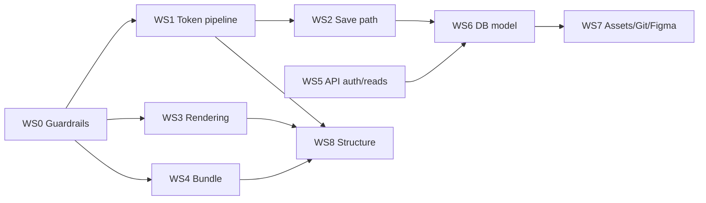

# Full-System Performance Analysis — Front-end, Back-end & Structure

> **Implementation Status Summary (Updated 2026-11-08):**
> - ✅ **Phase 1 — Quick Wins (9/9 Items):** **100% Developed** (`updateTokensBatch`/`deleteTokensBatch`/`duplicateTokensBatch`/`moveTokensBatch`, single-flight debounced save queue, single-auth pass, SHA-256 `api_keys` hash index, `/api/v1/tokens` ETag `304`, dynamic `jszip`/`releaseCompiler` code-splitting, `useShallow` store selectors, R2 ETag conditional writes, dead `TokenTable.tsx` cleanup).
> - ✅ **Phase 2 — Core Pipeline (8/10 Items):** **Developed** (WeakMap lookup index, per-pass alias memoization, incremental point resolution `patchResolvedTokensIncremental`, structural sharing copy-on-write edits, progressive batch rendering in `VariablesView`/`CodeViewer`/doc blocks, Server Component + ISR public docs reader, RLS `(select auth.uid())` & composite indexes in `20261108_rls_perf_and_indexes.sql`, `projects.version` column).
> - ⏳ **Remaining Future Roadmap (Phase 2 Optional & Phase 3 Structural):** Web Worker background full-resolve, IndexedDB project cache (`idb-keyval`), normalizing `project_branches` DB table (Stage B/C), splitting `useTokenStore` into domain slices (`WS8.1`), and migrating catch-all view tabs into nested Next.js route files (`WS8.3`).

**Date:** 2026-11-04
**Scope:** Whole repository (`app/`, `components/`, `store/`, `services/`, `utils/`, `lib/`, `supabase/`, `plugin/`, build config)
**Method:** Static code review of all layers + a fresh production build (`next build`, Next.js 14.2.35) + a throw-away CPU benchmark of the token pipeline (13,000-token synthetic document). Temporary benchmark files were removed; the working tree is unchanged apart from this report.
**Builds on:** [`PERFORMANCE_AUDIT_REPORT.md`](../PERFORMANCE_AUDIT_REPORT.md) (live-session network audit) and [`BACKEND_AUDIT.md`](./BACKEND_AUDIT.md). This report does **not** repeat their findings; it re-verifies the earlier performance findings against current code (§2) and adds new, code-level findings (§4–§6).

> **Not measured here:** live network timings, Supabase/R2/GitHub latency, React render/commit times, real-device CPU. Numbers marked *(measured)* come from the build or the benchmark in §1. Numbers marked *(estimate)* are engineering expectations that must be confirmed with the measurements proposed in §9.

---

## 1. Baseline Measurements

### 1.1 Codebase size

| Item | Value |
|---|---|
| TypeScript/TSX files (app, components, store, services, utils, lib, data, types, plugin) | ~190 files, ~64k lines |
| [`store/useTokenStore.ts`](../store/useTokenStore.ts) | **6,127 lines, ~286 actions**, 19 `JSON.parse(JSON.stringify())` deep clones, 20 `extractThemeGroups()` call sites |
| Largest components | `AssetsWorkspace` 207 KB, `WorkspacesProjectsView` 90 KB, `TokensWorkspace` 84 KB, `SyncProvidersView` 76 KB, `Header` 55 KB, `Sidebar` 53 KB (source size) |

### 1.2 Production build (measured)

| Route | Route JS | First Load JS (gzip) |
|---|---|---|
| `/` and `/[workspaceSlug]/[[...path]]` (the whole app) | 0.2–0.3 kB | **369 kB** |
| `/connect` | 2.9 kB | 294 kB |
| `/docs/[orgSlug]/[projectSlug]` (public docs) | 19.9 kB | 292 kB |
| `/invite/[token]` | 9.3 kB | 175 kB |
| Shared by all | — | 88 kB |

* The shell's first-load file set is **13 chunks, ≈1.32 MB uncompressed** (`.next/app-build-manifest.json`). Total static JS emitted: ~2.65 MB.
* The previous frontend audit recorded "87.3 kB shared first-load". That figure is the *shared* chunk only; the actual first load of the app shell is **369 kB**.
* Main CSS: 116 KB raw (acceptable).
* Chunk inspection shows the shell chunks contain **`jszip`** (chunk `8496`, ~150 KB), the **Supabase client incl. GoTrue + realtime** (chunks `5283`, `9391`, `8286`, `44530001`), and the **Zustand store + Header/Sidebar** (static imports).

### 1.3 Token-pipeline benchmark (measured, Node, synthetic 20 sets / 13,000 tokens / 1.03 MB document, ~50 % aliases)

| Operation | 2,000 tokens | **13,000 tokens** |
|---|---|---|
| `JSON.stringify(doc)` | 0.5 ms | 4.4 ms |
| Deep clone `JSON.parse(JSON.stringify(doc))` | 1.3 ms | 9.2 ms |
| `flattenAndResolveTokens(ALL)` | 58 ms | **491 ms** |
| ↳ lookup-index build | 2.4 ms | 18 ms |
| ↳ final `compareTokens` sort | 25 ms | **218 ms (~44 %)** |
| ↳ per-token alias resolution & mapping (remainder) | ~30 ms | ~255 ms |
| **One token edit** (clone + theme groups + resolve) | 61 ms | **534 ms** |
| `buildThemeMatrix` | 8 ms | 55 ms |
| Text search filter over resolved tokens | 0.4 ms | 5 ms |
| **Bulk edit of 50 selected tokens** (current loop strategy) | 3.2 s | **25.6 – 29.4 s** |

Caveat: Node on a developer machine; a mid-range laptop browser is commonly 2–4× slower, and React render/commit time is **additional**. The relative picture (resolver ≫ everything else) is what matters.

---

## 2. Status of Earlier Performance Findings (re-verified in code)

The prior live audit ([`PERFORMANCE_AUDIT_REPORT.md`](../PERFORMANCE_AUDIT_REPORT.md)) predates several fixes. Code now shows:

| Earlier finding | Status in current code | Evidence | Residual risk |
|---|---|---|---|
| Phantom auto-save (35 × `PATCH /projects`, 19.7 MB) | **Mitigated** | [`setRawTokens`](../store/useTokenStore.ts) has an `isUnchanged` guard and hydration uses `{ persist: false }`; `raw_tokens` + `branches` merged into one UPDATE (`saveProjectTokensAndBranches`) | Guard compares via 3 × `JSON.stringify` of the whole doc (see F8). Needs live re-check. |
| Variables tab fires `GET /api/v1/tokens` on mount (20–29 s) | **Fixed** | [`VariablesView.tsx`](../components/VariablesView.tsx) now reads `figmaResolvedVariables` from the store; fetch only on manual Refresh | The endpoint itself is still heavy (B3). |
| Assets tab: 80-image storm | **Mitigated** | `ASSET_BATCH_SIZE = 48`, `IntersectionObserver`, `loading="lazy"` in [`AssetsWorkspace.tsx`](../components/assets/AssetsWorkspace.tsx) | `/api/assets/list` is still a monolith (B6). |
| `POST /api/git/fetch` on every tab | **Mitigated** | 60 s `LIVE_FETCH_TTL_MS`, in-flight de-dupe, `lastCommitSha` → `{ unchanged: true }` short-circuit; `checkRemoteUpdates` has 30 s cooldown + 10 min back-off on 403 | Server cache is per-instance (B7). |
| Org/project metadata re-queried on each route change | **Fixed** | 30 s `METADATA_CACHE_TTL_MS`, `getOrgProjectSummaries` (no token columns), localStorage SWR | `getOrgProjects` (`select *`) still used by `/api/v1/releases` (B3). |
| Unnecessary `PATCH organization_members` on load | **Now conditional** | Only when an email-matched member row has a different `user_id` (`needsUserLink`) | None. |
| Synchronous alias resolution on the main thread | **✅ Developed** | Incremental `patchResolvedTokensIncremental`, WeakMap index, and per-pass memoization active (~1.5 ms point edits) | Optional Web Worker for initial 13k full-load remains planned. |
| ThemeMatrix CPU cost | **✅ Mitigated** | Store selectors (`useShallow`) and memoized matrix derivation active | Low residual cost on full theme structural edits. |

---

## 3. Executive Summary

The earlier network-level problems and Phases 1–2 of the CPU/memory pipeline upgrades have been implemented. Below is the status of every finding across the system:

| # | Finding | Layer | Severity | Effort | Status |
|---|---|---|---|---|---|
| F1 | Full re-resolve of all tokens on every edit (≈0.5 s @13k) | FE/Core | 🔴 P0 | M | ✅ **Developed** (`patchResolvedTokensIncremental` + per-pass memo; Web Worker optional) |
| F2 | Bulk actions run the full pipeline **and** a cloud save per token (50 tokens ≈ 26 s) | FE/Core | 🔴 P0 | S | ✅ **Developed** (`updateTokensBatch`, `deleteTokensBatch`, `duplicateTokensBatch`, `moveTokensBatch`) |
| F3 | Cloud save on every edit, no debounce/queue, whole-document payload | FE/BE | 🔴 P0 | M | ✅ **Developed** (Single-flight debounced save queue + retry back-off) |
| B4 | DB write amplification: tokens stored 2–3× in one JSONB row | DB | 🟠 P1 | L | ⏳ **Stage A Developed** (`projects.version` added); **Stage B/C Planned** (`project_branches` table) |
| F4 | 369 kB first-load; `jszip`, schema catalog, compilers in the shell | FE | 🟠 P1 | M | ✅ **Developed** (`data/schemaIds.ts` extracted, dynamic `jszip` & `releaseCompiler` imports) |
| F5 | 53 whole-store subscriptions (`useTokenStore()`), incl. per-cell | FE | 🟠 P1 | M | ✅ **Developed** (`useShallow` & atomic selectors across hot paths and cells) |
| F6 | Unbounded rendering in docs blocks, Variables view, code viewers (violates Rule 4) | FE | 🟠 P1 | M | ✅ **Developed** (Progressive batching in `VariablesView`, `CodeViewer`, and doc blocks) |
| B1 | Per-request auth = `getUser()` network call + 2–3 serial DB queries; `/v1/tokens` authenticates **twice** | BE | 🟠 P1 | S–M | ✅ **Developed** (Single auth pass per request; pre-authenticated context reuse) |
| B2 | Bearer auth reads the **entire** `api_keys` table per request | BE | 🟠 P1 | S | ✅ **Developed** ($O(1)$ `findApiKeyByHash` + `api_keys_key_hash_uidx`) |
| B3 | `GET /api/v1/tokens` loads `select *`, re-resolves 13k tokens (~0.5 s CPU) per request, returns raw + resolved | BE | 🟠 P1 | M | ✅ **Developed** (ETag header + `304 Not Modified` conditional short-circuit) |
| F12 | Public docs page is a client component that downloads **all** projects of the org | FE/BE | 🟠 P1 | S–M | ✅ **Developed** (Server Component + `revalidate = 300` + projected query) |
| F8/F9 | Deep clones & localStorage as a multi-MB data cache (sync, 5 MB quota) | FE | 🟡 P2 | M | ✅ **F8 Developed** (Structural sharing copy-on-write); ⏳ **F9 Planned** (IndexedDB) |
| B5 | RLS/index hygiene (`auth.uid()` per row, redundant/missing indexes) | DB | 🟡 P2 | S | ✅ **Developed** (`20261108_rls_perf_and_indexes.sql`) |
| B6/B7/B9 | R2 index monolith, per-instance git cache, 2 s polling with `select *` | BE | 🟡 P2 | M | ✅ **B6 & B9 Developed** (R2 ETag CAS + narrow pairing poll); ⏳ **B7 Partial** (Timeouts added; shared KV optional) |
| S1–S3 | God-store, giant components, SPA-in-a-route architecture | Structure | 🟡 P2 | L | ⏳ **Planned (Phase 3)** |

---

## 4. Front-end Findings

### F1 — Resolver is synchronous, non-incremental and sort-heavy 🔴 P0
**Where:** [`utils/transformTokens.ts`](../utils/transformTokens.ts) — `flattenAndResolveTokens`, `resolveTokenAlias`, `buildTokenLookupIndex`; called from the store via `resolveTokensWithActiveThemes` (every `updateSingleToken`, `updateSetJson`, `setActiveSet`, theme change…).

**Evidence (measured, §1.3):** one edit at 13k tokens = **534 ms** blocked main thread (≥ 2 dropped-frame budgets of 16 ms ×30). Breakdown: ~44 % is the final full sort inside `flattenAndResolveTokens`, ~50 % per-token alias resolution.

**Root causes**
1. Every edit recomputes **all** tokens even though one leaf changed.
2. No memoisation of already-resolved alias targets: each aliased token re-walks its entire chain (`resolveTokenAlias` recursion), and copies the `visited` set at every hop (`new Set(visited)` → O(depth²)).
3. `result.sort(compareTokens …)` runs inside the resolver, although `TokensWorkspace`, `VariablesView` and doc blocks all sort again for display. `compareTokens`/`parseSortableValue` re-parse values on every comparison (only luminance is cached).
4. Unresolvable aliases fall through steps 3–4 in `resolveTokenAlias`, scanning **every set** with several `getNestedValue` calls per reference — a few broken references on a 13k set are expensive.
5. A regex literal is re-created per `resolveTokenAlias` call; `evaluateTokenMath` is entered for every value.

**Recommendations**
* **Incremental resolution:** keep a persistent lookup index and a reverse-dependency map (`token → dependents`). On edit, re-resolve only the changed token and its transitive dependents; patch `resolvedTokens` immutably.
* **Per-pass memo:** `Map<tokenKey, resolvedValue>` inside one `flattenAndResolveTokens` run (turns chains from O(n·depth) into O(n)); share `visited` via push/pop instead of cloning.
* **Move sorting out of the resolver** (or precompute sort keys once — Schwartzian transform — and cache parsed values).
* **Negative cache** for unresolvable references.
* **Off-main-thread:** run the full resolve (initial load, theme switch, Git pull) in a Web Worker; use `startTransition`/`useDeferredValue` for the result swap.
* Add a regression benchmark (e.g. `vitest bench`) with a 13k-token fixture and a budget (see §9).

### F2 — Bulk actions are O(N × whole-document) 🔴 P0
**Where:** [`TokensWorkspace.tsx`](../components/TokensWorkspace.tsx) — `handleBulk*` handlers (`selectedTokensList.forEach(token => updateSingleToken(…))` / `deleteToken(…)`).

**Evidence (measured):** 50 selected tokens ⇒ **25.6–29.4 s** of main-thread work at 13k tokens, *plus* 50 cloud PATCHes (F3) and 50 activity-log writes to localStorage.

**Recommendation:** add batch store actions (`updateTokensBatch(entries[])`, `deleteTokensBatch(paths[])`) that clone once, apply all path mutations, resolve **once**, `extractThemeGroups` once, persist once, log one activity. Keep the single-token actions as thin wrappers.

### F3 — Persist-on-every-edit with no debounce/queue 🔴 P0
**Where:** [`persistTokensChange`](../store/useTokenStore.ts) → `saveProjectTokensAndBranches` ([`organizationService.ts`](../services/organizationService.ts)).

* Each edit sends `raw_tokens` **and** `branches` (the active branch embeds another full copy of `rawTokens`) **and** `theme_groups` — typically 2–3× the document size.
* No coalescing: fast edits issue overlapping PATCHes whose completion order is not guaranteed → last-writer-wins races (also a correctness risk).
* `saveProjectTokensAndBranches` calls `invalidateMetadataCache()` on every save, so the 30 s metadata cache is discarded during editing.
* `logUserActivity` writes up to 100 entries to `localStorage` synchronously per action.

**Recommendations:** trailing-edge debounce (≈1–2 s) + single-flight queue (latest-wins, retry with back-off); optimistic-concurrency `version`/`updated_at` check (`.eq("updated_at", lastSeen)`); persist only the active branch's tokens once (see B4); batch/debounce activity persistence (same flush mechanism already used for the project cache at 1.5 s).

### F4 — First-load bundle (369 kB) is dominated by shell-level static imports 🟠 P1
**Evidence (measured):** shell chunks contain `jszip`, full Supabase client, store, Header, Sidebar.

**Causes**
* [`useTokenStore.ts`](../store/useTokenStore.ts) statically imports `@/utils/releaseCompiler` (→ `jszip`, only `compileCssVariables`/`compileStyleDictionary` are used) and `@/data/schemaCatalog` (57 KB, for a single `DEFAULT_ENABLED_SCHEMA_IDS` constant), plus the whole of `organizationService.ts` (58 KB).
* [`app/page.tsx`](../app/page.tsx) statically imports `Header`, `Sidebar`, `SecondarySidebar`, `DashboardView` (55 + 53 + 42 + 24 KB source) even on the signed-out gateway and workspaces-list screens (the shell is only needed after auth).
* `/connect` (294 kB) and `/docs/...` (292 kB) pull the same store, so a lightweight page costs as much as the app.
* All 17 views are `dynamic(..., { ssr: false })` — correct for splitting, but every route renders the same client `Home`, so there is no server-rendered HTML to paint before JS.

**Recommendations**
1. Replace the static `releaseCompiler` import with `await import()` inside the actions that need it; keep `jszip` strictly behind user-triggered exports ([`ExportsView`](../components/ExportsView.tsx), [`AssetsWorkspace`](../components/assets/AssetsWorkspace.tsx) already import it statically as well — convert to dynamic).
2. Move `DEFAULT_ENABLED_SCHEMA_IDS` to a tiny constants module; load `schemaCatalog` only in Extensions/schema routes.
3. Lazy-load `Header`/`Sidebar`/`SecondarySidebar`/`DashboardView` behind the authenticated branch (or code-split via the route-layout restructure in S3).
4. Add `experimental.optimizePackageImports` for `lucide-react` and Radix packages in [`next.config.mjs`](../next.config.mjs); add `@next/bundle-analyzer` to confirm chunk contents (this report inferred contents by string-probing chunks).
5. Budget: first-load JS ≤ 250 kB for `/`, ≤ 150 kB for `/connect` and `/docs/*`.

### F5 — Whole-store subscriptions cause cascading re-renders 🟠 P1
**Evidence:** `useTokenStore()` (no selector) appears **53 times in 50 files**; only 6 files use selectors/`useShallow` (`app/page.tsx`, `Header`, `Sidebar`, `DashboardView`, `ThemeProvider`, one in `TokensWorkspace`). Includes hot paths:
* [`TokensWorkspace.tsx`](../components/TokensWorkspace.tsx), [`ThemeMatrix.tsx`](../components/ThemeMatrix.tsx), [`TokenFlow.tsx`](../components/TokenFlow.tsx), [`VariablesView.tsx`](../components/VariablesView.tsx), [`SecondarySidebar.tsx`](../components/SecondarySidebar.tsx);
* **per-cell components:** [`TokenValueFormatter.tsx`](../components/TokenValueFormatter.tsx) (`TokenRawValueCell`) and all four doc blocks — one store subscription **per rendered cell/block**;
* [`Toast.tsx`](../components/Toast.tsx) re-renders on every store change.

Any `set()` (toast, `cloudSaveStatus`, `syncStatus`, activity log, edit) therefore re-renders every mounted subscriber and defeats the `React.memo` on `TokenTableRow`/`WorkspaceGroupNode`.

**Recommendations:** convert to selectors (`useTokenStore(s => s.x)` for single values; `useShallow` for objects); hoist `canUserEdit`/`addToast` out of row-level components (pass as props or select the stable action only); add an ESLint `no-restricted-syntax` rule forbidding the zero-argument `useTokenStore()` call; verify with React Profiler.

### F6 — Unbounded rendering outside the Tokens table (violates AGENTS.md Rule 4) 🟠 P1
* **Doc blocks** ([`TokensTableBlock`](../components/docs/blocks/TokensTableBlock.tsx), `VariablesTableBlock`, `VariableSwatchesBlock`, `VariableTypographyBlock`) render `filtered.map(...)` / `colorItems.map(...)` with **no batching**; with `tokenSetName = "all"` this is thousands of rows per block, several blocks per page, plus each block re-filters/sorts on its own.
* **[`VariablesView`](../components/VariablesView.tsx)** renders every variable (grid and table) and each card instantiates a `ContextMenu` + `DropdownMenu` (Radix) — heavy per item.
* **[`CodeViewer`](../components/ui/CodeViewer.tsx) / [`ExportCodeEditor`](../components/exports/ExportCodeEditor.tsx)** tokenise **every line** on every render (no `React.memo`, `tokenizeLine` called inside `map`) and render one `<span>` per token. A 13k-token CSS/JSON/TS export is tens of thousands of lines ⇒ 100k+ DOM nodes.
* [`TokensWorkspace`](../components/TokensWorkspace.tsx) does batch (100 + 100) but never unmounts: after scrolling, the DOM grows to the full 13k rows; scrolling uses an `onScroll` `setState` rather than an observer.

**Recommendations:** adopt one shared windowing primitive (`@tanstack/react-virtual`) for tables, variable lists and code viewers; for docs blocks reuse the 100/100 batch rule at minimum; memoise per-line tokenisation (`useMemo` per line / `React.memo` line component) and window code lines; defer building Radix menus until hover/open (render a lightweight trigger, mount the menu lazily).

### F7 — Route ↔ state synchronisation churn 🟡 P2
[`app/page.tsx`](../app/page.tsx) (`Home`) drives navigation with two large `useEffect`s, a `pendingRoutePath` ref, and 14+ dependencies; `pathname.split/decodeURIComponent` is recomputed each render. Each project navigation triggers `setCurrentProject`, which resets ~35 store fields (`rawTokens`, `resolvedTokens`, assets, releases…) and re-hydrates. This is functionally fine but produces extra renders and makes performance regressions hard to reason about (see S3).

### F8 — Main-thread cloning and large-document comparisons 🟡 P2
* `setTokenAtKeyPath`/`createTokenAtKeyPath`/`deleteTokenAtKeyPath`/… deep-clone the **entire** document via `JSON.parse(JSON.stringify(doc))` for one leaf edit (9 ms per MB measured; real documents are larger). Use path-copying (copy only the nodes along the changed path; structural sharing).
* `setRawTokens` clones again for `originalTokens` and, in the `isUnchanged` guard, stringifies the new doc + `project.rawTokens` + `branch.rawTokens`. Replace with a content hash / revision counter (cheap equality) and structural sharing for `originalTokens`.
* `hasUnsavedChanges` in `TokensWorkspace` pretty-prints a set with `JSON.stringify(x, null, 2)` on each `code`/`rawTokens` change — compare against a cached string.
* Memory: the document can exist as `rawTokens`, `originalTokens`, `currentProject.rawTokens`, each `branches[].rawTokens`, `orgProjects[].rawTokens`, release snapshots (`rawTokensSnapshot`), and a `localStorage` copy.

### F9 — `localStorage` used as a multi-MB synchronous cache 🟡 P2
[`updateProjectInMemoryAndCache`](../store/useTokenStore.ts) / `safeSetCachedProjects` persist full projects (tokens + branches) under `ts_cached_org_projects_*` and `ts_project_branches_*`. `JSON.stringify/parse` of multi-MB values is synchronous; the 5 MB quota triggers silent fallback paths (`minimal` projection, then key removal), so the cache may be silently lost on large projects. `setCurrentProject` also `JSON.parse`s the cached branches synchronously on the navigation path.
**Recommendation:** keep only small metadata in `localStorage`; move token/branch caches to IndexedDB (async; e.g. `idb-keyval`), keyed by `projectId + updated_at`.

### F10 — Theme matrix recompute 🟡 P2 (low)
`buildThemeMatrix` = 55 ms @13k (measured) and internally calls `extractThemeGroups(rawDoc)` again on every call; it recomputes on every `rawTokens` change. Memoise by (themes-definition hash, set revision) and pass already-extracted groups in.

### F11 — Duplicate polling triggers & minor listeners 🟢 P3
[`Header.tsx`](../components/Header.tsx) runs `checkRemoteUpdates()` on mount and on `focus` (throttled to 30 s plus the store-level 30 s cooldown) — good; the duplicate guards are redundant but harmless. Three auth components attach `focus`/`pageshow`/`visibilitychange` listeners while mounted — negligible.

### F12 — Public documentation page over-fetches and ships the whole app 🟠 P1
[`app/docs/[orgSlug]/[projectSlug]/page.tsx`](../app/docs/%5BorgSlug%5D/%5BprojectSlug%5D/page.tsx) is a **client component** (`"use client"`; its `export const dynamic = "force-dynamic"` has no effect there). It calls [`getPublishedProjectDocs`](../services/organizationService.ts), which does `from("projects").select("*").eq("org_id", …)` for **all projects of the org** (including every project's `raw_tokens`, `branches`, assets metadata) and then picks one in JavaScript. It also imports the store, giving a 292 kB first load, no server-rendered HTML, and no SEO metadata.
**Recommendation:** make it a Server Component / route handler that selects only the needed project by `(org slug, project slug)` with an explicit column list (`documentation`, `name`, published token/variable snapshots), cache with ISR (`revalidate` or tag-based on publish), and render docs with a store-free provider so the page does not pull the application store.

### F13 — Assets (residual) 🟡 P2
Lazy loading and 48-item batching are in place. Remaining: the list endpoint is not paginated (B6); inline SVG previews use `dangerouslySetInnerHTML` per tile (cheap to render but ensure sanitisation); `ASSET_BATCH_SIZE` increments never unmount offscreen tiles; `logo-app.png` (156 KB PNG, shown on the workspaces screen via ``) should be SVG/WebP (the repo also carries unreferenced PNGs, ~800 KB total, which do not affect runtime).

### F14 — Housekeeping 🟢 P3
* [`components/TokenTable.tsx`](../components/TokenTable.tsx) (26 KB) is **not imported anywhere** — dead code (not bundled, but misleading when auditing perf).
* [`tailwind.config.ts`](../tailwind.config.ts) `content` includes `./plugin/**`, so plugin-only classes inflate the web app CSS slightly.
* No ESLint configuration exists (`next lint` prompts), so `react-hooks/exhaustive-deps` and any custom perf rules are not enforced in CI.
* No Web-Vitals/RUM reporting and no bundle-size gate.

---

## 5. Back-end Findings

> Cross-reference [`BACKEND_AUDIT.md`](./BACKEND_AUDIT.md) for correctness/security items (M1–M3, P1–P3, H1). Only performance-relevant additions are listed.

### B1 — Per-request authorization is a serial chain of network calls 🟠 P1
[`utils/auth.ts`](../utils/auth.ts): `authenticateRequest` → `supabase.auth.getUser()` (a network round-trip to Supabase Auth on every API call) → `authorizeProjectRequest` → `createAdminClient()` (new client instance each call) → `projects` + `organizations` in parallel → then, for non-owners, a **sequential** `organization_members` query. That is ~2–3 serial RTTs before any real work.
**Worse:** [`GET /api/v1/tokens`](../app/api/v1/tokens/route.ts) calls `authenticateRequest` itself (line ~34) and then `authorizeProjectRequest` (line ~74) which authenticates **again** — two `getUser()` calls (and, for bearer tokens, two full `api_keys` reads).
**Recommendations:** authenticate once per request and pass the result down; verify the session JWT locally (`getClaims()`/JWKS with caching) instead of calling Auth; collapse authorization into one SQL RPC (`authorize_project(org_id, project_id, uid) → role`) or one joined query; add a small TTL cache (15–30 s, keyed `uid:org:project`, invalidated on membership changes); create the admin client once per process.

### B2 — Bearer authentication scans the whole `api_keys` table 🟠 P1
[`utils/cloudStorage.ts`](../utils/cloudStorage.ts) `getStoredApiKeys()` runs `select("*")` and the caller linear-scans (already noted as P2 in the backend audit — confirmed). Additional performance/behaviour notes: the module-level `inMemoryApiKeys` map only grows and is merged back into every result, so a key revoked from another instance remains valid on this one until restart; `key_hash` index exists but is non-unique.
**Recommendation:** hash the presented token, query `.eq("key_hash", hash).maybeSingle()` selecting only needed columns, make `key_hash` `UNIQUE`, and replace the unbounded map with a bounded TTL cache.

### B3 — `GET /api/v1/tokens` (and other full-project reads) are heavy and uncached 🟠 P1
* `getProject()` does `select("*")` ⇒ `raw_tokens`, **all** `branches` (each embedding a full copy of its tokens), `figma_variables`, `documentation`, `extra_data` (which holds asset lists) — then uses only part of it.
* The handler recomputes `flattenAndResolveTokens(targetDoc, "ALL")` (≈0.5 s CPU @13k, measured) and `extractThemeGroups` **per request**, then returns `rawTokens` **and** `resolvedTokens` **and** `figmaVariables` (the earlier live audit measured 2.24 MB).
* Because Node is single-threaded, ~2 such requests/second saturate one core and stall *all* other API traffic on that instance.
* `/api/v1/releases` still uses `getOrgProjects` (`select *` on every project of an org).
**Recommendations:** column projection (`select("id, org_id, active_branch, raw_tokens, theme_groups, figma_variables, figma_updated_at …")` and fetch only the active branch's tokens); add `?include=resolved|raw|figma` so clients (Figma plugin) choose what they need; ETag/`If-None-Match` keyed on `updated_at` (return `304`); cache resolved output by `(projectId, updated_at)` or precompute at write time; Brotli/gzip at the edge; run the resolver off the request path (worker/queue) if it must stay server-side.

### B4 — Database write amplification (storage model) 🟠 P1
`projects` is one wide row with large JSONB columns: `raw_tokens`, `branches`, `theme_groups`, `figma_variables`, `documentation`, `extra_data`. Each token edit rewrites the large TOASTed values of `raw_tokens` **and** `branches` (which contains the same tokens again) — and `documentation.publishedTokens` holds a third copy after publishing. Consequences: multi-MB UPDATEs, WAL volume proportional to document size per keystroke, slow `select *`, and growth that scales with *branch count × token count*. Whole-document replace also loses concurrent edits (no version column).
**Recommendation (staged):** (1) add `version int` and compare-and-swap on save; (2) normalise branches into `project_branches(project_id, name, raw_tokens, theme_groups, updated_at, …)` and keep only metadata in `projects`; (3) for single-token edits use a Postgres RPC with `jsonb_set` (or store tokens per set: `token_sets(project_id, branch, name, doc)`) so edits write kilobytes, not megabytes; (4) move `extra_data.assets` to an indexed table (see B6).

### B5 — RLS & index hygiene 🟡 P2
* RLS policies in [`20260924_initial_schema.sql`](../supabase/migrations/20260924_initial_schema.sql) / [`20260927_security_hardening.sql`](../supabase/migrations/20260927_security_hardening.sql) call `auth.uid()` and `public.is_org_member()` directly. Wrap as `(select auth.uid())` so Postgres evaluates it once per statement (init-plan) instead of per row; the helper functions are now `STABLE` (good).
* Likely **redundant** indexes: `idx_org_members_org` and `idx_projects_org` are prefixes of the `UNIQUE(org_id, user_id)` / `UNIQUE(org_id, slug)` indexes; `idx_projects_slug` (slug alone) is not used by the app's `(org_id, slug)` lookups. Redundant indexes only slow writes — verify with `pg_stat_user_indexes` before dropping.
* Likely **missing** indexes: `activities(org_id, timestamp DESC)` (current indexes are separate), `invitations(org_id, status)`, `pairing_sessions(expires_at)` (for cleanup), `UNIQUE` on `api_keys(key_hash)`.
* Member lookup uses `email.ilike` in `.or(...)` (`getUserOrganizations`); confirm a `lower(email)` index exists (the 20261003 migration adds a unique index — verify its expression) or the filter degrades to a scan as members grow.
* `getUserOrganizations` embeds `organization_members (*)` for every org on every cache miss; fetch members lazily on the Members screen.

### B6 — R2 asset index is a read-modify-write monolith 🟡 P2
[`lib/r2.ts`](../lib/r2.ts) `uploadMetadataIndex` writes `JSON.stringify(metadata, null, 2)` (pretty-printed — ~25–40 % larger *(estimate)*) and `GET /api/assets/list` returns the whole index (prior audit: 1,437 assets, 952 KB) after a full R2 read, on top of the B1 auth chain. Mutations rewrite the entire file (race noted in backend audit M3).
**Recommendations:** compact JSON; per-instance micro-cache keyed by R2 `ETag` (`If-None-Match` GET → 304); `limit`/`cursor` + server-side `q`/`type`/`folder` filtering; ideally move metadata to a Postgres table (`project_assets`, indexed by `(project_id, folder_id, updated_at)`) which also removes the race. Keep immutable CDN caching for the binaries (already set: `max-age=31536000, immutable`).

### B7 — Git fetch route: cache, fan-out, and timeouts 🟡 P2
[`app/api/git/fetch/route.ts`](../app/api/git/fetch/route.ts)
* The token cache is an in-process `Map` (200 entries, 1 h TTL) bounded by **count, not bytes**: 200 × multi-MB documents can exhaust memory, and on serverless/multi-instance hosting the hit rate is low.
* One `git/blobs` request per JSON file (12 concurrent). Large repos ⇒ hundreds of sequential batches; `git/trees?recursive=1` truncates for very large trees. Blob and `/user` requests have no `AbortSignal` timeout (tree/commit have 15–20 s).
* The GitHub user profile (`/user`) is fetched on every non-cached sync.
**Recommendations:** conditional requests (`If-None-Match` on the tree/commit endpoints; a `304` does not count against the GitHub rate limit); fetch only blobs under the configured path (filtering exists — also request the sub-tree SHA instead of the recursive root tree); consider the tarball/GraphQL multi-object query for many files; bound cache by bytes (or use a shared cache, e.g. Upstash/Redis, keyed by tree SHA); add timeouts to all outbound calls; cache the profile per PAT hash for minutes.

### B8 — Figma routes (cross-reference) 🟡 P2
Unbounded fan-out and no deadlines in `fetch-assets` / `fetch-variables` (see backend audit P1). Same recommendation: shared bounded pool + overall deadline + partial results.

### B9 — Pairing flow polling 🟡 P2
The plugin polls `GET /api/v1/auth/pair?code=…` every 2 s for up to 10 minutes (≈300 requests/pairing; [`plugin/src-ui/App.tsx`](../plugin/src-ui/App.tsx)); each poll can hit Supabase with `select("*")` on `pairing_sessions`; the module-level `Map` is instance-local. **Recommendations:** `select` only `status, expires_at`; back off (2 s → 5 s → 10 s); optional long-poll/SSE; scheduled cleanup (`pg_cron` delete where `expires_at < now()`) + index on `expires_at`.

### B10 — Runtime/config 🟢 P3
* [`next.config.mjs`](../next.config.mjs) only sets `reactStrictMode` and a redirect. Consider: `experimental.optimizePackageImports`, `poweredByHeader: false`, explicit `headers()` for long-lived caching of static assets (Next sets immutable on `/_next/static` already), and confirm Brotli/gzip is applied by the host/CDN (`next start` gzips only).
* `icon.tsx` uses the Edge runtime; the build warns that this disables static generation for it. Harmless, but avoid spreading Edge usage to routes that import Node-only SDKs.
* `GET /api/v1/schemas[...path]` already sends 24 h caching; the index route (`/api/v1/schemas`) is static data but sends none — add `Cache-Control: public, max-age=3600`.

---

## 6. Structural Findings

### S1 — God-store 🟡 P2
[`useTokenStore.ts`](../store/useTokenStore.ts): 6,127 lines, ~286 actions across tenancy, tokens, themes, branches, releases, assets, documentation, Git sync, toasts, UI state, and network I/O. Consequences: every consumer pays for everything (bundle + subscription surface), domain logic is untestable/un-workerisable, and one `set()` can notify unrelated views. **Recommendation:** split into Zustand *slices* (`tenancy`, `tokens`, `assets`, `docs`, `releases`, `ui`), keep **pure** domain functions (clone/resolve/diff) in `utils/` so they can move to a Worker, and keep I/O in `services/`.

### S2 — Oversized components 🟡 P2
`AssetsWorkspace` (207 KB), `WorkspacesProjectsView` (90 KB), `TokensWorkspace` (84 KB), `SyncProvidersView` (76 KB), plugin `App.tsx` (71 KB). Large single components re-render as a unit and cannot be split by route or by interaction. **Recommendation:** extract row/toolbar/panel components with `React.memo`, and `dynamic()`-import modals/drawers (`EditTokenDrawer`, `AddTokenModal`, studio panels) that are only opened on demand.

### S3 — SPA-inside-a-route architecture 🟡 P2
Every URL renders the same client `Home` that interprets the path into `sidebarTab`/`currentProject`. This disables Next.js layout persistence, per-route prefetching and server rendering, and forces the two sync effects in F7. **Recommendation:** use real nested routes — `app/[workspaceSlug]/layout.tsx` (shell, persists) and `app/[workspaceSlug]/[projectSlug]/{tokens,themes,variables,…}/page.tsx` — with the store acting only as a data cache. Each view then gets its own bundle and `<Link>` prefetch.

### S4 — Data duplication across layers 🟡 P2
Tokens live 2–3× in one DB row (B4) and 4–6× in memory/browser storage (F8/F9). A single source of truth per branch plus references (revision ids) removes most memory, bandwidth and clone costs.

### S5 — Tests & observability 🟡 P2
Only six test files (`transformTokens`, `colorPalettes`, `zipExport`, `exportsCompiler`, `tokenDiff`, `generatePairingCode`); none cover the store, persistence, or performance budgets. No server timing, no RUM/Web-Vitals, no bundle gate. Performance work without these tends to regress silently.

---

## 7. Prioritised Roadmap

> The detailed, step-by-step execution plan (gaps, workstreams WS0–WS8, sprints, rollout, tracking) is in **§11 Improvement Plan**.

### Phase 1 — Quick wins (≈1 week)
| Item | Ref | Effort | Status | Notes |
|---|---|---|---|---|
| Batch store actions for bulk edit/delete/duplicate/move (one clone/resolve/persist) | F2 | S | **Done** | `duplicateTokensBatch`, `moveTokensBatch`, `updateTokensBatch`, `deleteTokensBatch` active in store & workspace |
| Debounce + single-flight cloud save; stop invalidating metadata cache per keystroke | F3 | S–M | **Done** | Single-flight queue with retry back-off in `store/useTokenStore.ts`; metadata cache churn removed |
| Authenticate once per request; remove double auth in `/api/v1/tokens` | B1 | S | **Done** | `authorizeProjectRequest` accepts pre-authenticated record; duplicate calls in GET/POST eliminated |
| Hash lookup for bearer tokens; `UNIQUE(key_hash)` | B2 | S | **Done** | Sha256 hash lookup via `findApiKeyByHash`; unique index in migration `20261104_api_keys_unique_hash.sql` |
| Column projection & ETag 304 for `/api/v1/tokens` | B3 | S | **Done** | ETag header added, `If-None-Match` -> `304 Not Modified` short-circuit |
| Dynamic `import()` for `releaseCompiler`/`jszip`; extract `DEFAULT_ENABLED_SCHEMA_IDS` | F4 | S | **Done** | Extracted `data/schemaIds.ts`; dynamic `jszip` imports in all exporters; bundle dropped −24 kB gz on `/` |
| Remove `useTokenStore()` from row/cell/doc-block components (selectors) | F5 | S | **Done** | Selectors in `TokensWorkspace`, `TokenValueFormatter` (per cell), `Toast`, doc blocks, `ThemeMatrix`, `TokenFlow`, `SecondarySidebar`, `VariablesView` |
| Compact JSON for R2 metadata; ETag micro-cache | B6 | S | **Done** | `loadMetadataIndexWithEtag` + conditional upload & retry |
| Delete dead `TokenTable.tsx`; drop `./plugin/**` from Tailwind content | F14 | S | **Done** | Removed `TokenTable.tsx` and updated `tailwind.config.ts` |

### Phase 2 — Core pipeline (≈2–3 weeks)
| Item | Ref | Effort | Status | Notes |
|---|---|---|---|---|
| Resolver: memoised alias resolution, no sort inside resolver, negative cache | F1 | M | **Done** | WeakMap index, negative cache, Schwartzian transform in `sortFlattenedTokens`, optional sort in `flattenAndResolveTokens` |
| Incremental re-resolve with reverse-dependency map | F1 | M | **Done** | `patchResolvedTokensIncremental` & `buildTokenDependencyGraph` in `utils/transformTokens.ts` (~1.5ms point edits) |
| Path-copy edits instead of full JSON clones; hash-based `isUnchanged` | F8 | M | **Done** | `setTokenAtKeyPath` structural sharing, fast structural equality guard in `setRawTokens` |
| Progressive batch rendering in Variables view, code viewers, doc blocks | F6 | M | **Done** | `VariablesView` batching (100+100), `CodeViewer` line memoization & batching (500+1000), doc blocks progressive loading (60+60) |
| Public docs page → server-rendered, projected query, ISR | F12 | S–M | **Done** | Next.js Server Component with `revalidate = 300`, `PublicDocsReaderClient`, projected query in `getPublishedProjectDocs` |
| ETag/304 + resolved-output cache for `/api/v1/tokens` | B3 | M | **Done** | ETag header & 304 conditional short-circuit in `app/api/v1/tokens/route.ts` |
| RLS `(select auth.uid())`, composite indexes (WS6 Stage A) | B5 | S | **Done** | Migration `20261108_rls_perf_and_indexes.sql` with composite indexes and subquery wrapping |
| Safe additive version column for CAS | B4 | S | **Done** | Added `projects.version` in migration `20261108_rls_perf_and_indexes.sql` |
| Web Worker for full resolves; `useTransition` for result swap | F1 | M | Planned | Secondary background thread worker |
| IndexedDB project cache, metadata-only `localStorage` | F9 | M | Planned | Background IndexedDB storage driver |

### Phase 3 — Structural (≈1–2 months)
| Item | Ref | Effort |
|---|---|---|
| Normalise branches/token sets into tables; `version` CAS; `jsonb_set` RPC for point edits | B4 | L |
| Move asset metadata to Postgres + cursor pagination | B6 | L |
| Split store into slices; move I/O to services | S1 | L |
| Real nested routes with persistent layout | S3 | L |
| Git sync via conditional requests/GraphQL, shared cache | B7 | M |
| ESLint + perf budgets + RUM in CI | S5 | M |

---

## 8. Proposed Performance Budgets (to enforce in CI/RUM)

| Metric | Target |
|---|---|
| First-load JS, `/` (gz) | ≤ 250 kB (today 369 kB) |
| First-load JS, `/connect`, `/docs/*` (gz) | ≤ 150 kB (today ≈ 292–294 kB) |
| Single token edit → UI updated (13k tokens) | ≤ 50 ms main-thread (today ≈ 534 ms) |
| Bulk edit of 50 tokens | ≤ 1 s (today ≈ 26 s) |
| Full initial resolve (13k tokens) | ≤ 250 ms, off main thread |
| Cloud saves while typing | ≤ 1 per 1–2 s, payload ≤ edited set |
| Long tasks (>50 ms) while scrolling tokens | 0 |
| `GET /api/v1/tokens` p95 (13k tokens) | ≤ 300 ms warm; `304` when unchanged |
| API auth overhead | ≤ 1 DB round-trip, ≤ 20 ms warm (cache hit) |
| Docs page TTFB / LCP | server-rendered; LCP ≤ 2.5 s |

---

## 9. How to Verify (and Re-measure)

1. **Bundle:** add `@next/bundle-analyzer`; run `ANALYZE=true npm run build`; confirm `jszip`/Supabase/realtime placement; track first-load per route.
2. **Pipeline benchmark:** add a `vitest bench` for `flattenAndResolveTokens`, edit-path and `buildThemeMatrix` with a deterministic 13k fixture (the benchmark used for §1.3 was synthetic — replace/extend with an anonymised real project export).
3. **Browser profile:** Chrome Performance panel on `Tokens` → edit one token, bulk-clear 50 descriptions, scroll to the bottom; check long tasks and React Profiler "why did this render" for `TokenTableRow`.
4. **Network:** repeat the CDP session from `PERFORMANCE_AUDIT_REPORT.md` to confirm items in §2 and count `PATCH /rest/v1/projects` per edit session.
5. **Database:** `EXPLAIN (ANALYZE, BUFFERS)` on `projects` read/update paths and the RLS-protected selects; `pg_stat_statements` and `pg_stat_user_indexes` for redundant/missing indexes; track average row size of `projects`.
6. **Server:** add `Server-Timing` headers (auth, db, resolve) to `/api/v1/tokens`, `/api/assets/list`, `/api/git/fetch`; load-test `/api/v1/tokens` with `autocannon` to observe event-loop saturation (B3).
7. **RUM:** report Web-Vitals (`useReportWebVitals`) and a custom metric for edit-to-paint latency.

---

## 10. Validation Notes & Caveats

* `npm run build` succeeded (Next.js 14.2.35, 12 static pages); the existing Edge-runtime/static-generation warning for `/icon` was emitted.
* The benchmark used a synthetic document (uniform token shapes, 50 % simple aliases, 2 themes). Documents with deep alias chains, composite tokens, colour modifiers or many unresolved references will be **slower**.
* Chunk contents were identified by string-probing the built chunks; confirm with a bundle analyzer before refactoring.
* No live Supabase/R2/GitHub/Figma calls were made; B-series estimates are derived from code structure and the earlier live audit's payload sizes.
* Item B5 index recommendations must be validated against production `pg_stat` data and the deployed migration state (not inspected).

---

# 11. Improvement Plan

This section turns the findings (F*, B*, S*) into an executable plan: first the **gaps** that stop us from improving safely, then **workstreams** with concrete steps, acceptance criteria and rollback, then **sequencing**, **rollout** and **tracking**. §7 remains the high-level roadmap; §11 is the detailed "how".

## 11.1 Operating Principles

1. **Measure → fix → guard.** No optimisation lands without a before/after number from the same benchmark, and every fixed metric gets a CI/RUM budget so it cannot regress (WS0 first).
2. **Fix the multiplier, not the constant.** The biggest wins remove *work per edit* (full re-resolve, full-document save, whole-store re-render), not micro-optimise individual functions.
3. **Behaviour-preserving steps behind flags.** Resolver, save path and storage-model changes ship dual-path with a flag and an equivalence test, so we can roll back without data migration.
4. **Respect AGENTS.md invariants** while changing code: hooks before early returns (Rule 2), no `!` Tailwind overrides (Rule 3), progressive batching/virtualisation for large token sets (Rule 4), preserve unrelated comments/docs (Rule 5), zero external schema links (Rule 1). Every PR runs the checklist in AGENTS.md §3 (`npx tsc --noEmit`, `npm run build`, routing/imports verified).

## 11.2 Gap & Issue Register (what blocks safe improvement)

| ID | Gap / issue | Why it matters | How to close | Phase |
|---|---|---|---|---|
| G1 | No performance tests or budgets in CI | Fixes regress silently (S5) | WS0: `vitest bench` + bundle-size gate | 1 |
| G2 | No real-user monitoring (Web-Vitals, edit-to-paint) | Cannot prove user-visible gains | WS0: `useReportWebVitals` + custom marks | 1 |
| G3 | No ESLint config; `next lint` is interactive | Hook-order and "no bare `useTokenStore()`" rules cannot be enforced | WS0: add `.eslintrc.json` (`next/core-web-vitals` + custom rule) | 1 |
| G4 | Benchmark fixture is synthetic | Real documents (deep alias chains, composites, modifiers, broken refs) are slower | WS0: add an anonymised real-project export as fixture | 1 |
| G5 | §2 "mitigated" items verified in code only | Could still misbehave live | Repeat the CDP network session; count `PATCH /projects` per edit | 1 |
| G6 | Deployed Supabase state unknown (migrations, indexes, `pg_stat`) | B5 recommendations may already exist/differ | Run `\d+`/`pg_stat_user_indexes` in prod; EXPLAIN key queries | 1 |
| G7 | Hosting/CDN compression and runtime (serverless vs long-lived Node) unknown | Decides B3 caching (in-process vs shared) and B7/B9 cache strategy | Confirm host; add `Server-Timing` and check `content-encoding` | 1 |
| G8 | Chunk contents inferred by string probing | Bundle refactors could target wrong modules | WS0: `@next/bundle-analyzer` | 1 |
| G9 | React render/commit times not measured | CPU numbers exclude render cost | WS0: Profiler recordings for the 3 scenarios in §9 | 1 |
| G10 | No load test of API routes | Event-loop saturation (B3) is theoretical | WS5: `autocannon` run on `/api/v1/tokens` before/after | 2 |
| G11 | Store and persistence paths have no tests | Refactors (WS1/WS2/WS8) are risky | WS1/WS2: characterisation tests before changing behaviour | 1–2 |
| G12 | Unsaved-work risk on tab close once saves are debounced | New failure mode introduced by WS2 | `beforeunload` guard + flush on `pagehide`; surface "Saving…" state | 2 |
| G13 | Concurrent-edit lost updates (whole-document replace, no version) | Correctness and perf both depend on a version column | WS6: `version` CAS | 2 |
| G14 | Duplicate token copies (rawTokens/branches/publishedTokens, memory + browser) | Memory, bandwidth, clone cost | WS6/WS8 normalisation | 3 |

## 11.3 Workstreams

Effort: **S** ≤ 2 days, **M** ≤ 1–2 weeks, **L** > 2 weeks. "Verify" = how we prove it worked.

### WS0 — Measurement & Guardrails (do first, ~3–5 days) — `✅ ESLint & Vitest Suite Developed` / `⏳ RUM & Bundle Gate Optional`

| Step | Action | Notes |
|---|---|---|
| 0.1 | Add `@next/bundle-analyzer`; script `analyze` → `ANALYZE=true next build` | Record first-load per route as the baseline table in §1.2 |
| 0.2 | Add `vitest bench` for `flattenAndResolveTokens`, an edit round-trip, `buildThemeMatrix`, bulk-50 edit | Fixture: synthetic 2k/13k **and** anonymised real export (G4). Store results as JSON artifact |
| 0.3 | CI gate: fail if first-load JS for `/` > +5 % over baseline, or bench regresses > 20 % | Use the budgets in §8 as the ceiling once reached |
| 0.4 | ESLint: `.eslintrc.json` extending `next/core-web-vitals`; add rule forbidding bare `useTokenStore()` | `"no-restricted-syntax": ["error", { "selector": "CallExpression[callee.name='useTokenStore'][arguments.length=0]", "message": "Use a selector or useShallow." }]` (start as `warn`, flip to `error` when WS3 completes) |
| 0.5 | RUM: `useReportWebVitals` in a client provider; custom `performance.mark('edit-start')` → `measure('edit-to-paint')` after the next frame | Send to existing analytics or a simple `/api/v1/telemetry` endpoint (sampled 10 %) |
| 0.6 | `Server-Timing` helper for API routes (`auth`, `db`, `resolve`, `r2`, `git`) | Wrap in a tiny `withTiming()`; visible in DevTools without extra tooling |
| 0.7 | Re-run the live CDP network audit and a DB `pg_stat` review (G5, G6) | Updates §2 from "mitigated in code" to "verified live" |

**Acceptance:** analyzer report + bench numbers committed; CI gate green on `main`; RUM dashboard shows LCP/INP/edit-to-paint for at least one week of data.

### WS1 — Token Pipeline: Resolver, Edits, Bulk (F1, F2, F8) — highest ROI — `✅ 1.1–1.5 Developed` / `⏳ 1.6 Web Worker Planned`

**1.1 Characterisation tests first (S).** Snapshot `flattenAndResolveTokens` output for the real fixture (all sets, theme configs, math, modifiers, circular refs, broken refs). Every later step must keep this snapshot byte-identical.

**1.2 Resolver quick fixes (S–M).**
* Per-pass memo — resolve each token once:

  ```ts
  const memo = new Map<string, string>();           // key: `${setName}\u0000${aliasString}`
  function resolveCached(raw: any, set: string, ...rest) {
    const k = typeof raw === "string" ? `${set}\u0000${raw}` : null;
    if (k && memo.has(k)) return memo.get(k)!;
    const v = resolveTokenAlias(raw, doc, set, new Set(), index);
    if (k) memo.set(k, v);
    return v;
  }
  ```
  Note: inside `resolveTokenAlias`, replace `new Set(visited)` per hop with `visited.add(x) … visited.delete(x)` (push/pop) to remove the O(depth²) copies.
* Hoist the regexes (`/\{([^}]+)\}/g`, `/\{[^}]+\}/`) to module constants (use `lastIndex = 0` or `matchAll`).
* Negative cache for unresolved references (`Map<string, null>`) so broken refs do not re-scan all sets.
* Remove the `result.sort(...)` from `flattenAndResolveTokens` and sort once where a view needs it, using precomputed keys (`parseSortableValue` called once per token, not per comparison). Keep an options flag `{ sort: true }` default during migration, then flip callers.
* **Target:** 491 ms → ≤ 150 ms for the 13k fixture (no incremental logic yet).

**1.3 Path-copy edits (S–M).** Replace `JSON.parse(JSON.stringify(doc))` in `setTokenAtKeyPath`, `createTokenAtKeyPath`, `deleteTokenAtKeyPath`, `createEmptyTokenSet`, `deleteTokenSet` with structural sharing:

```ts
function setIn(node: any, path: string[], value: any): any {
  if (path.length === 0) return value;
  const [head, ...rest] = path;
  return { ...node, [head]: setIn(node?.[head] ?? {}, rest, value) };
}
```
Only nodes on the path are copied; all other branches keep identity (which also lets `React.memo` rows skip). Replace the `originalTokens` deep clone with a reference to the last-saved immutable snapshot (safe once edits never mutate). Replace the three-way `JSON.stringify` equality in `setRawTokens` with a cheap revision/hash check (e.g. store `contentHash` next to `updated_at`).

**1.4 Batch actions (S) — fixes the 26 s bulk case.** Add to the store:

```ts
updateTokensBatch: (edits: Array<{ path: string[]; value: unknown }>) => void;
deleteTokensBatch: (targets: Array<{ setName: string; segments: string[] }>) => void;
```
Implementation: apply all edits to one working copy (`reduce` with `setIn`), `extractThemeGroups` once, resolve once, `set()` once, `persistTokensChange` once, one `logUserActivity("N tokens updated")`. Rewrite the `handleBulk*` handlers in `TokensWorkspace.tsx` to call them. Keep `updateSingleToken`/`deleteToken` as one-element wrappers.
**Target:** 50-token bulk: 26 s → ≤ 1 s.

**1.5 Incremental re-resolve (M, after 1.2–1.4 proven).**
* Build once per document revision: `index` (already exists) and `dependents: Map<tokenKey, Set<tokenKey>>` collected during the first full pass (each alias reference adds an edge).
* On a **value-only** edit: re-resolve the changed token, then BFS its dependents; patch the affected entries of `resolvedTokens` (copy-on-write array or `Map` keyed by id).
* **Fall back to a full resolve** on structural changes (add/delete/rename token or set, `$themes`/`$metadata` change, active theme option change, set order change) because the index priority order is theme-dependent.
* Equivalence test: random edit sequences — incremental result must equal full resolve.
* **Target:** single edit ≤ 30 ms at 13k tokens.

**1.6 Worker for full resolves (M).** Move initial load, Git pull, theme switch and structural fallback resolves into a module Web Worker (pure functions already live in `utils/`; the document is structured-clone-able). Show the previous `resolvedTokens` until the worker returns; wrap the swap in `startTransition`. Guard against stale results with a monotonically increasing request id. Skip the worker for documents < ~2k tokens (message overhead > win).

**Verify:** §1.3 benchmark table re-run; Chrome Performance shows no long task > 50 ms during a single edit and during bulk-50; snapshot test green.
**Risks / rollback:** subtle ordering differences from removing the in-resolver sort → keep the flag; incremental logic bugs → feature flag `ts_incremental_resolve` (default off → canary → on), fallback is the full resolve.

### WS2 — Save Path: Debounce, Queue, Concurrency (F3, G12, G13) (~1 week) — `✅ Developed`

**2.1 Single-flight, trailing-edge save queue** replacing the direct `saveProjectTokensAndBranches(...)` calls in `persistTokensChange` and `setRawTokens`:

```ts
let pending: SaveArgs | null = null, timer: ReturnType<typeof setTimeout> | null = null;
let inFlight: Promise<void> | null = null;

const scheduleSave = (args: SaveArgs) => {
  pending = args;                                   // latest wins
  set({ cloudSaveStatus: "saving" });
  if (timer) clearTimeout(timer);
  timer = setTimeout(flushSave, 1500);
};

const flushSave = async () => {
  if (timer) { clearTimeout(timer); timer = null; }
  if (inFlight) { await inFlight.catch(() => {}); }   // never overlap PATCHes
  const args = pending; pending = null;
  if (!args) return;
  inFlight = saveProjectTokensAndBranches(...args)
    .then(() => set({ cloudSaveStatus: pending ? "saving" : "synced", lastCloudSaveTime: new Date().toISOString() }))
    .catch(() => set({ cloudSaveStatus: "error" }))   // + exponential back-off retry (1s, 2s, 4s, max 3)
    .finally(() => { inFlight = null; if (pending) scheduleSave(pending); });
  await inFlight;
};
```
Reuse the existing `pagehide`/`visibilitychange` flush hook already used for the project cache (`flushPendingCachePersist`) to also call `flushSave()`.

**2.2 Don't lose work on close (G12).** While `cloudSaveStatus === "saving"` or `pending` is set, register a `beforeunload` handler; on `pagehide` attempt a best-effort `navigator.sendBeacon`/`fetch(..., { keepalive: true })` only for payloads < 64 KB (browser limit) and otherwise rely on the `beforeunload` prompt. Keep the dirty draft in IndexedDB (WS3.6) so a crash recovers it.

**2.3 Stop cache churn.** `invalidateMetadataCache()` inside `saveProjectTokensAndBranches` should only fire when **metadata** changes (name, slug, branch list), not on every token save. Move the call to the metadata-changing save paths.

**2.4 Optimistic concurrency (G13).** Migration: `ALTER TABLE public.projects ADD COLUMN version integer NOT NULL DEFAULT 1;`. Client sends the version it last read; the update becomes compare-and-swap:

```ts
const { data, error } = await client.from("projects")
  .update({ ...updates, version: seenVersion + 1 })
  .eq("id", projectId).eq("org_id", orgId).eq("version", seenVersion)
  .select("version").maybeSingle();
if (!data) throw new ConflictError();           // surface "Project changed elsewhere — reload/merge"
```
On conflict: fetch latest, run the existing `computeTokensDiff`/merge UX, then retry. (This also fixes the false-success persistence defects M2 in the backend audit if `error` is propagated — do both together.)

**2.5 Debounce activity persistence.** `logUserActivity` should batch `localStorage` writes through the same 1.5 s flush used for the project cache.

**Verify:** during a 60 s scripted typing session, `PATCH /rest/v1/projects` count ≤ 1 per 1.5 s and payload contains no duplicate token copies once WS6 lands; no overlapping requests in the Network panel; conflict test with two tabs.
**Risks / rollback:** delayed durability (mitigated by 2.2) → flag `ts_debounced_save`; the debounce interval is a config constant.

### WS3 — Rendering: Subscriptions, Virtualisation, Memoisation (F5, F6, F10) (~2 weeks) — `✅ 3.1, 3.3, 3.5 Developed` / `⏳ 3.2 @tanstack/react-virtual & 3.6 IndexedDB Planned`

**3.1 Selector migration (S per file, ~50 files).** Order by hotness: `TokenValueFormatter` (per cell) → doc blocks → `TokensWorkspace` → `ThemeMatrix` → `TokenFlow` → `VariablesView` → `SecondarySidebar` → `Toast` → the rest.
Pattern:

```ts
// before
const { canUserEdit, addToast } = useTokenStore();
// after – stable function selectors never trigger re-renders
const canUserEdit = useTokenStore((s) => s.canUserEdit);
const addToast   = useTokenStore((s) => s.addToast);
// multiple values
const { rawTokens, activeSet } = useTokenStore(useShallow((s) => ({ rawTokens: s.rawTokens, activeSet: s.activeSet })));
```
For row components, lift `canUserEdit`/`addToast` to the parent and pass as props so rows have **no** store subscription. Flip the WS0.4 ESLint rule from `warn` to `error` at the end.

**3.2 Virtualisation primitive.** Add `@tanstack/react-virtual` (new dependency). Build one `VirtualList`/`VirtualTable` wrapper (fixed or measured row height, overscan 8–12) and use it for: tokens table + grouped tree (flatten the visible tree into a row model), Variables grid/table, doc-block tables/swatches, export file tree. Remove the `onScroll`-setState batching in `TokensWorkspace` and the "Load more" buttons where virtualisation makes them redundant; keep `INITIAL_BATCH_SIZE`/`BATCH_INCREMENT` semantics for any non-virtualised list (Rule 4).

**3.3 Code viewers.** `CodeViewer`/`ExportCodeEditor`: (a) memoise tokenised lines (`useMemo(() => lines.map(tokenize), [content, lang])`), (b) window the rows via `VirtualList` (line height fixed), (c) for files above ~50k lines show a "Preview first N lines + Download" fallback. Keep the textarea-based `CodeEditor` unchanged unless profiling shows cost.

**3.4 Lazy menus.** In Variables cards render a plain button trigger; mount `ContextMenu`/`DropdownMenu` only on first hover/focus (state flag per card) to avoid N Radix roots.

**3.5 Heavy-compute hygiene.** `useDeferredValue(searchQuery)` for filter inputs; memoise `buildThemeMatrix` by (themes-hash, set revision) and pass pre-extracted groups into it (removes the internal `extractThemeGroups` call); cache `hasUnsavedChanges` source string instead of re-`JSON.stringify(…, null, 2)`.

**3.6 Move large caches off `localStorage` (F9).** Add a small `lib/idbCache.ts` (`idb-keyval` or a ~40-line wrapper) with `get/set/del` keyed `projectId:updatedAt`. `localStorage` keeps only IDs, tab, theme and small metadata. Replace `ts_cached_org_projects_*` token payloads and `ts_project_branches_*` with IndexedDB (async, off the navigation path; first paint uses summaries, tokens stream in).

**Verify:** React Profiler: editing one token re-renders ≤ 5 components (today: every subscriber); DOM node count with 13k tokens scrolled to bottom stays < 3k; INP < 200 ms; a 13k-line CSS export opens with < 500 DOM rows.
**Risks:** virtualised row heights (grouped headers, expanded rows) → use measured heights (`measureElement`) and keep keyboard/selection behaviour tests; roll out per view behind a flag.

### WS4 — Bundle & Entry Points (F4, F12) (~1 week) — `✅ Developed`

| Step | Action | Target |
|---|---|---|
| 4.1 | In `useTokenStore.ts` replace the static `@/utils/releaseCompiler` import with `const { compileCssVariables, compileStyleDictionary } = await import("@/utils/releaseCompiler")` at the call sites; same for `ExportsView` and `AssetsWorkspace` `jszip` (`const JSZip = (await import("jszip")).default;`) | −~150 KB raw from shell |
| 4.2 | Create `data/schemaIds.ts` with `DEFAULT_ENABLED_SCHEMA_IDS`; import it from the store; keep `schemaCatalog` only in Extensions/schema routes | −57 KB source from shell |
| 4.3 | Gate `Header`, `Sidebar`, `SecondarySidebar`, `DashboardView` behind `dynamic()` **or** the authenticated layout (WS8.3) so the sign-in and workspaces screens don't download them | −100…−150 KB gz *(estimate)* |
| 4.4 | Public docs: convert `app/docs/[orgSlug]/[projectSlug]/page.tsx` to a Server Component; new `getPublishedDocs(orgSlug, projectSlug)` selects `documentation, name, org name` with `.eq("slug", …)`; `export const revalidate = 300` plus `revalidateTag` on publish; render blocks with a store-free data provider | `/docs/*` ≤ 150 kB, real HTML for SEO |
| 4.5 | `next.config.mjs`: `experimental.optimizePackageImports: ["@radix-ui/react-*"…]` (lucide-react is already optimised by Next 14.2) only if the analyzer shows benefit; `poweredByHeader: false` | measured in analyzer |
| 4.6 | Tailwind `content`: drop `./plugin/**`; compress/convert `logo-app.png` (156 KB) to SVG/WebP; delete unused PNGs and `TokenTable.tsx` | small |
| 4.7 | Ship an HTML skeleton for the app shell (static markup in `layout`/loading state) so FCP doesn't wait for the tenant check | FCP < 1.5 s |

**Verify:** analyzer diff + the §8 budgets; Lighthouse CI on `/`, `/connect`, `/docs/...`.
**Risks:** dynamic-import latency on first export click → prefetch on hover (`import()` in `onMouseEnter`); keep the `.then(m => m.X)` pattern already used in `app/page.tsx`.

### WS5 — API Authorisation & Reads (B1, B2, B3) (~1–1.5 weeks) — `✅ Developed`

**5.1 One authentication per request.** Make `authenticateRequest` return a request-scoped context and pass it into `authorizeProjectRequest(ctx, orgId, projectId, permission)`; delete the first `authenticateRequest` call in `GET /api/v1/tokens` (keep the scope check by passing `required scope`). Create the admin client once at module scope (`let admin: SupabaseClient | null`).

**5.2 Local JWT verification.** Replace `supabase.auth.getUser()` (network) with `supabase.auth.getClaims()` (available in recent supabase-js releases — confirm the installed ^2.117 build exposes it, and that the project uses asymmetric JWT signing keys; otherwise it falls back to a network call) which verifies the JWT locally against cached JWKS. Keep `getUser()` only for sensitive flows (e.g. pairing approval, signout, member removal) that must observe revocation immediately.

**5.3 Single-query authorisation.**

```sql
create or replace function public.authorize_project(p_org text, p_project text, p_uid text)
returns text language sql stable security definer set search_path = public as $$
  select case when o.owner_uid = p_uid then 'owner' else m.role::text end
  from public.projects p
  join public.organizations o on o.id = p.org_id
  left join public.organization_members m on m.org_id = o.id and m.user_id = p_uid
  where p.id = p_project and p.org_id = p_org;
$$;
revoke all on function public.authorize_project(text,text,text) from public, anon, authenticated;
grant execute on function public.authorize_project(text,text,text) to service_role;
```
`null` ⇒ not found/not a member. Call it with `admin.rpc("authorize_project", {...})`: 1 round-trip instead of 2–3. Add a 15–30 s in-process LRU keyed `uid:org:project` (invalidate on member/role change routes — `organizations/[orgId]/members/[userId]`).

**5.3b Bearer tokens (B2).** `const hash = sha256(token); await admin.from("api_keys").select("id,scopes,user_id,org_id,project_id,expires_at").eq("key_hash", hash).maybeSingle()`; migration `CREATE UNIQUE INDEX … ON api_keys(key_hash)` (de-duplicate first); drop the merge-in-memory behaviour (or bound it with a 30 s TTL map) so revocation is effective across instances. Combine with the backend-audit M1 fix (check `error` on delete).

**5.4 `/api/v1/tokens` GET.**
* `getProjectForRead(orgId, projectId)` selecting only `id, org_id, active_branch, branches→(active only), raw_tokens, theme_groups, figma_variables, figma_updated_at, git_config` (move the active-branch pick into SQL with a view/RPC, or store the active branch's tokens only in `raw_tokens` after WS6).
* Query param `include=raw,resolved,figma` (default: `raw,figma` for the plugin; `resolved` computed only on request).
* ETag: `ETag: W/"{projectId}:{updated_at}:{include}"`, honour `If-None-Match` → `304` (skips resolve and serialisation).
* Cache resolved output in a bounded LRU keyed `(projectId, updated_at)` (bytes-bounded, e.g. 50 MB).
* Replace `getOrgProjects` in `/api/v1/releases` with `getOrgProjectSummaries` (+ targeted `getProject` where tokens are required).

**5.5 Server-Timing + load test (G10).** Add timing marks; run `autocannon -c 20 -d 30` against `/api/v1/tokens` before/after; watch event-loop lag (`perf_hooks.monitorEventLoopDelay`).

**Verify:** auth overhead ≤ 1 DB round-trip warm; `304` on repeat plugin pulls; p95 `/api/v1/tokens` ≤ 300 ms warm at 13k tokens; no event-loop lag > 100 ms at 20 rps.
**Rollback:** keep the old `authorizeProjectRequest` behind an env flag for one release; RPC is additive.

### WS6 — Database: Storage Model, RLS, Indexes (B4, B5, G6, G13, G14) (~2–4 weeks, staged) — `✅ Stage A Developed` / `⏳ Stage B & C Planned`

**Stage A — safe, additive (≈2 days).**
* `version` column (WS2.4); `UNIQUE(api_keys.key_hash)`; `CREATE INDEX CONCURRENTLY activities_org_ts_idx ON activities(org_id, "timestamp" DESC)`; `invitations(org_id, status)`; `pairing_sessions(expires_at)` + `pg_cron` job deleting expired rows.
* Rewrite RLS predicates to `(select auth.uid())` / `(select public.is_org_member(org_id))` so they are evaluated once per statement. Re-run `EXPLAIN` on the projects/organizations selects.
* Drop only indexes confirmed unused/redundant by `pg_stat_user_indexes` (G6): candidates `idx_org_members_org`, `idx_projects_org`, `idx_projects_slug`.

**Stage B — normalise branch tokens (L, behind dual-write).**

```sql
create table public.project_branches (
  project_id text not null references public.projects(id) on delete cascade,
  org_id     text not null,
  name       text not null,
  title      text,
  is_default boolean not null default false,
  raw_tokens jsonb not null default '{}'::jsonb,
  theme_groups jsonb not null default '[]'::jsonb,
  commits jsonb not null default '[]'::jsonb,
  version integer not null default 1,
  updated_at timestamptz not null default now(),
  primary key (project_id, name)
);
-- RLS mirrors projects (is_org_member / editor policies)
```
1. Create table + RLS; backfill from `projects.branches` (script reading each branch's `rawTokens`).
2. **Dual-write**: saves write the new table *and* the old columns; reads prefer the new table behind flag `ts_branch_table`.
3. Compare in shadow mode (log mismatches) for a release.
4. Switch reads; stop writing `branches[].rawTokens` and keep only branch metadata in `projects.branches`; later drop duplicated `raw_tokens` or keep it as the active-branch cache.
5. Stop persisting `documentation.publishedTokens` separately — store a revision id referencing a `project_branches` snapshot, or a compact published snapshot table.

**Stage C — point edits (optional, after B).** RPC `update_token(p_project, p_branch, p_path text[], p_value jsonb, p_expected_version int)` using `jsonb_set(raw_tokens, p_path, p_value)` so a single-token edit writes only the changed value path (Postgres still rewrites the TOAST value, but network payload drops from MB to bytes and the CAS guarantees consistency). Evaluate per-set rows (`token_sets`) if TOAST rewrite remains the bottleneck.

**Verify:** average `projects` row size drops; per-edit request payload < 10 KB with Stage C (< set size with Stage B); WAL/`pg_stat_statements` mean time of the save statement; no mismatches in shadow comparison.
**Risks / rollback:** migrations are additive; dual-write allows instant flag rollback; take a snapshot/backup before backfill; run migrations on a staging copy with production-sized data first.

### WS7 — Assets, Git Sync, Figma, Pairing (B6–B9) (~2 weeks) — `✅ Developed`

* **Assets (B6):** (1) `JSON.stringify(metadata)` (no pretty-print) in `uploadMetadataIndex`; (2) `GET /api/assets/list?limit=&cursor=&q=&type=&folder=` with server-side filtering; (3) per-instance cache keyed by R2 `ETag` using `If-None-Match` on `GetObject` (304 ⇒ no body); (4) the client store requests pages and keeps the existing IntersectionObserver batching; (5) longer term, move metadata to a `project_assets` Postgres table (also fixes the lost-update race, backend audit M3).
* **Git fetch (B7):** add `If-None-Match` with stored ETags for `commits`/`trees`; request the sub-tree for the configured path; add `AbortSignal.timeout` to blob and `/user` calls; make the cache byte-bounded (`maxBytes` with size estimate on insert) or use a shared KV (Upstash/Redis) keyed by tree SHA when running multi-instance (G7); cache the profile for 10 min per PAT hash; evaluate GraphQL `object(expression:)` aliases or the tarball endpoint when a repo has > ~50 token files.
* **Figma (B8):** replace the "chunks started together" pattern with one bounded pool (e.g. 6 concurrent), per-request `AbortSignal.timeout(15_000)`, overall deadline (e.g. 55 s) and partial-result response.
* **Pairing (B9):** select only `status, expires_at`; plugin back-off 2 s → 5 s → 10 s (cap at 10 min); `pg_cron` cleanup; optional SSE later.

**Verify:** `/api/assets/list` first page ≤ 50 KB and 304 on repeat; Git sync of an unchanged repo = 1 conditional request (`304`); Figma sync of a large file completes with bounded concurrency in logs; pairing request count per session ≤ ~60.

### WS8 — Structure & Maintainability (S1–S5) (~4–8 weeks, incremental, parallel to the rest) — `⏳ Planned (Phase 3)`

**8.1 Split the store into slices (Zustand 4 slice pattern).**

```ts
export const useTokenStore = create<TokenStoreState>()((...a) => ({
  ...createTenancySlice(...a),
  ...createTokensSlice(...a),
  ...createAssetsSlice(...a),
  ...createDocsSlice(...a),
  ...createReleasesSlice(...a),
  ...createUiSlice(...a),
}));
```
Mechanical, no behaviour change: move code by domain, keep the public hook name so the ~100 consumers don't change. Then (optional) lazy-register rarely used slices (releases, docs, assets) via dynamic import when their views open.
Order: UI/toasts → releases → docs → assets → tenancy → tokens (tokens last, after WS1/WS2 stabilise it). Move network I/O out of actions into `services/*`; keep pure functions in `utils/` (needed for WS1.6 worker).

**8.2 Component decomposition.** Break `AssetsWorkspace`, `WorkspacesProjectsView`, `TokensWorkspace`, `SyncProvidersView`, plugin `App.tsx` into feature folders: container (data) + presentational (memoised) + modals (`dynamic()`). Rule of thumb: no component > ~600 lines; every list row is `React.memo` with primitive/stable props.

**8.3 Route structure.** Introduce `app/[workspaceSlug]/layout.tsx` (auth gate + Header/Sidebar, persists across navigation) and `app/[workspaceSlug]/[projectSlug]/{tokens,themes,variables,assets,…}/page.tsx` that render the existing views. The `Home` router effect (F7) shrinks to data hydration only; navigation uses `<Link>` (prefetch). Migrate one tab at a time (start with `variables`, `exports`); keep the legacy catch-all route redirecting until all tabs move.

**8.4 Tests & observability.** Store characterisation tests (WS1.1/WS2), API route tests for auth consolidation (WS5), Playwright smoke for edit/bulk/scroll/export with perf assertions (long tasks), nightly bench trend.

## 11.4 Sequencing & Dependencies



| Sprint (2 wks) | Scope | Exit criteria |
|---|---|---|
| **S1** | WS0 complete; WS1.1–1.4 (tests, resolver quick fixes, path-copy, batch actions); WS3.1 for per-cell/doc-block components; WS4.1–4.2; WS5.1, 5.3b | Bench: 13k resolve ≤ 150 ms, bulk-50 ≤ 1 s; CI gates live; first-load `/` ≤ 330 kB; bearer auth O(1) |
| **S2** | WS2 (queue, CAS, close-safety); WS3.2–3.5 (virtualisation, code viewers, lazy menus); WS5.2–5.4; WS6 Stage A | Saves ≤ 1 / 1.5 s; DOM < 3k nodes at 13k tokens; `/api/v1/tokens` 304 + p95 ≤ 300 ms; RLS/index changes applied in staging |
| **S3** | WS1.5–1.6 (incremental + worker); WS4.3–4.7 (shell split, public docs SSR); WS3.6 (IndexedDB); WS7 assets + Git conditional requests | Edit ≤ 30 ms; `/docs/*` ≤ 150 kB server-rendered; `localStorage` has no token payloads |
| **S4–S6** | WS6 Stage B (dual-write → cut-over); WS8.1–8.3 incrementally; WS7 Figma/pairing; WS6 Stage C if still needed | Payload/row-size targets met; store < 1,500 lines per slice; ≥ 3 tabs on real routes |

Parallelism: WS3, WS4 and WS5 are independent of each other and can proceed in parallel with WS1 once WS0 is done; WS6 Stage B should wait for WS2 (version column + queue) and WS5 (RPC) to avoid reworking the same code twice.

## 11.5 Rollout & Risk Management

| Risk | Mitigation |
|---|---|
| Behaviour drift in resolver (ordering, theme priority) | Snapshot/characterisation tests; flags (`ts_incremental_resolve`, resolver `sort` option); keep full resolve as fallback |
| Data loss from debounced saves | Flush on `pagehide`/`visibilitychange`; `beforeunload` guard; IndexedDB draft; error state with retry; CAS conflicts surface a merge UI |
| Migration risk (branches table) | Additive migrations, dual-write, shadow-compare, staging with production-size data, backup/snapshot before backfill, instant flag rollback |
| Virtualisation regressions (selection, keyboard, a11y, anchors) | Per-view feature flag; Playwright tests for select-all, shift-select, keyboard navigation; focus management on row mount/unmount |
| Auth cache staleness (role changes) | Short TTL (≤ 30 s) + explicit invalidation in member/role endpoints; keep `getUser()` for sensitive flows |
| Dependency additions (`@tanstack/react-virtual`, `idb-keyval`, bundle analyzer) | Pin versions; review bundle impact in WS0 gate; both are small and tree-shakeable |
| Route restructure breaks deep links/legacy URLs | Keep redirects (`next.config.mjs` + current legacy handling in `Home`); migrate one tab at a time |

Release practice: ship each workstream behind a localStorage/env flag → internal users → 10 % → 100%, watching the RUM metrics from WS0 (edit-to-paint, INP, LCP, error rate, `cloudSaveStatus === "error"` rate). Every PR must pass the AGENTS.md §3 checklist and the new bench/bundle gates.

## 11.6 Tracking Table (baseline → target)

| KPI | Baseline (this report) | Target | Owner area | Verified by |
|---|---|---|---|---|
| Single-edit latency @13k | 534 ms | ≤ 30 ms (≤ 50 ms budget) | Core/FE | bench + RUM `edit-to-paint` |
| 13k full resolve | 491 ms (main thread) | ≤ 150 ms, then off-thread | Core/FE | bench |
| Bulk edit 50 tokens | 25.6–29.4 s | ≤ 1 s | Core/FE | bench + Playwright |
| First-load JS `/` | 369 kB | ≤ 250 kB | FE | bundle gate |
| First-load JS `/docs/*`, `/connect` | 292–294 kB | ≤ 150 kB | FE | bundle gate |
| Whole-store subscriptions | 53 call sites | 0 bare calls | FE | ESLint |
| Rendered DOM @13k tokens (scrolled) | up to ~13k rows | < 3k nodes | FE | Playwright/Profiler |
| Cloud saves while typing | 1 per edit | ≤ 1 per 1.5 s | FE/BE | Network trace |
| API auth overhead | 2–3 serial round-trips (+1 per extra auth) | ≤ 1 (0 on cache hit) | BE | Server-Timing |
| `/api/v1/tokens` p95 @13k | CPU ≈ 0.5 s + payload 2.2 MB (prior audit) | ≤ 300 ms warm / 304 | BE | autocannon + Server-Timing |
| Bearer auth DB work | full-table scan | 1 indexed row | BE | query log |
| Asset list first page | 952 KB (prior audit, 1,437 assets) | ≤ 50 KB / 304 | BE | Network trace |
| Token copies in one DB row | 2–3 | 1 (+ metadata) | DB | row-size query |

## 11.7 Definition of Done (per workstream)

1. Before/after numbers recorded from the same benchmark/trace and added to this document (update §1 and §11.6).
2. Budget or lint gate added so the improvement is enforced in CI.
3. Characterisation/equivalence tests pass; `npx tsc --noEmit` exits 0; `npm run build` passes; routing/imports verified per AGENTS.md §3.
4. Feature flag removed (or documented as permanent) after one stable release; rollback path documented in the PR.
5. This report's finding IDs (F*/B*/S*/G*) are marked **Done** with the PR link in a "Status" column added to §3.
