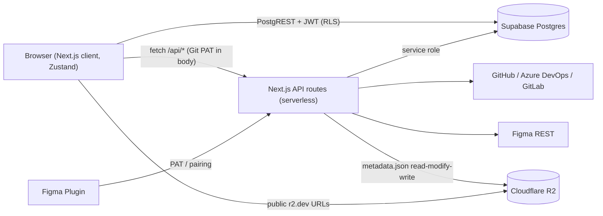
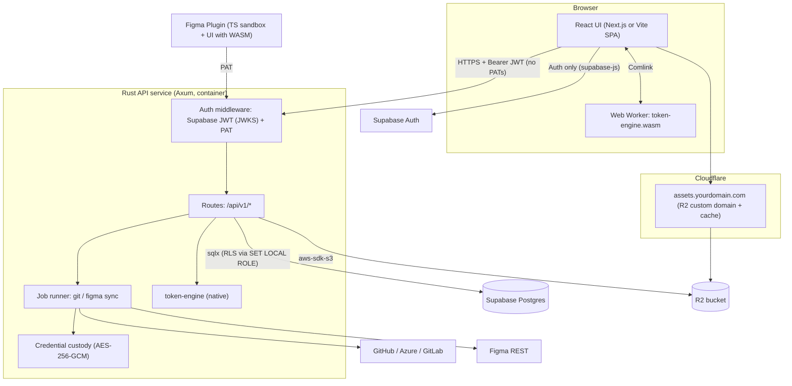
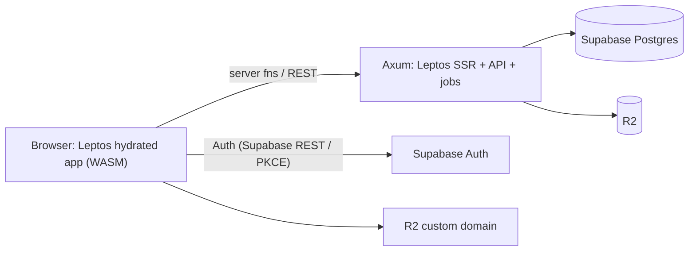
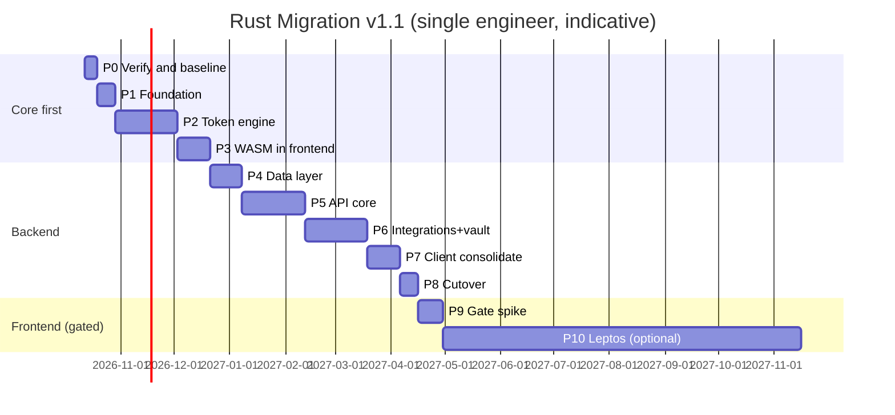

# Rust Migration Plan (`RUST_MIGRATION_PLAN.md`)

> **Scope:** Move the **Second Screen / Tokens Platform** to a Rust backend and a Rust frontend runtime.
> **Unchanged:** Supabase (PostgreSQL + Auth), Cloudflare R2 (asset storage / CDN), Figma Companion Plugin sandbox (TypeScript).
> **Branch:** `upgrade/rust`
> **Status:** Proposal, **v1.1 (2026-10-08)**, re-baselined against the current codebase

### Revision history

| Version | Date | Change |
|---|---|---|
| 1.0 | 2026-10-07 | Initial plan, based on `PERFORMANCE_AUDIT_REPORT.md` |
| **1.1** | **2026-10-08** | Codebase re-audit: 7 of 11 audit findings already fixed in TS (see [§1.4](#14-audit-remediation-status)). Phase 0 shrunk to verify + baseline. **Token engine + WASM moved earlier** (now Phases 2–3) because main-thread compute is the #1 remaining bottleneck. Credential handling corrected (plaintext today, not encrypted). Asset metadata dual-source documented. Metrics re-based. |

---

## Table of Contents

0. [Executive Verdict](#0-executive-verdict)
1. [Current-State Baseline (verified 2026-10-08)](#1-current-state-baseline)
2. [Honest Assessment](#2-honest-assessment)
3. [Target Architecture](#3-target-architecture)
4. [Repository Layout](#4-repository-layout)
5. [Technology Choices](#5-technology-choices)
6. [Phase 0: Verify, Baseline & Quick Wins](#phase-0)
7. [Phase 1: Rust Foundation & CI](#phase-1)
8. [Phase 2: Rust Token Engine (Core Crate)](#phase-2)
9. [Phase 3: WASM Engine in the Current Frontend](#phase-3)
10. [Phase 4: Data Layer Evolution (Supabase)](#phase-4)
11. [Phase 5: Rust API Service, Core Routes](#phase-5)
12. [Phase 6: Integrations Port & Credential Custody](#phase-6)
13. [Phase 7: Client Data-Access Consolidation](#phase-7)
14. [Phase 8: Backend Cutover & Decommission](#phase-8)
15. [Phase 9: Frontend Go / No-Go Gate](#phase-9)
16. [Phase 10: Rust Frontend (Leptos), Optional](#phase-10)
17. [Phase 11: Figma Plugin Alignment](#phase-11)
18. [Testing Strategy](#testing-strategy)
19. [Rollout, Feature Flags & Rollback](#rollout)
20. [Risk Register](#risk-register)
21. [Timeline & Effort](#timeline)
22. [Success Metrics](#success-metrics)
23. [Governance & Docs Updates](#governance)
24. [Appendix A: Route Migration Matrix](#appendix-a)
25. [Appendix B: Reference Code Sketches](#appendix-b)
26. [Appendix C: Per-Phase Exit Checklists](#appendix-c)

---

<a id="0-executive-verdict"></a>
## 0. Executive Verdict

| Layer | Move to Rust? | Verdict |
|---|---|---|
| **Token compute** (alias resolution, math, theme matrix, diff, exporters) | ✅ **Yes, the #1 priority** | Now the **main remaining bottleneck**: every edit re-resolves the whole document synchronously on the main thread (25 call sites, no Web Worker anywhere). Rust → WASM in a worker, with **incremental** re-resolution, fixes this directly. |
| **Backend API** (`app/api/*`, 25+ routes) | ✅ **Yes, good move** | No serverless timeouts for Git/Figma sync. Server-side custody of Git PATs (they currently pass through the browser). Typed DB access. Low memory. |
| **Frontend UI** (≈45k LOC React + Radix + Tailwind) | ⚠️ **Not yet, gated** | No Rust equivalent of Radix accessibility primitives, and it's a full rewrite of the most complex UI. Decide at [Phase 9](#phase-9) with measured data. |
| **Figma plugin sandbox** | ❌ **No** | Figma's sandbox is JS-only. The plugin **UI** iframe can use the WASM engine. |

**Recommended order:** Rust **token engine first** (ships user-visible speed in ~2.5 months) → Rust **backend** → **gated** Rust frontend.

> [!NOTE]
> **What changed since v1.0:** The team has already fixed most network-level findings in the old audit:
> phantom auto-save, the Variables tab 25s fetch, Git refetch on every tab, `check-updates` polling, duplicate asset list/config calls,
> metadata re-queries, and the unnecessary member PATCH. See [§1.4](#14-audit-remediation-status).
> What remains is **CPU on the main thread**, **whole-document writes**, **asset metadata storage**, and **credential handling**.
> Rust and the planned schema changes are well suited to all four.

---

<a id="1-current-state-baseline"></a>
## 1. Current-State Baseline (verified 2026-10-08)

### 1.1 Inventory

| Area | Location | Size | Notes |
|---|---|---|---|
| Global store | [`store/useTokenStore.ts`](../store/useTokenStore.ts) | 6,689 LOC | Zustand, calls Supabase directly, holds all project state. |
| Assets workspace | [`components/assets/AssetsWorkspace.tsx`](../components/assets/AssetsWorkspace.tsx) | 4,688 LOC | Monolithic. Progressive batch rendering (48) + lazy images. |
| Tenancy service | [`services/organizationService.ts`](../services/organizationService.ts) | 1,750 LOC | Used by **browser and server**. 30s metadata cache + in-flight dedupe. |
| Token engine (TS) | `utils/transformTokens.ts`, `themeHelpers.ts`, `releaseCompiler.ts`, `exportsCompiler.ts`, `tokenDiff.ts`, `colorPalettes.ts`, `colorModifier.ts`, `accessibility.ts`, `tokenFlowBuilder.ts`, `tokenDeprecation.ts` | ≈6,500 LOC | Pure functions, the Rust candidates. |
| Schema catalog | [`data/schemaCatalog.ts`](../data/schemaCatalog.ts) | 1,506 LOC | 182 Draft 2020-12 schemas, self-hosted. |
| API routes | `app/api/**` | 25+ handlers | Thin I/O: Supabase, GitHub/Azure/GitLab, Figma, R2, Resend. |
| R2 client | [`lib/r2.ts`](../lib/r2.ts) | 618 LOC | AWS SDK v3. **Asset metadata index stored as `metadata.json` in R2.** |
| Figma plugin | [`plugin/code.ts`](../plugin/code.ts), [`plugin/src-ui/App.tsx`](../plugin/src-ui/App.tsx) | ≈2,000 LOC | Vite single-file build. |
| Tests | 6 Vitest files | | Parity oracles for Rust. |
| **Total TS/TSX** | | **≈72,500 LOC** | |

### 1.2 Data model hot spots (Supabase)
- `projects.raw_tokens`, `projects.theme_groups`, `projects.branches` (each branch **embeds a full `rawTokens` copy**), and `projects.figma_variables`, all JSONB on one row.
- `getProject()` uses `select("*")` ([organizationService.ts#L843-L880](../services/organizationService.ts#L843-L880)), so opening a project downloads every branch's full document.
- Integration configs (Git PAT, Figma token) live in `project_integrations` (RLS: editors only). A trigger blocks writing them to `projects` ([`20260927_security_hardening.sql`](../supabase/migrations/20260927_security_hardening.sql)).

### 1.3 Runtime topology today



<a id="14-audit-remediation-status"></a>
### 1.4 Audit remediation status

Each item from [`PERFORMANCE_AUDIT_REPORT.md`](./PERFORMANCE_AUDIT_REPORT.md) (historical), checked against the code:

| # | Audit finding | Status | Evidence in code | Residual / where the plan handles it |
|---|---|---|---|---|
| 1 | Phantom `PATCH /projects` auto-save (35×) | ✅ **Fixed** | `setRawTokens` skips cloud save when content is unchanged ([useTokenStore.ts#L4464-L4516](../store/useTokenStore.ts#L4464-L4516)), plus a `persist: false` option | Real edits still send the **full** `raw_tokens` + `theme_groups` + **all branches** on every edit with no debounce ([L1001-L1026](../store/useTokenStore.ts#L1001-L1026), [organizationService.ts#L1426](../services/organizationService.ts#L1426)). The "unchanged" check runs 3× `JSON.stringify` on the full doc on the main thread. → [Phase 0 quick win](#phase-0), [Phase 4](#phase-4), [Phase 7](#phase-7) |
| 2 | Variables tab 25s duplicate `/api/v1/tokens` | ✅ **Fixed** | `fetchVariables` runs only on manual Refresh ([VariablesView.tsx#L120-L138](../components/VariablesView.tsx#L120-L138), [L338](../components/VariablesView.tsx#L338)) | Endpoint still resolves `"ALL"` server-side for PAT consumers. → [Phase 5](#phase-5) (native engine + ETag) |
| 3 | 80-image R2 storm | 🟡 **Mostly fixed** | `ASSET_BATCH_SIZE = 48`, IntersectionObserver, `loading="lazy"` ([AssetsWorkspace.tsx#L114](../components/assets/AssetsWorkspace.tsx#L114), [L923-L988](../components/assets/AssetsWorkspace.tsx#L923-L988)) | `R2_PUBLIC_URL` still points at `*.r2.dev` (rate-limited, not for production). No thumbnails. → [Phase 0](#phase-0), [Phase 6](#phase-6) |
| 4 | `git/fetch` on every tab | ✅ **Fixed** | In-flight dedupe, 60s TTL, server `unchanged` SHA short-circuit ([useTokenStore.ts#L4116-L4162](../store/useTokenStore.ts#L4116-L4162), [git/fetch/route.ts#L342-L346](../app/api/git/fetch/route.ts#L342-L346)) | Fetch is still synchronous inside a serverless request, so big repos risk a timeout. → [Phase 6](#phase-6) (jobs) |
| 5 | Monolithic `/api/assets/list` fired twice | 🟡 **Partially** | Fired once now (in-flight map + SWR cache, [useTokenStore.ts#L596-L597](../store/useTokenStore.ts#L596-L597), [L725-L736](../store/useTokenStore.ts#L725-L736)) | Still returns **all** assets. Metadata is a single R2 `metadata.json` rewritten on every change, so concurrent uploads can overwrite each other. → [Phase 4](#phase-4) (`assets` table) |
| 6 | `/api/assets/config` fired twice | ✅ **Fixed** | `inFlightAssetConfigs` ([L597](../store/useTokenStore.ts#L597), [L856-L862](../store/useTokenStore.ts#L856-L862)) | — |
| 7 | `check-updates` on every navigation | ✅ **Fixed** | 30s throttle + 10-min backoff ([L4075-L4092](../store/useTokenStore.ts#L4075-L4092)), focus throttle ([Header.tsx#L446-L465](../components/Header.tsx#L446-L465)) | — |
| 8 | Org/project/members re-queried per tab | ✅ **Fixed** | `METADATA_CACHE_TTL_MS = 30000`, in-flight dedupe, lightweight summaries/counts ([organizationService.ts#L131-L146](../services/organizationService.ts#L131-L146)) | — |
| 9 | `PATCH organization_members` on read | ✅ **Fixed** | Only runs when an email-matched row is unlinked ([L193-L203](../services/organizationService.ts#L193-L203)) | — |
| 10 | Synchronous alias resolution on the main thread | ❌ **Open** | `resolveTokensWithActiveThemes` → `flattenAndResolveTokens` called from **25** sites in the store ([L466-L474](../store/useTokenStore.ts#L466-L474)). Every `updateSingleToken` re-resolves the whole doc + `extractThemeGroups`. **No Web Worker in the codebase.** | → **[Phase 2](#phase-2) + [Phase 3](#phase-3)** (core reason for Rust) |
| 11 | Theme matrix Cartesian product on the main thread | ❌ **Open** | `useMemo(buildThemeMatrix…)` ([ThemeMatrix.tsx#L206-L209](../components/ThemeMatrix.tsx#L206-L209)), memoized but synchronous | → [Phase 2](#phase-2) + [Phase 3](#phase-3) |

**Score:** 7 fixed · 2 partial · 2 open. The open and partial items are exactly what this plan targets.

### 1.5 Other findings from the deep check (they shape the plan)

| Finding | Impact | Plan response |
|---|---|---|
| **Git PATs are stored in plaintext** in `project_integrations` JSONB (RLS: editors). The browser holds them and sends them in the request body to `/api/git/*`. `TOKENS_PLATFORM_SECRET_KEY` is defined in `.env.example` but **unused**. | Security: any editor session (or an XSS) can read repo tokens. | [Phase 6.1](#phase-6): server-side custody + AES-256-GCM encryption at rest. The browser never sees PATs. |
| **Two sources of asset metadata:** R2 `metadata.json` / `config.json` ([lib/r2.ts#L90-L100](../lib/r2.ts#L90-L100)) **and** `projects.extra_data.assets` / `assetFolders` / `assetsCount` | Drift, no pagination, write races | [Phase 4](#phase-4): single `assets` + `asset_collections` tables in Postgres |
| `getProject` loads the full row, including every branch's embedded document | Large payload on project open | [Phase 4](#phase-4) normalization + [Phase 7](#phase-7) lazy per-branch loads |
| localStorage project caches with coalesced writes (`d5775c4`) | Good. Keep it. | Kept in the React track. Leptos track uses the same cache keys. |
| Stale docs: `docs/ARCHITECTURE.md` references `services/gitSyncService.ts`, `services/figmaSyncService.ts`, `plugin/src/code.ts` (none exist). `AGENTS.md` links use `d:/GitHub/...` paths and `plugin/src/code.ts`. | Misleads contributors and AI agents | [Phase 0.5](#phase-0) docs refresh |

---

<a id="2-honest-assessment"></a>
## 2. Honest Assessment

### 2.1 What Rust genuinely improves (for this codebase, today)

| Benefit | Where it shows up |
|---|---|
| **Off-main-thread, incremental compute** | Replaces the full re-resolution on every edit (25 call sites) with `engine.apply(edits)`, which re-resolves only the affected alias subgraph inside a worker. |
| **Raw speed** | 3–10× on resolve, theme matrix, diff and exporters for 13k+ tokens (native and WASM). |
| **One engine, three runtimes** | Server (native), browser (WASM worker), Figma plugin UI (WASM). No drift between TS copies. |
| **Content hashing in the engine** | Replaces 3× `JSON.stringify` deep-compare with a cheap hash per token set, which also enables partial saves. |
| **No serverless limits** | Git fetch/push and Figma asset sync become jobs with progress streaming. |
| **Security** | Server-side credential custody, encryption at rest, memory safety, smaller dependency surface. |
| **Type-checked SQL** | `sqlx` compile-time checks against the real schema. |

### 2.2 Already solved in TypeScript (don't re-solve)

Network deduplication, TTL caches, SHA short-circuit, polling throttles, progressive rendering (`INITIAL_BATCH_SIZE = 100` in Tokens, `48` in Assets), and dynamic imports are done. **Port these behaviours as-is.** They're regression requirements, not new work.

### 2.3 Remaining non-language work (schema/infra, needed regardless of Rust)

| Problem | Fix | Phase |
|---|---|---|
| Whole-document writes per edit | Normalize into `project_branches` + `token_sets`, send changed sets only | 4, 7 |
| Asset metadata in R2 JSON + `extra_data` | `assets` table, keyset pagination | 4, 5 |
| `r2.dev` public URL | R2 custom domain + cache rules | 0 |

### 2.4 Why a Rust frontend is still high-risk

1. **Rewrite size:** ≈45k LOC: virtualized token grid, flow canvas, block doc editor, color pickers, Radix dialogs, menus and selects.
2. **Accessibility:** Radix gives you focus traps, roving tabindex, dismissable layers and typeahead. Rust UI libraries (e.g. Thaw, leptos-use) aren't at parity, so budget time to build headless primitives yourself.
3. **Bundle/startup:** a Leptos WASM app is typically 300 KB–1.5 MB gzipped. Code splitting is less mature than Next dynamic imports, which this app already uses heavily.
4. **Iteration speed:** Rust compile + reload is slower than Next HMR for UI work.
5. **The UI isn't the bottleneck.** After Phase 3, React only renders 100-row batches from a worker.

---

<a id="3-target-architecture"></a>
## 3. Target Architecture

### 3.1 End state after Phase 8 (recommended baseline)



### 3.2 End state after optional Phase 10 (full Rust)



### 3.3 Principles
1. **Supabase owns the schema.** Migrations stay in `supabase/migrations/`. Rust never owns DDL.
2. **RLS stays authoritative.** User queries run as `authenticated` with the user's JWT claims. The service role is used only through an audited wrapper.
3. **Strangler fig.** Any route can be served by Next or Rust, switched by a flag.
4. **Contract-first.** `utoipa` OpenAPI generates the TS client.
5. **Self-hosted schemas (AGENTS.md Rule 1).** `$id`/`$schema` URLs resolve from the request origin. **Never** `registry.tokens.studio`.
6. **Preserve the existing perf behaviours** listed in [§2.2](#22-already-solved-in-typescript-dont-re-solve).

---

<a id="4-repository-layout"></a>
## 4. Repository Layout

```
second-screen/
├── app/ components/ store/ ...        # existing Next.js app (kept through Phase 8)
├── plugin/                            # Figma plugin (code.ts sandbox + src-ui)
├── supabase/migrations/               # schema source of truth
├── rust/
│   ├── Cargo.toml                     # [workspace]
│   ├── rust-toolchain.toml            # pinned stable + wasm32-unknown-unknown
│   ├── deny.toml
│   ├── crates/
│   │   ├── token-engine/              # pure Rust, no I/O
│   │   │   ├── src/{model,parse,alias,math,color,flatten,theme,diff,hash,validate,graph}/
│   │   │   ├── src/export/{css,scss,ts,tailwind,flutter,style_dictionary,dtcg,figma}.rs
│   │   │   ├── benches/
│   │   │   └── tests/golden/          # captured from TS in Phase 0
│   │   ├── token-engine-wasm/         # wasm-bindgen facade, handle-based API
│   │   ├── schema-registry/           # 182 schemas via include_str!
│   │   ├── domain/                    # Org, Project, Member, Branch, TokenSet, Asset, ApiKey
│   │   ├── db/                        # sqlx repositories, RLS session helper
│   │   ├── auth/                      # Supabase JWT (JWKS/HS256), PAT, pairing
│   │   ├── vault/                     # credential encryption (AES-256-GCM)
│   │   ├── integrations/{git,figma,r2,email}/
│   │   ├── jobs/
│   │   └── api/                       # Axum binary
│   └── apps/web-leptos/               # ONLY in Phase 10
├── packages/api-client/               # TS client generated from OpenAPI
└── docs/RUST_MIGRATION_PLAN.md
```

---

<a id="5-technology-choices"></a>
## 5. Technology Choices

| Concern | Choice | Notes |
|---|---|---|
| HTTP | **axum** + tokio + tower-http | CORS, compression, tracing, timeouts, body limits |
| DB | **sqlx** (postgres, rustls) | Offline mode (`.sqlx/`) for CI |
| Supabase connection | Direct, or **Supavisor session mode (5432)** | ⚠️ Transaction mode (6543) breaks sqlx prepared statements |
| JWT | **jsonwebtoken** + JWKS cache | Asymmetric signing keys + legacy HS256 fallback |
| PAT hashing | **sha2** + `subtle` | Matches [`utils/patAuth.ts`](../utils/patAuth.ts) SHA-256, so existing keys keep working |
| Credential encryption | **aes-gcm** + `zeroize` | Key from `TOKENS_PLATFORM_SECRET_KEY` (currently unused) or Supabase Vault |
| R2 | **aws-sdk-s3** (endpoint `https://<acct>.r2.cloudflarestorage.com`, region `auto`) | Presigned PUT/GET |
| HTTP client | **reqwest** (rustls), optional `octocrab` | |
| JSON | **serde_json** (`preserve_order`) + **ryu-js** | Key order + JS-identical number formatting |
| Hashing | **blake3** or sha256 | Token-set content hashes |
| JSON Schema | **jsonschema** (2020-12) | |
| Diff | **similar** | |
| ZIP | **zip** | |
| OpenAPI | **utoipa** → `openapi-typescript` | |
| Errors | thiserror / anyhow | |
| Observability | tracing + OpenTelemetry | |
| Jobs | Postgres `jobs` table + `SKIP LOCKED` | No Redis needed |
| WASM | wasm-bindgen, wasm-pack, wasm-opt, Comlink (TS side) | |
| Templates | **askama** | Invite email, optional SSR docs page |
| Rust UI (Phase 10) | **Leptos** + cargo-leptos | Dioxus is the alternative |
| Testing | nextest, insta, proptest, criterion, wiremock, cargo-fuzz | |

---

<a id="phase-0"></a>
## Phase 0: Verify, Baseline & Quick Wins

**Goal:** Lock in the TS fixes as regression requirements, capture correctness oracles, measure today's real numbers, and land two cheap wins.
**Duration:** ~1 week (was 2 in v1.0). **Risk:** Low.

### 0.1 Fresh measurement (replaces the old audit numbers)
Repeat the audit's 4-minute session (Tokens → Themes → Variables → Assets) on the **enterprise 13k-token project** and record the results in `docs/RUST_BASELINE.md`:

| Metric | Tool |
|---|---|
| Total requests / bytes up / bytes down per session | Chrome DevTools HAR |
| Main-thread long tasks (> 50 ms) per minute, INP | Performance panel, web-vitals |
| `updateSingleToken` → UI settled (ms) | `performance.mark` around the store action |
| `flattenAndResolveTokens` 13k (p50/p95) | Vitest bench |
| `buildThemeMatrix`, all exporters, `computeTokensDiff` | Vitest bench |
| Bytes per single-token save | HAR (`PATCH /rest/v1/projects`) |
| Project open payload (`getProject`) | HAR |
| `/api/v1/tokens` and `/api/git/fetch` latency | k6 / autocannon |
| Asset list payload and image p95 | HAR |

### 0.2 Quick wins (small and safe, worth doing before Rust)

| # | Task | File | Acceptance |
|---|---|---|---|
| 0.2.1 | **R2 custom domain** + Cloudflare cache rule; set `R2_PUBLIC_URL` | Cloudflare dashboard, env | No `*.r2.dev` URLs in prod. Image p95 < 300 ms. |
| 0.2.2 | **Coalesce cloud saves**: debounce `persistTokensChange` (~800 ms trailing, flush on `beforeunload`/project switch) | [`useTokenStore.ts#L1001`](../store/useTokenStore.ts#L1001) | 10 rapid edits → 1 PATCH |
| 0.2.3 | *(Optional)* Replace the 3× `JSON.stringify` compare in `setRawTokens` with a single cached hash | [`useTokenStore.ts#L4464-L4473`](../store/useTokenStore.ts#L4464-L4473) | Fewer main-thread ms on hydrate |

> [!NOTE]
> **Deliberately NOT done in TS:** asset list pagination over the R2 `metadata.json`. That would be throwaway work. Phase 4 moves asset metadata into Postgres with real keyset pagination.

### 0.3 Golden fixtures (parity oracle for Rust)
1. Export 3 token documents: small (~200), medium (~2k), enterprise (**13k+**). Anonymize if needed.
2. Write `scripts/capture-golden.mjs`, which writes into `rust/crates/token-engine/tests/golden/<fixture>/`:
   `flatten.json`, `index.json`, `themes.json`, `theme_matrix.json`, `diff.json`, `math.json`, `color.json`, and `export/<format>/*` for CSS, SCSS, TS, Tailwind, Flutter, Style Dictionary, DTCG and Figma Variables.
3. Commit them. Intentional behaviour changes regenerate them in a reviewed PR.

### 0.4 API contracts
- Record request/response pairs for every route in [Appendix A](#appendix-a) (secrets scrubbed) → `rust/crates/api/tests/contracts/`.
- Hand-write `openapi.yaml` v0 for the current routes.

### 0.5 Docs refresh
- Add a "Superseded, see RUST_MIGRATION_PLAN §1.4" banner to `docs/PERFORMANCE_AUDIT_REPORT.md`.
- Fix `docs/ARCHITECTURE.md`: remove `gitSyncService.ts` / `figmaSyncService.ts`, change `plugin/src/code.ts` → `plugin/code.ts`, document `project_integrations` and the R2 `metadata.json`.
- Fix `AGENTS.md` key file map paths (`d:/GitHub/...` → repo-relative, `plugin/code.ts`).

### 0.6 Regression guards for existing fixes
Add Playwright/Vitest checks so nothing regresses during migration:
- 0 `PATCH /projects` during a read-only session.
- ≤ 1 `/api/git/fetch` per project open, none on sibling-tab switches.
- ≤ 1 `/api/assets/list` and `/api/assets/config` per project open.
- Variables tab makes no network calls on mount.

### 0.7 Feature-freeze policy
During Phases 2–8, new token semantics go **only into the Rust engine**. New backend features go only into Rust routes.

**Exit:** `RUST_BASELINE.md` filled, quick wins live, fixtures + contracts committed, regression guards in CI, docs refreshed.

---

<a id="phase-1"></a>
## Phase 1: Rust Foundation & CI

**Duration:** 1–2 weeks. **Risk:** Low.

### 1.1 Workspace
1. `rust/Cargo.toml`: `resolver = "2"`, shared `[workspace.dependencies]`, release `lto = "thin"`, `codegen-units = 1`.
2. `rust-toolchain.toml`: pinned stable, `rustfmt`, `clippy`, target `wasm32-unknown-unknown`.
3. Empty compiling crates from [§4](#4-repository-layout).
4. `api` binary with `/healthz`, `/readyz` (DB ping + R2 `HeadBucket`), graceful SIGTERM shutdown.

### 1.2 Config
- Reuse existing env names: `NEXT_PUBLIC_SUPABASE_URL`/`SUPABASE_URL`, `SUPABASE_SERVICE_ROLE_KEY`, `TOKENS_PLATFORM_SECRET_KEY`, `RESEND_API_KEY`, `INVITE_FROM_EMAIL`, `R2_*`.
- New: `DATABASE_URL`, `SUPABASE_JWKS_URL`, `SUPABASE_JWT_SECRET` (legacy), `APP_ORIGIN`, `RUST_LOG`, `OTEL_EXPORTER_OTLP_ENDPOINT`.
- Fail fast at startup and list every missing variable.

### 1.3 CI (GitHub Actions)

| Job | Command |
|---|---|
| fmt | `cargo fmt --all --check` |
| lint | `cargo clippy --workspace --all-targets -- -D warnings` |
| test | `cargo nextest run --workspace` (`SQLX_OFFLINE=true`) |
| db-test | Ephemeral Postgres + `supabase/migrations/*` + sqlx integration tests |
| wasm | `wasm-pack build crates/token-engine-wasm --target web --release` + size budget |
| deny | `cargo deny check` |
| existing | `npx tsc --noEmit`, `npm run build`, `npm test` (unchanged, per AGENTS.md) |

### 1.4 Container & hosting
- `cargo-chef` multi-stage → distroless runtime image (< 40 MB).
- Host **in the same region as Supabase** (Fly.io, Railway, Cloud Run with min instances = 1, Render, or a VPS). Cloudflare in front.

> [!NOTE]
> Cloudflare Workers (`workers-rs`) is a poor fit: its CPU/runtime limits and Postgres driver constraints rule out long Git syncs and sqlx.

**Exit:** CI green, staging container up, `/readyz` green against staging Supabase + R2.

---

<a id="phase-2"></a>
## Phase 2: Rust Token Engine (Core Crate)

**Goal:** A pure-Rust engine with **byte-for-byte parity** with the TS utilities, plus **incremental** re-resolution.
**Duration:** 4–6 weeks. **Risk:** Medium (semantic parity).

### 2.1 Module map

| TS source | Rust module | Key functions |
|---|---|---|
| `utils/transformTokens.ts` | `model`, `parse`, `alias`, `math`, `flatten`, `mutate`, `sort` | `is_token_leaf`, `count_tokens`, `get_leaf_type`, `build_lookup_index`, `resolve_alias`, `evaluate_math`, `flatten_and_resolve`, `set/create/delete_token_at_key_path`, natural sort |
| `utils/themeHelpers.ts` + store `resolveTokensWithActiveThemes` / `getActiveThemeSets` / `canonicalizeTokenDocument` | `theme` | `extract_theme_groups`, `active_theme_sets`, `canonicalize`, `build_theme_matrix` |
| `utils/tokenDiff.ts` | `diff` | `line_diff`, `tokens_diff`, `side_by_side`, `parse_unified_patch` |
| `utils/releaseCompiler.ts` | `export::*` | `format_token_name`, `token_to_css_var`, all `compile_*` |
| `utils/exportsCompiler.ts` | `export::*` | `format_color_value`, `transform_casing`, `generate_*_export_files` |
| `utils/colorPalettes.ts`, `colorModifier.ts`, `accessibility.ts` | `color` | palettes, modifiers, `to_hex_fast` (LRU), WCAG contrast |
| `utils/tokenFlowBuilder.ts` | `graph` | alias dependency graph for the Flow canvas |
| `utils/tokenDeprecation.ts` | `deprecation` | |
| `data/schemaCatalog.ts` | `schema-registry` | embedded catalog + `validate` |

### 2.2 Core structures
- `TokenDocument`: `IndexMap<String, Node>` (order-preserving). `$extensions` is kept opaque so documents round-trip unchanged.
- `TokenGraph`: interned paths, alias adjacency (forward + reverse), Tarjan SCC cycle detection → `ResolveError::Cycle`.
- **Incremental resolution:** `apply(edits)` marks edited nodes dirty, walks **reverse** alias edges to find dependents, and re-resolves only that subgraph. This replaces the current full re-resolve on every edit.
- **Content hashing:** a blake3 hash per token set and per document. Used for no-op save detection (replacing `JSON.stringify` compare) and later for partial saves and ETags.

### 2.3 Parity rules
1. Number → string via `ryu-js`, matching JS `Number#toString`.
2. Sorting matches `naturalCompareTokenKeys` and `compareTokens` exactly.
3. Malformed input returns the same fallback as TS (non-strict mode).
4. JSON output matches `JSON.stringify(x, null, 2)` key order and indentation.

### 2.4 Testing
- Golden: every fixture × function equals the Phase 0 output.
- Incremental: for random edit sequences, `apply(edits)` must equal a full re-resolve from scratch (proptest).
- Fuzz the math and alias parsers.
- Criterion on 13k: resolve, single-edit apply, theme matrix, diff, exports. Target **≥ 3× faster** full resolve and **≥ 20× faster** single-edit apply than the TS baseline.

### 2.5 Public API

```rust
pub struct Engine { /* graph, caches, hashes */ }
impl Engine {
    pub fn load(doc: TokenDocument, opts: EngineOptions) -> Result<Self, LoadError>;
    pub fn set_active_themes(&mut self, active: &ActiveThemes) -> ChangeSet;
    pub fn apply(&mut self, edits: &[Edit]) -> Result<ChangeSet, EditError>;      // incremental
    pub fn page(&self, filter: &Filter, offset: usize, limit: usize) -> Page<ResolvedToken>; // Rule 4
    pub fn theme_groups(&self) -> Vec<ThemeGroup>;
    pub fn theme_matrix(&self, group: &str, active: &ActiveThemes) -> ThemeMatrix;
    pub fn diff(&self, other: &Engine) -> TokensDiff;
    pub fn export(&self, target: ExportTarget, cfg: &ExportConfig) -> Vec<GeneratedFile>;
    pub fn validate(&self, registry: &SchemaRegistry) -> Vec<Diagnostic>;
    pub fn set_hashes(&self) -> IndexMap<String, Hash>;                            // per token set
    pub fn to_document(&self) -> TokenDocument;
}
```

**Exit:** 100% golden parity, incremental ≡ full proven by proptest, benchmarks recorded, no `unsafe`, clippy clean.

---

<a id="phase-3"></a>
## Phase 3: WASM Engine in the Current Frontend

**Goal:** The first user-visible Rust win: the main thread is free during edits, theme switches and matrix builds.
**Duration:** 2–3 weeks. **Risk:** Low–Medium.

### 3.1 Build
Use a handle-based API so the document stays in WASM memory:

```rust
#[wasm_bindgen]
pub struct EngineHandle(Engine);

#[wasm_bindgen]
impl EngineHandle {
    #[wasm_bindgen(constructor)]
    pub fn new(doc_json: &str, opts_json: &str) -> Result<EngineHandle, JsError>;
    pub fn apply_edits(&mut self, edits_json: &str) -> Result<String, JsError>;      // ChangeSet JSON
    pub fn set_active_themes(&mut self, active_json: &str) -> Result<String, JsError>;
    pub fn page(&self, filter_json: &str, offset: u32, limit: u32) -> Result<String, JsError>;
    pub fn theme_matrix(&self, group: &str, active_json: &str) -> Result<String, JsError>;
    pub fn export(&self, target: &str, cfg_json: &str) -> Result<js_sys::Array, JsError>;
    pub fn set_hashes(&self) -> Result<String, JsError>;
    pub fn document(&self) -> Result<String, JsError>;
}
```

- Benchmark JSON strings against `serde-wasm-bindgen` for each call.
- `opt-level = "z"`, `wasm-opt -O3`. **Budget ≤ 400 KB gzipped.**

### 3.2 Store integration (the 25 call sites)
1. `lib/engine/worker.ts` (Comlink) and `lib/engine/index.ts` (async facade).
2. Introduce `engineSlice` in the store: holds `engineReady`, a `resolvedPage` cache, and the last `ChangeSet`.
3. Migrate in this order:
   1. `updateSingleToken` and the other mutating actions → `engine.applyEdits()` (no full re-resolve).
   2. `setRawTokens` → `engine.load()` + `setHashes()` (replaces the 3× `JSON.stringify`).
   3. Theme option switches → `engine.setActiveThemes()`.
   4. `ThemeMatrix.tsx` → `engine.themeMatrix()`.
   5. `TokenDiffViewer`, releases → `engine.diff()`.
   6. `ExportsHub`, `ExportsView`, release publish → `engine.export()`.
   7. `TokenFlow.tsx` → engine graph.
4. Keep **Rule 4** batching (`page(offset, 100)`) and **Rule 2** hook ordering (`useEngineQuery` hook; no early returns before hooks).
5. Flag: `NEXT_PUBLIC_ENGINE=ts|wasm` + localStorage override for QA.

### 3.3 Dual-run
In staging, run both engines for 1 week and log hash mismatches to telemetry.

**Exit:** WASM is the default in prod. Long tasks on the Tokens tab reduced ≥ 80% versus the Phase 0 baseline. Edit → UI settled < 50 ms on 13k tokens. TS engine kept behind the flag for 2 releases.

---

<a id="phase-4"></a>
## Phase 4: Data Layer Evolution (Supabase)

**Goal:** Partial writes, paginated assets, a single asset source of truth, and job tracking. No downtime.
**Duration:** 2–3 weeks. **Risk:** Medium. **Pattern:** expand → migrate → contract.

### 4.1 New tables (additive)

```sql
CREATE TABLE public.project_branches (
  id          UUID PRIMARY KEY DEFAULT gen_random_uuid(),
  project_id  TEXT NOT NULL REFERENCES public.projects(id) ON DELETE CASCADE,
  org_id      TEXT NOT NULL REFERENCES public.organizations(id) ON DELETE CASCADE,
  name        TEXT NOT NULL,
  title       TEXT,
  description TEXT,
  is_default  BOOLEAN NOT NULL DEFAULT false,
  theme_groups JSONB NOT NULL DEFAULT '[]',
  head_sha    TEXT,                      -- last synced remote SHA
  meta        JSONB NOT NULL DEFAULT '{}', -- commits, comments (existing ProjectBranch fields)
  version     BIGINT NOT NULL DEFAULT 1, -- optimistic concurrency
  updated_at  TIMESTAMPTZ NOT NULL DEFAULT now(),
  UNIQUE (project_id, name)
);

CREATE TABLE public.token_sets (
  id           UUID PRIMARY KEY DEFAULT gen_random_uuid(),
  branch_id    UUID NOT NULL REFERENCES public.project_branches(id) ON DELETE CASCADE,
  org_id       TEXT NOT NULL,
  set_path     TEXT NOT NULL,
  sort_index   INT  NOT NULL DEFAULT 0,
  content      JSONB NOT NULL,
  content_hash TEXT NOT NULL,            -- engine blake3; skip no-op writes, ETag
  updated_at   TIMESTAMPTZ NOT NULL DEFAULT now(),
  UNIQUE (branch_id, set_path)
);

CREATE TABLE public.asset_collections (
  id            UUID PRIMARY KEY DEFAULT gen_random_uuid(),
  org_id        TEXT NOT NULL,
  project_id    TEXT NOT NULL REFERENCES public.projects(id) ON DELETE CASCADE,
  name          TEXT NOT NULL,
  parent_id     UUID REFERENCES public.asset_collections(id) ON DELETE CASCADE,
  allowed_types TEXT[] NOT NULL DEFAULT '{}',
  metadata_schema JSONB NOT NULL DEFAULT '{}',
  created_at    TIMESTAMPTZ NOT NULL DEFAULT now()
);

CREATE TABLE public.assets (
  id            UUID PRIMARY KEY DEFAULT gen_random_uuid(),
  org_id        TEXT NOT NULL,
  project_id    TEXT NOT NULL REFERENCES public.projects(id) ON DELETE CASCADE,
  collection_id UUID REFERENCES public.asset_collections(id) ON DELETE SET NULL,
  r2_key        TEXT NOT NULL UNIQUE,
  name          TEXT NOT NULL,
  asset_type    TEXT NOT NULL,
  content_type  TEXT NOT NULL,
  size_bytes    BIGINT,
  width INT, height INT,
  tags          TEXT[] NOT NULL DEFAULT '{}',
  custom_meta   JSONB NOT NULL DEFAULT '{}',
  source        TEXT,                    -- upload | git | figma
  checksum      TEXT,
  created_at    TIMESTAMPTZ NOT NULL DEFAULT now(),
  updated_at    TIMESTAMPTZ NOT NULL DEFAULT now()
);
CREATE INDEX ON public.assets (project_id, created_at DESC, id);
CREATE INDEX ON public.assets USING gin (tags);

CREATE TABLE public.jobs (
  id         UUID PRIMARY KEY DEFAULT gen_random_uuid(),
  org_id     TEXT NOT NULL,
  project_id TEXT,
  kind       TEXT NOT NULL,              -- git_fetch | git_push | git_assets | figma_variables | figma_assets
  status     TEXT NOT NULL DEFAULT 'queued',
  payload    JSONB NOT NULL DEFAULT '{}',
  progress   JSONB NOT NULL DEFAULT '{}',
  error      TEXT,
  attempts   INT NOT NULL DEFAULT 0,
  run_after  TIMESTAMPTZ NOT NULL DEFAULT now(),
  created_by TEXT,
  created_at TIMESTAMPTZ NOT NULL DEFAULT now(),
  updated_at TIMESTAMPTZ NOT NULL DEFAULT now()
);
CREATE INDEX ON public.jobs (status, run_after);
```

> Align `asset_collections` columns with the collection types in [`ASSETS_TAB_UPGRADE_PLAN.md`](./ASSETS_TAB_UPGRADE_PLAN.md) §3.1 before writing the migration.

### 4.2 RLS
- SELECT: `is_org_member(org_id)`. Writes: `is_org_editor(org_id)`. `jobs` writes are service-role only.
- RLS test matrix (viewer / editor / admin / owner / non-member) for every new table.

### 4.3 Backfill (Rust CLI, idempotent)
1. `projects.branches[*]` (+ `raw_tokens` fallback) → `project_branches` + `token_sets` (split by top-level set). Use the **engine** canonicalizer and hashes.
2. Assets: merge R2 `metadata.json` + `config.json` **and** `projects.extra_data.assets` / `assetFolders`. Resolve conflicts by `r2_key`, latest `updated_at` wins, and log every conflict.
3. Verify: re-assembled documents equal the originals byte-for-byte after canonical JSON. Asset counts match `listProjectAssetKeys`.

### 4.4 Dual-write window
- The TS app keeps writing legacy columns. The Rust API (Phase 5) is the only writer of the new tables.
- A nightly reconciliation job reports drift. The target is 0.

### 4.5 Contract (in Phase 8)
After 30 days with zero reads, drop `projects.raw_tokens`, `branches`, `theme_groups`, `extra_data.assets*`, R2 `metadata.json` and `config.json`.

**Exit:** tables + RLS in prod, backfill 100% verified, TS app unaffected.

---

<a id="phase-5"></a>
## Phase 5: Rust API Service, Core Routes

**Duration:** 4–6 weeks. **Risk:** Medium.

### 5.1 Strangler routing
- `next.config.mjs` `rewrites()` driven by a `RUST_ROUTES` allow-list, **or** Cloudflare routing with a KV allow-list. Rollback = remove the path.
- URLs stay identical, so the Figma plugin and PAT consumers don't notice.

### 5.2 Auth middleware
1. Bearer Supabase JWT → JWKS (cached 10 min, refresh on unknown `kid`) or HS256 legacy. Validate `exp`, `aud = authenticated`, `iss`.
2. Bearer PAT → SHA-256 → `api_keys.key_hash` (constant-time). Check expiry and scopes (`read:tokens`/`write:tokens`). Update `last_used_at` asynchronously.
3. Cookie fallback: `@supabase/ssr` `sb-<ref>-auth-token` (chunked `.0/.1…`, `base64-` prefix).

> [!TIP]
> Have React send `Authorization: Bearer <access_token>` from `supabase.auth.getSession()`. Then cookie parsing is only an edge case.

### 5.3 RLS-preserving DB access
- User requests run inside `BEGIN; set_config('request.jwt.claims', …, true); SET LOCAL ROLE authenticated; …; COMMIT;`.
- Service-role access goes only through an audited wrapper (PAT lookup, pairing, invitation accept, backfill, jobs, vault).
- PAT requests use service role **plus** explicit org/project checks (parity with `authorizeProjectRequest` in [`utils/auth.ts`](../utils/auth.ts)).

### 5.4 Cross-cutting
- CORS parity with [`utils/cors.ts`](../utils/cors.ts) (plugin origin `null`).
- `CompressionLayer` (br/gzip), `TimeoutLayer`, `RequestBodyLimitLayer`, `TraceLayer`, request IDs.
- `tower_governor` rate limits on pairing and invitations.
- v1 error shape `{ success: false, error }` + `code` + `requestId`.
- **ETag** on token reads from `token_sets.content_hash` → cheap 304s.

### 5.5 Waves
- **Wave 1:** schemas registry, plugin download.
- **Wave 2:** `user/orgs`, `tokens` GET, `tokens/branches`, `auth/pat`, org members.
- **Wave 3:** `tokens` writes (**per-set partial**), releases + publish (native exporters), `assets/*` (Postgres + paginated + presigned R2), invitations, pairing.

### 5.6 Per-route verification
Contract replay → **shadow mode** for GETs (3–7 days of diff logging) → flip → watch for 48 h → next route.

**Exit:** Waves 1–3 on Rust, error rate ≤ baseline, p95 improved, OpenAPI at `/api/docs`.

---

<a id="phase-6"></a>
## Phase 6: Integrations Port & Credential Custody

**Duration:** 4–6 weeks. **Risk:** Medium–High (`git/fetch` 771 LOC, `git/fetch-assets` 500, `figma/fetch-assets` 464).

### 6.1 Credential custody (security upgrade)
**Current state (verified):** Git PATs and Figma tokens are **plaintext JSONB** in `project_integrations` (RLS: editors can read them). The browser loads them into `credentials.pat` and posts them to `/api/git/*`. `TOKENS_PLATFORM_SECRET_KEY` is unused.

**Target:**
1. `vault` crate: AES-256-GCM, a random 96-bit nonce per secret, ciphertext stored as `{v:1, alg:"A256GCM", kid, nonce, ct}`. The key is derived from `TOKENS_PLATFORM_SECRET_KEY` with HKDF (or held in Supabase Vault). `kid` allows key rotation.
2. New write endpoint `PUT /api/v1/projects/{id}/integrations` encrypts server-side. Reads return only **masked** values (`ghp_…a1b2`) and a `configured: true` flag.
3. Git/Figma routes take `projectId` only. The Rust service loads and decrypts credentials server-side, so **PATs never reach the browser again**.
4. Migration: a backfill encrypts existing plaintext rows. Then tighten RLS on `project_integrations` (SELECT for service role only, or a view that exposes masked columns to editors).
5. Zeroize decrypted secrets after use. Never log them (a `tracing` field filter enforces this).

### 6.2 Git providers
```rust
#[async_trait]
pub trait GitProvider {
    async fn list_branches(&self, repo: &RepoRef) -> Result<Vec<Branch>>;
    async fn head_sha(&self, repo: &RepoRef, branch: &str) -> Result<String>;
    async fn read_tree(&self, repo: &RepoRef, sha: &str, prefix: &str) -> Result<Vec<TreeEntry>>;
    async fn read_blobs(&self, repo: &RepoRef, shas: &[String]) -> Result<Vec<Blob>>;
    async fn commit_files(&self, repo: &RepoRef, branch: &str, files: &[FileChange], msg: &str) -> Result<CommitInfo>;
}
```
- GitHub, Azure DevOps, GitLab implementations. `buffer_unordered(8)`, backoff on 403/429 (`Retry-After`, `X-RateLimit-Reset`).
- **Port the existing SHA short-circuit** ([git/fetch/route.ts#L342-L346](../app/api/git/fetch/route.ts#L342-L346)), backed by `project_branches.head_sha` instead of client state.

### 6.3 Jobs & progress
- `POST /api/git/fetch` → `202 { jobId }`. Compat: `Prefer: wait=30` returns inline for old clients.
- `GET /api/jobs/{id}` + **SSE** `/api/jobs/{id}/events`.
- Runner: tokio workers, `FOR UPDATE SKIP LOCKED`, heartbeat, retries, cancel.

### 6.4 Figma
- `fetch-variables` → normalize via the engine → `projects.figma_variables` (or its own table if large).
- `fetch-assets` → batched image export → stream to R2 → `assets` rows → thumbnails (Cloudflare Image Resizing or the `image` crate).

### 6.5 R2
- Port [`lib/r2.ts`](../lib/r2.ts) **minus** the metadata/config JSON functions (replaced by Postgres).
- Content-addressed keys + `Cache-Control: public, max-age=31536000, immutable`. Public URLs use the custom domain.

### 6.6 Email
Resend via reqwest, template from [`lib/inviteEmail.ts`](../lib/inviteEmail.ts) ported to askama.

**Exit:** Wave 4 on Rust, PATs no longer in browser memory or request bodies, 13k-token repo sync completes without timeout, SSE progress visible.

---

<a id="phase-7"></a>
## Phase 7: Client Data-Access Consolidation

**Duration:** 2–3 weeks. **Risk:** Medium.

1. Generate `packages/api-client` (`openapi-typescript` + `openapi-fetch`).
2. Replace writes:
   - `persistTokensChange` / `saveProjectTokensAndBranches` → `PATCH /api/v1/projects/{id}/branches/{name}/sets` with **only changed sets** (engine `ChangeSet` → set paths → hashes). Keep the Phase 0 debounce.
   - Branch create/merge/delete actions ([useTokenStore.ts#L6190-L6611](../store/useTokenStore.ts#L6190-L6611)) → branch endpoints (server-side copy, no client upload of whole docs).
   - Git config, Figma variables, documentation, schemas, project CRUD, org/member mutations → Rust endpoints.
3. Reads: per-branch lazy loading (`GET /branches/{name}/sets`) replaces `getProject` `select("*")`. Keep the existing 30s metadata cache semantics (or TanStack Query with an equivalent `staleTime`).
4. Optimistic concurrency with `If-Match: <branch.version>`. On `409`, show a refresh/merge prompt.
5. Supabase anon key in the browser is used **for Auth only**.
6. Flip reads to the normalized tables. Stop legacy dual-writes.

**Exit:** a single-token edit sends < 5 KB, no direct PostgREST writes from the browser, project open loads only the active branch.

---

<a id="phase-8"></a>
## Phase 8: Backend Cutover & Decommission

**Duration:** 1–2 weeks. **Risk:** Low.

1. `/auth/callback`: keep client-side PKCE exchange (React track) or port it to Rust (Leptos track).
2. Delete `app/api/**`, `lib/r2.ts`, `lib/supabase/admin.ts`, server-only utils, `@aws-sdk/*`.
3. Optional: Next static export or a Vite SPA on Cloudflare Pages (almost all views are already `ssr: false`). Keep SSR for `/docs/[orgSlug]/[projectSlug]`, either via askama in Axum or by keeping Next for it.
4. Run the Phase 4.5 contract migration.
5. Update `ARCHITECTURE.md`, `AGENTS.md`, `README.md`, `.env.example`.

**Exit:** the frontend build has no server code, Rust serves 100% of the API, legacy columns are dropped.

---

<a id="phase-9"></a>
## Phase 9: Frontend Go / No-Go Gate

| Criterion | GO if… | NO-GO if… |
|---|---|---|
| UI perf after Phase 3/7 | INP > 200 ms or long tasks > 10/min still on Tokens | INP ≤ 200 ms, long tasks rare |
| Team | ≥ 1 engineer fluent in Leptos/WASM | React-only team |
| Roadmap | ≥ 6 months without major UI features | Heavy UI roadmap (e.g. the Assets DAM plan in flight) |
| 2-week Leptos spike | Virtualized 13k grid + accessible dialog/menu/tooltip, ≤ 1.5 MB gz | Misses a11y or size |
| Strategy | Single-language codebase is a hard requirement | Nice to have |

**Spike scope:** `apps/web-leptos` on the existing Axum server; port TokenTable via the engine `page()` API; one dialog + dropdown + tooltip with NVDA/VoiceOver checks; measure bundle size, TTI, INP and dev-loop time.

---

<a id="phase-10"></a>
## Phase 10: Rust Frontend (Leptos), Optional

**Duration:** 6–9 months (1–2 engineers). **Risk:** High. Only after a GO.

### 10.1 Stack
- Leptos + `cargo-leptos`, SSR + hydration via `leptos_axum` on the same service.
- `leptos_router` mirroring `/[workspaceSlug]/[[...path]]`, `/docs/[org]/[project]`, `/invite/[token]`, `/connect`.
- Tailwind with `content: ["./src/**/*.rs"]`, reusing `tailwind.config.ts` and `app/globals.css` tokens so the look stays identical.
- Lucide SVGs as generated components.
- State: Zustand slices → `RwSignal`/`Store` contexts (`AuthCtx`, `OrgCtx`, `ProjectCtx`, `EngineCtx`). Engine in a worker via `gloo-worker` (same WASM crate).
- Data: `Resource`s + `#[server]` fns calling the `db`/`integrations` crates directly.
- Auth: Supabase Auth REST + PKCE, HttpOnly session cookie set by Axum.
- Keep the same localStorage cache keys as the React app so caches survive the switch.

### 10.2 `crates/ui-primitives` (build before any screens)

| Primitive | Replaces | Must support |
|---|---|---|
| Dialog / Sheet / Drawer | Radix dialog, `vaul` | Focus trap, scroll lock, Esc, return focus, portal |
| DropdownMenu / ContextMenu | Radix menus | Roving tabindex, typeahead, submenus, collision positioning |
| Popover / Tooltip | Radix | Floating positioning, delay groups |
| Select | Radix select | Listbox semantics, typeahead, virtualized |
| Tabs, Switch, Collapsible, Avatar, Separator, Label | Radix | ARIA roles/states |
| VirtualList / VirtualGrid | current batching | 13k+ rows, overscan |
| Toast | `components/Toast` | Live region |

### 10.3 Migration order (route-level strangler, shared Supabase cookie)

| # | Screens | Why |
|---|---|---|
| 1 | `/docs/[org]/[project]` | Read-only, SSR/SEO, isolated |
| 2 | `/invite/[token]`, `/connect`, auth gateway | Small flows |
| 3 | Org settings, Members, Project settings, API keys | Forms + primitives |
| 4 | Dashboard, Workspaces | Lists/cards |
| 5 | **Tokens workspace** | Core value, engine `page()` |
| 6 | Theme matrix, Variables, Branches, Diff | Engine-backed |
| 7 | Releases, Exports | Engine exporters |
| 8 | Sync providers, Credentials | Jobs/SSE + vault |
| 9 | Assets workspace + studio | 4.7k LOC; split it first |
| 10 | Token Flow canvas, Doc block editor | Pointer-heavy, highest effort |

### 10.4 Done per screen
Screenshot diff ≤ 0.1%, axe-core 0 serious/critical, INP/TTI ≥ React, E2E green.

### 10.5 Decommission
Remove Next.js and React. Node remains only for the Figma plugin build.

---

<a id="phase-11"></a>
## Phase 11: Figma Plugin Alignment

1. `plugin/code.ts` (sandbox) stays TypeScript.
2. `plugin/src-ui` may load the WASM engine (inlined by `vite-plugin-singlefile`). Check size and confirm `WebAssembly.instantiate` is allowed in the plugin iframe.
3. No URL changes. PAT and pairing were ported in Phase 5.
4. Plugin download is packaged by Rust (`zip` crate) in Wave 1.

---

<a id="testing-strategy"></a>
## Testing Strategy

| Layer | Tooling | Gate |
|---|---|---|
| Engine golden + incremental | nextest, insta, proptest | 100% parity; incremental ≡ full |
| Engine robustness | cargo-fuzz | No panics |
| DB + RLS | sqlx tests on ephemeral Postgres + Supabase migrations, pgTAP | Role matrix per table |
| Vault | Known-answer tests, rotation test | Decrypt(old kid) after rotation |
| API contract | Phase 0 replay, `schemathesis` | 0 breaks |
| Integrations | wiremock (GitHub/Azure/GitLab/Figma/Resend), MinIO for R2 | Happy + 429 + 5xx paths |
| Perf regression guards | Playwright network assertions ([Phase 0.6](#phase-0)) | No regressions of fixed audit items |
| Frontend (React) | Vitest + Playwright | Core flows |
| Frontend (Leptos) | wasm-bindgen-test, Playwright, axe-core | Parity + a11y |
| Load | k6: 50 rps token reads, 5 concurrent git syncs | p95 < 300 ms, 0 timeouts |
| Security | cargo audit/deny, ZAP baseline, RLS review | No high findings |

---

<a id="rollout"></a>
## Rollout, Feature Flags & Rollback

| Flag | Scope | Progression |
|---|---|---|
| `NEXT_PUBLIC_ENGINE=ts\|wasm` | Browser engine | staging → 10% → 100% |
| `RUST_ROUTES` | Per API route | shadow → staging → prod |
| `JOBS_ASYNC` | Git/Figma jobs | inline compat → async |
| `DATA_READS=legacy\|normalized` | Token/asset reads | after backfill verified |
| `CREDENTIALS_SERVER_SIDE` | PAT custody | on per project after encryption backfill |
| `LEPTOS_ROUTES` | Per page (Phase 10) | per screen |

**Rollback:** remove the route from `RUST_ROUTES` → flip `DATA_READS=legacy` (legacy stays in sync until Phase 8). Never ship a destructive migration in the same release as a code flip.

---

<a id="risk-register"></a>
## Risk Register

| # | Risk | L | I | Mitigation |
|---|---|---|---|---|
| R1 | TS/Rust engine semantic drift | High | High | Golden fixtures, `ryu-js`, dual-run |
| R2 | Incremental resolution misses a dependent | Medium | High | Proptest: incremental ≡ full; reverse-edge index tests |
| R3 | RLS bypass via service-role misuse | Medium | Critical | `SET LOCAL ROLE` default, audited wrapper, role matrix tests |
| R4 | Supavisor transaction mode vs prepared statements | Medium | Medium | Direct/session connection |
| R5 | Git rate limits | Medium | Medium | SHA short-circuit, bounded concurrency, backoff, jobs |
| R6 | Credential encryption migration locks users out of Git sync | Medium | High | Flagged per project, keep plaintext until verified decrypt, key-rotation tests, secret backup |
| R7 | Asset backfill conflicts (R2 JSON vs `extra_data`) | Medium | Medium | Conflict log, latest-wins by `r2_key`, manual review report |
| R8 | WASM bundle too large | Medium | Low | `opt-level=z`, feature-gated exporters |
| R9 | Regressing already-fixed audit items | Medium | Medium | Phase 0.6 regression guards in CI |
| R10 | Leptos rewrite stalls features | High | High | Phase 9 gate, route-level strangler |
| R11 | A11y regressions without Radix | High (P10) | High | `ui-primitives` first, axe gates |
| R12 | Data loss in normalization | Low | Critical | Expand/contract, checksums, 30-day retention, Supabase PITR |
| R13 | Single-developer bus factor | Medium | High | ADRs in `docs/adr/`, module docs |

---

<a id="timeline"></a>
## Timeline & Effort

One experienced engineer with moderate Rust experience. Phases 2–3 (engine) and 4 (data) can run in parallel with two engineers.

| Phase | Duration | Cumulative | User-visible outcome |
|---|---|---|---|
| 0: Verify, baseline, quick wins | 1 wk | 1 wk | Faster images (custom domain), coalesced saves |
| 1: Foundation & CI | 1–2 wks | 3 wks | — |
| 2: Token engine | 4–6 wks | 9 wks | — |
| 3: WASM in frontend | 2–3 wks | **~12 wks** | **No main-thread freezes on edit/theme/matrix** |
| 4: Data layer | 2–3 wks | 15 wks | — |
| 5: API core | 4–6 wks | 21 wks | Paginated assets, compressed + ETag token API |
| 6: Integrations + vault | 4–6 wks | 27 wks | No sync timeouts, PATs off the browser |
| 7: Client consolidation | 2–3 wks | 30 wks | Tiny saves, lighter project open |
| 8: Cutover | 1–2 wks | **≈ 7 months** | Single Rust backend |
| 9: Gate spike | 2 wks | | Decision |
| 10: Leptos (optional) | 24–36 wks | **+6–9 months** | Full-Rust UI |
| 11: Plugin | 1 wk (parallel) | | WASM in plugin UI |



---

<a id="success-metrics"></a>
## Success Metrics

"Audit" values are **historical** (before the TS fixes). "Now" gets filled in during [Phase 0.1](#phase-0).

| Metric | Audit (historical) | Now (Phase 0) | Target after Phase 8 |
|---|---|---|---|
| Requests per 4-min browse session | 289 | _measure_ | < 60 |
| Upload bytes, read-only session | 19.7 MB | ~0 (fixed) | 0, guarded by regression test |
| Variables tab open | 20–29 s | instant (fixed) | instant, guarded |
| Assets tab first paint | up to 41 s | _measure_ | < 1 s |
| Asset list payload | 952 KB | _measure (still full list)_ | < 60 KB/page |
| Bytes per single-token save | ~565 KB | _measure (full doc + all branches)_ | **< 5 KB** |
| Edit → UI settled (13k tokens) | n/a | _measure_ | **< 50 ms**, 0 long tasks |
| Long tasks > 50 ms/min (Tokens tab) | n/a | _measure_ | −80% |
| `/api/v1/tokens` p95 (13k) | ~25 s | _measure_ | < 400 ms (compressed + ETag) |
| Project open payload | n/a | _measure (all branches)_ | active branch only |
| Git sync of 13k-token repo | could time out | _measure_ | completes, with progress |
| PATs visible to the browser | yes | yes | **no** |

---

<a id="governance"></a>
## Governance & Docs Updates

**`AGENTS.md`** (as phases land):
1. §1 Tech Stack: add the Rust workspace, WASM worker and vault.
2. Rule 1: applies to `crates/schema-registry` (origin from `Host`/`X-Forwarded-Host`).
3. Rule 4: the engine `page(offset, limit)` is mandatory, with no unbounded result sets.
4. **New Rule 6, RLS by default:** user-scoped transaction helper. Service role only through the audited wrapper.
5. **New Rule 7, engine parity:** token-semantics changes update golden fixtures in the same PR.
6. **New Rule 8, no secrets client-side:** integration credentials never leave the Rust service in plaintext.
7. Verification checklist: add `cargo fmt --check`, `cargo clippy -D warnings`, `cargo nextest run`, `wasm-pack build`.
8. Fix the key-file-map paths (`d:/GitHub/...`, `plugin/src/code.ts`).

**Docs:** mark `PERFORMANCE_AUDIT_REPORT.md` superseded, refresh `ARCHITECTURE.md` (Phase 0.5, then again in Phase 8), add `RUST_BASELINE.md` and `docs/adr/`.

---

<a id="appendix-a"></a>
## Appendix A: Route Migration Matrix

| Current route | Purpose | Rust module | Wave | Auth | Risk |
|---|---|---|---|---|---|
| `GET /api/v1/schemas` | Schema catalog | `schema-registry` | 1 | none | Low |
| `GET /api/v1/schemas/[...path]` | Schema JSON | `schema-registry` | 1 | none | Low |
| `GET /api/v1/plugin/download` | Zip plugin | `api::plugin` | 1 | none/user | Low |
| `GET /api/v1/user/orgs` | Orgs + summaries | `api::orgs` | 2 | JWT/PAT | Low |
| `GET /api/v1/tokens` | Resolved tokens + themes | `api::tokens` + engine | 2 | JWT/PAT | Medium |
| `GET /api/v1/tokens/branches` | Branch discovery | `api::tokens` | 2 | JWT/PAT | Low |
| `* /api/v1/auth/pat` | PAT CRUD | `auth::pat` | 2 | JWT | Medium |
| `* /api/organizations/[orgId]/members/[userId]` | Member role/removal | `api::members` | 2 | JWT admin | Medium |
| `POST/PUT /api/v1/tokens` | Token / figma variable writes (**per set**) | `api::tokens` | 3 | JWT/PAT write | High |
| `GET /api/v1/releases` | Release list | `api::releases` | 3 | JWT/PAT | Low |
| `POST /api/v1/releases/publish` | Compile + publish | `api::releases` + engine | 3 | JWT | Medium |
| `GET /api/assets/config` | Asset config (→ collections) | `api::assets` | 3 | JWT | Low |
| `GET /api/assets/list` | **Paginated** asset list | `api::assets` | 3 | JWT | Medium |
| `GET /api/assets/content` | Raw content proxy | `api::assets` + r2 | 3 | JWT | Low |
| `POST /api/assets/upload` | Upload | `api::assets` + r2 | 3 | JWT editor | Medium |
| `POST /api/assets/presigned-url` | Presigned PUT/GET | `integrations::r2` | 3 | JWT editor | Low |
| `DELETE /api/assets/delete` | Delete | `api::assets` | 3 | JWT editor | Medium |
| `POST /api/invitations/send` | Invite + email | `api::invitations` + email | 3 | JWT admin | Medium |
| `GET /api/invitations/[token]` | Invite lookup | `api::invitations` | 3 | none/JWT | Low |
| `POST /api/invitations/[token]/accept` | Accept | `api::invitations` | 3 | JWT | Medium |
| `POST /api/v1/auth/pair` | Plugin pairing | `auth::pairing` | 3 | mixed | Medium |
| `POST /api/v1/auth/signout` | Sign-out | `auth` | 4 | cookie | Low |
| `POST /api/git/branches` | Remote branches (**creds server-side**) | `integrations::git` + vault | 4 | JWT | Medium |
| `POST /api/git/check-updates` | SHA compare vs `head_sha` | `integrations::git` | 4 | JWT | Low |
| `POST /api/git/fetch` | Pull tokens (job) | `jobs` + git + engine | 4 | JWT | **High** |
| `POST /api/git/fetch-assets` | Repo assets → R2 (job) | `jobs` + git + r2 | 4 | JWT | **High** |
| `POST /api/git/push` | Commit tokens (job) | `jobs` + git + engine | 4 | JWT editor | **High** |
| `POST /api/figma/fetch-variables` | Figma variables | `integrations::figma` + vault | 4 | JWT | Medium |
| `POST /api/figma/fetch-assets` | Figma assets → R2 (job) | `jobs` + figma + r2 | 4 | JWT | **High** |
| *(new)* `PUT /api/v1/projects/{id}/integrations` | Encrypted credential write | `vault` | 4 | JWT editor | Medium |
| *(new)* `GET /api/jobs/{id}`, `/events` | Job status + SSE | `jobs` | 4 | JWT | Low |
| `GET /auth/callback` | OAuth PKCE | frontend (React) / `auth` (Leptos) | 5 | — | Medium |

---

<a id="appendix-b"></a>
## Appendix B: Reference Code Sketches

### B.1 Axum skeleton
```rust
#[tokio::main]
async fn main() -> anyhow::Result<()> {
    let cfg = Config::from_env()?;
    telemetry::init(&cfg)?;
    let state = AppState::new(&cfg).await?; // pg pool, jwks cache, r2, vault, engine registry

    let app = Router::new()
        .nest("/api/v1/schemas", schemas::router())
        .nest("/api/v1/tokens", tokens::router())
        .nest("/api/assets", assets::router())
        .nest("/api/git", git::router())
        .nest("/api/jobs", jobs::router())
        .route("/healthz", get(|| async { "ok" }))
        .route("/readyz", get(ready))
        .merge(openapi::swagger())
        .layer(
            ServiceBuilder::new()
                .layer(SetRequestIdLayer::x_request_id(MakeRequestUuid))
                .layer(TraceLayer::new_for_http())
                .layer(CompressionLayer::new())
                .layer(TimeoutLayer::new(Duration::from_secs(30)))
                .layer(cors::layer(&cfg)),
        )
        .with_state(state);

    let listener = tokio::net::TcpListener::bind(cfg.bind_addr).await?;
    axum::serve(listener, app).with_graceful_shutdown(shutdown_signal()).await?;
    Ok(())
}
```

### B.2 RLS-scoped transaction
```rust
pub async fn with_user_tx<T, F>(pool: &PgPool, claims: &serde_json::Value, f: F) -> Result<T, DbError>
where
    F: for<'c> FnOnce(&'c mut Transaction<'_, Postgres>) -> BoxFuture<'c, Result<T, DbError>>,
{
    let mut tx = pool.begin().await?;
    sqlx::query("select set_config('request.jwt.claims', $1, true)")
        .bind(claims.to_string())
        .execute(&mut *tx).await?;
    sqlx::query("set local role authenticated").execute(&mut *tx).await?;
    let out = f(&mut tx).await?;
    tx.commit().await?;
    Ok(out)
}
```

### B.3 Vault (credential encryption)
```rust
pub struct Vault { keys: HashMap<String, Key<Aes256Gcm>>, active_kid: String }

impl Vault {
    pub fn seal(&self, plaintext: &[u8]) -> Sealed {
        let cipher = Aes256Gcm::new(&self.keys[&self.active_kid]);
        let nonce = Aes256Gcm::generate_nonce(&mut OsRng);
        let ct = cipher.encrypt(&nonce, plaintext).expect("encrypt");
        Sealed { v: 1, alg: "A256GCM".into(), kid: self.active_kid.clone(), nonce: b64(&nonce), ct: b64(&ct) }
    }
    pub fn open(&self, s: &Sealed) -> Result<Zeroizing<Vec<u8>>, VaultError> {
        let cipher = Aes256Gcm::new(self.keys.get(&s.kid).ok_or(VaultError::UnknownKid)?);
        Ok(Zeroizing::new(cipher.decrypt(&unb64(&s.nonce)?.into(), unb64(&s.ct)?.as_ref())?))
    }
}
```

### B.4 Incremental apply (engine)
```rust
pub fn apply(&mut self, edits: &[Edit]) -> Result<ChangeSet, EditError> {
    let mut dirty = Vec::new();
    for e in edits { dirty.push(self.graph.apply_edit(e)?); }   // updates node + alias edges
    let affected = self.graph.reverse_closure(&dirty);          // dependents via reverse edges
    for id in self.graph.topo_order(&affected) { self.cache.recompute(id, &self.graph)?; }
    self.hashes.update_sets_for(&affected);
    Ok(ChangeSet::from(affected))
}
```

### B.5 Keyset-paginated assets
```sql
SELECT id, name, r2_key, asset_type, content_type, size_bytes, width, height, tags, created_at
FROM public.assets
WHERE project_id = $1
  AND ($2::timestamptz IS NULL OR (created_at, id) < ($2, $3))
ORDER BY created_at DESC, id DESC
LIMIT $4;
```

### B.6 React facade over the WASM worker
```ts
// lib/engine/index.ts
import * as Comlink from "comlink";
import type { EngineWorker } from "./worker";

const worker = Comlink.wrap<EngineWorker>(
  new Worker(new URL("./worker.ts", import.meta.url), { type: "module" })
);

export const engine = {
  load: (doc: RawTokensDocument, opts: EngineOptions) => worker.load(JSON.stringify(doc), JSON.stringify(opts)),
  applyEdits: (edits: TokenEdit[]) => worker.applyEdits(JSON.stringify(edits)),
  setActiveThemes: (ids: Record<string, string>) => worker.setActiveThemes(JSON.stringify(ids)),
  page: (filter: TokenFilter, offset = 0, limit = 100) => worker.page(JSON.stringify(filter), offset, limit),
  themeMatrix: (groupId: string, ids: Record<string, string>) => worker.themeMatrix(groupId, JSON.stringify(ids)),
  exportFiles: (target: ExportTarget, cfg: ExportConfig) => worker.exportFiles(target, JSON.stringify(cfg)),
  setHashes: () => worker.setHashes(),
};
```

---

<a id="appendix-c"></a>
## Appendix C: Per-Phase Exit Checklists

- [ ] **P0:** `RUST_BASELINE.md` filled · R2 custom domain live · save debounce live · golden fixtures + contracts committed · regression guards in CI · audit report marked superseded · ARCHITECTURE/AGENTS paths fixed
- [ ] **P1:** Workspace builds · CI green (fmt/clippy/test/wasm/deny) · staging `/readyz` green
- [ ] **P2:** Golden parity 100% · incremental ≡ full (proptest) · fuzz clean · criterion targets met
- [ ] **P3:** WASM default in prod · ≤ 400 KB gz · long tasks −80% · edit → settled < 50 ms · TS fallback flag kept
- [ ] **P4:** New tables + RLS in prod · role matrix green · backfill 100% · asset conflict report reviewed · drift = 0
- [ ] **P5:** Waves 1–3 on Rust · shadow diffs resolved · OpenAPI published · assets paginated
- [ ] **P6:** Wave 4 on Rust · vault live, plaintext PATs migrated · PATs absent from browser · jobs + SSE live
- [ ] **P7:** No browser PostgREST writes · single-edit save < 5 KB · active-branch-only project load
- [ ] **P8:** `app/api` deleted · legacy columns/R2 JSON dropped · docs + `AGENTS.md` updated
- [ ] **P9:** Spike report · GO/NO-GO ADR recorded
- [ ] **P10 (if GO):** `ui-primitives` a11y-tested · screens migrated in order · Next.js removed
- [ ] **P11:** Plugin UI uses WASM (if allowed) · pairing/PAT unchanged for users
