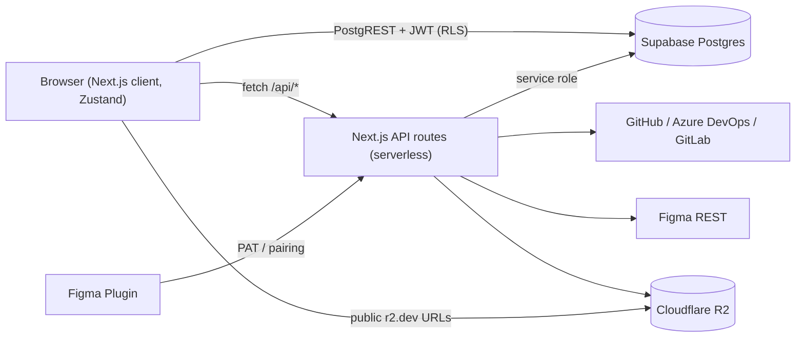
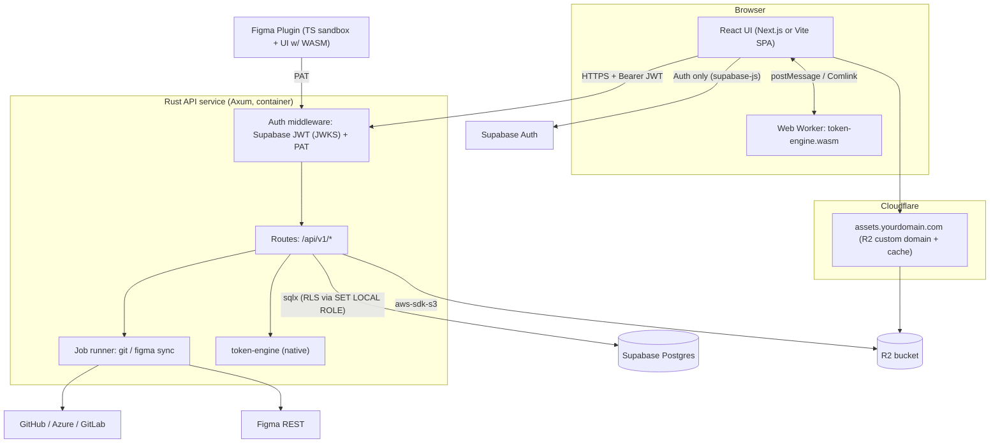
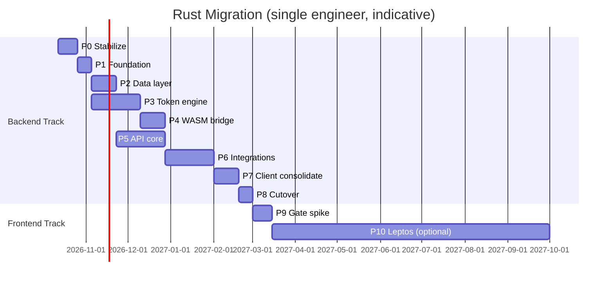

# Rust Migration Plan (`RUST_MIGRATION_PLAN.md`)

> **Scope:** Move the **Second Screen / Tokens Platform** to a Rust backend and a Rust frontend runtime.
> **Unchanged:** Supabase (PostgreSQL + Auth), Cloudflare R2 (asset storage / CDN), Figma Companion Plugin sandbox (TypeScript).
> **Branch:** `upgrade/rust`
> **Status:** Proposal, v1.0 (2026-10-07)

---

## Table of Contents

0. [Executive Verdict](#0-executive-verdict)
1. [Current-State Baseline](#1-current-state-baseline)
2. [Honest Assessment: What Rust Fixes and What It Doesn't](#2-honest-assessment)
3. [Target Architecture](#3-target-architecture)
4. [Repository Layout](#4-repository-layout)
5. [Technology Choices (Crates & Tools)](#5-technology-choices)
6. [Phase 0: Stabilize & Baseline](#phase-0)
7. [Phase 1: Rust Foundation & CI](#phase-1)
8. [Phase 2: Data Layer Evolution (Supabase)](#phase-2)
9. [Phase 3: Rust Token Engine (Core Crate)](#phase-3)
10. [Phase 4: WASM Bridge into the Current Frontend](#phase-4)
11. [Phase 5: Rust API Service (Axum), Core Routes](#phase-5)
12. [Phase 6: Integrations Port (Git, Figma, R2, Email)](#phase-6)
13. [Phase 7: Client Data-Access Consolidation](#phase-7)
14. [Phase 8: Backend Cutover & Decommission](#phase-8)
15. [Phase 9: Frontend Go / No-Go Gate](#phase-9)
16. [Phase 10: Rust Frontend (Leptos), Optional Track](#phase-10)
17. [Phase 11: Figma Plugin Alignment](#phase-11)
18. [Testing Strategy](#testing-strategy)
19. [Rollout, Feature Flags & Rollback](#rollout)
20. [Risk Register](#risk-register)
21. [Timeline & Effort](#timeline)
22. [Success Metrics](#success-metrics)
23. [Governance Updates (`AGENTS.md`)](#governance)
24. [Appendix A: Route Migration Matrix](#appendix-a)
25. [Appendix B: Reference Code Sketches](#appendix-b)
26. [Appendix C: Per-Phase Exit Checklists](#appendix-c)

---

<a id="0-executive-verdict"></a>
## 0. Executive Verdict

| Layer | Move to Rust? | Verdict |
|---|---|---|
| **Token compute** (alias resolution, math, theme matrix, diff, exporters) | ✅ **Yes, highest value** | CPU-bound work on 13,000+ tokens. Rust compiled to WASM (browser) and native (server) gives one engine with no main-thread freezes. |
| **Backend API** (`app/api/*`, 25+ routes) | ✅ **Yes, good move** | Gives you a single binary, low memory use, no serverless cold starts or timeouts, long-running Git sync jobs, strong typing at the DB boundary. |
| **Frontend UI** (≈45k LOC React + Radix + Tailwind) | ⚠️ **Not yet, gated** | No Rust equivalent of Radix's accessibility primitives. It's a full rewrite of the most complex UI (Tokens grid, Flow canvas, Doc editor, Assets studio), and the UI isn't what makes the app slow. Decide at [Phase 9](#phase-9) using measured data. |
| **Figma plugin sandbox** | ❌ **No** | Figma's plugin sandbox is a JS environment. The plugin **UI** iframe can use the WASM engine. |

**Recommended path:** do a **Rust core + Rust backend first, then a gated Rust frontend.**
Phases 0–8 deliver most of the performance and reliability gains with low risk.
Phase 10 (Leptos) only runs if the [Phase 9](#phase-9) go/no-go criteria are met.

> [!IMPORTANT]
> The biggest slowdowns in [`PERFORMANCE_AUDIT_REPORT.md`](../PERFORMANCE_AUDIT_REPORT.md) are **logic and data-model bugs**, not language speed:
> phantom auto-save PATCH loops (19.7 MB/session), a duplicate 25-second `/api/v1/tokens` fetch,
> an unpaginated 952 KB asset list, and a rate-limited `r2.dev` image storm.
> Porting these bugs to Rust won't make them go away. **Phase 0 fixes them first** so that Rust's gains can be measured honestly.

---

<a id="1-current-state-baseline"></a>
## 1. Current-State Baseline

### 1.1 Inventory (measured from the repo)

| Area | Location | Size | Notes |
|---|---|---|---|
| Global store | `store/useTokenStore.ts` | 6,688 LOC | Zustand, holds all project state and calls Supabase directly. |
| Assets workspace | `components/assets/AssetsWorkspace.tsx` | 4,688 LOC | Monolithic component. |
| Tenancy service | `services/organizationService.ts` | 1,750 LOC | Used from **both** browser (store) and server (API routes). |
| Token engine (TS) | `utils/transformTokens.ts`, `themeHelpers.ts`, `releaseCompiler.ts`, `exportsCompiler.ts`, `tokenDiff.ts`, `colorPalettes.ts`, `colorModifier.ts`, `accessibility.ts`, `tokenFlowBuilder.ts` | ≈6,500 LOC | Pure functions, the prime Rust candidates. |
| Schema catalog | `data/schemaCatalog.ts` | 1,506 LOC | 182 Draft 2020-12 schemas, self-hosted. |
| API routes | `app/api/**` | 25+ handlers | Thin I/O: Supabase, GitHub/Azure/GitLab, Figma, R2, Resend. |
| R2 client | `lib/r2.ts` | 618 LOC | AWS SDK v3, presign, metadata index stored **as a JSON blob in R2**. |
| Figma plugin | `plugin/code.ts`, `plugin/src-ui/App.tsx` | ≈2,000 LOC | Vite single-file build. |
| Tests | `utils/**/*.test.ts`, `pair/*.test.ts` | 6 files | Vitest; these become parity oracles. |
| **Total TS/TSX** | | **≈72,500 LOC** | |

### 1.2 Data model hot spots (Supabase)

- `projects.raw_tokens JSONB`, `projects.branches JSONB` (each branch embeds its own `rawTokens`), and `projects.figma_variables JSONB`.
  - Every save rewrites a ~565 KB row. There are no partial updates and no per-branch concurrency.
- Asset metadata lives in an R2 JSON index (`buildMetadataKey`), not Postgres, so you can't paginate, filter or join it.
- RLS is built on `is_org_member`, `is_org_admin`, `is_org_editor` and `is_org_owner` (`SECURITY DEFINER`).
- The browser calls PostgREST directly with the anon key + user JWT (RLS enforced). The server uses the service role for admin operations.

### 1.3 Runtime topology today



---

<a id="2-honest-assessment"></a>
## 2. Honest Assessment

### 2.1 What Rust genuinely improves

| Benefit | Where it shows up |
|---|---|
| **Predictable CPU performance** | `flattenAndResolveTokens`, `buildThemeMatrix` (Cartesian product), `computeTokensDiff`, exporters on 13k+ tokens. Expect 3–10× speedups. More importantly, the work moves **off the main thread** via a WASM worker. |
| **One engine, three runtimes** | The same crate runs in the server (native), browser (WASM worker) and Figma plugin UI (WASM). No more TS-server vs TS-client drift. |
| **No serverless limits** | Git fetch/push and Figma asset sync become background jobs with progress streaming, with no function timeout. |
| **Memory and cost** | An Axum service idles at ~20–40 MB RSS, while a Node SSR instance typically uses 150–300 MB. |
| **Type-checked SQL** | `sqlx` checks queries against the real schema at compile time. |
| **Security posture** | Memory safety, explicit error handling, and a smaller dependency tree than `node_modules`. |

### 2.2 What Rust does not fix

| Problem | Real fix (language-agnostic) |
|---|---|
| 35× phantom `PATCH /projects` | Gate saves on real `isDirty`; diff-based partial writes. |
| 25s Variables tab | Don't refetch data that's already in the store. |
| 41s asset image storm | Virtualization, pagination, lazy images, **custom R2 domain** (`r2.dev` is rate-limited and not meant for production). |
| Refetch on every tab | Client caching with stale-while-revalidate. |
| 565 KB row rewrites | Normalize token storage (Phase 2). |

### 2.3 Why a Rust frontend is high-risk *right now*

1. **Rewrite size:** ≈45k LOC of UI, including a virtualized token grid, drag-and-drop flow canvas, block doc editor, color pickers, and Radix dialogs, menus, popovers and selects.
2. **Accessibility primitives:** Radix gives you focus traps, roving tabindex, dismissable layers, typeahead and ARIA wiring for free. Rust UI libraries (e.g. Thaw, leptos-use) are useful but not at parity. You'd need to **budget time to build headless primitives yourself.**
3. **Bundle and startup:** A Leptos WASM bundle is typically 300 KB–1.5 MB gzipped before code splitting. Code splitting in Rust/WASM is still maturing compared with Next.js dynamic imports.
4. **Iteration speed:** Rust compile + hot reload is slower than Vite/Next HMR for UI tweaking.
5. **Hiring and AI tooling:** There are far fewer Leptos engineers and much less example code than for React.
6. **The UI isn't the bottleneck.** Once compute moves to a WASM worker (Phase 4), the React UI only renders the 100-row batches it already renders.

**Conclusion:** Rust everywhere is achievable. The **order** matters: core → backend → (gate) → frontend.

---

<a id="3-target-architecture"></a>
## 3. Target Architecture

### 3.1 End-state after Phase 8 (recommended baseline)



### 3.2 End-state after optional Phase 10 (full Rust)


### 3.3 Architectural principles

1. **Supabase is the source of truth for schema.** Migrations stay in `supabase/migrations/`, and `sqlx` reads from them. Rust never owns DDL.
2. **RLS stays authoritative.** User-initiated queries run as the `authenticated` role with the user's JWT claims. The service role is only for explicitly-admin operations, and those are audited.
3. **Strangler fig.** Every route can be served by either Next or Rust, switched by a flag. No big-bang cutover.
4. **Contract-first.** OpenAPI (generated by `utoipa`) is the contract. TS clients are generated from it, so the React UI stays type-safe against Rust.
5. **Self-hosted schemas (AGENTS.md Rule 1).** The Rust registry resolves `$id` and `$schema` URLs from the request origin. **Never** `registry.tokens.studio`.

---

<a id="4-repository-layout"></a>
## 4. Repository Layout

A monorepo. The Rust workspace sits next to the existing Next app until cutover.

```
second-screen/
├── app/ components/ store/ ...        # existing Next.js app (kept through Phase 8)
├── plugin/                            # Figma plugin (TS)
├── supabase/migrations/               # schema source of truth (unchanged location)
├── rust/
│   ├── Cargo.toml                     # [workspace]
│   ├── rust-toolchain.toml            # pinned stable + wasm32-unknown-unknown
│   ├── deny.toml                      # cargo-deny licenses/advisories
│   ├── crates/
│   │   ├── token-engine/              # pure Rust, no I/O, no tokio
│   │   │   ├── src/{model,parse,alias,math,color,flatten,theme,diff,validate}/
│   │   │   ├── src/export/{css,scss,ts,tailwind,flutter,style_dictionary,dtcg,figma}.rs
│   │   │   ├── benches/               # criterion
│   │   │   └── tests/golden/          # fixtures captured from TS (Phase 0)
│   │   ├── token-engine-wasm/         # wasm-bindgen facade, handle-based API
│   │   ├── schema-registry/           # 182 schemas embedded via include_str!
│   │   ├── domain/                    # Org, Project, Member, Branch, Asset, ApiKey types (serde)
│   │   ├── db/                        # sqlx repositories, RLS session helper
│   │   ├── integrations/
│   │   │   ├── git/                   # github, azure_devops, gitlab
│   │   │   ├── figma/
│   │   │   ├── r2/
│   │   │   └── email/                 # Resend
│   │   ├── auth/                      # Supabase JWT (JWKS/HS256), PAT, pairing
│   │   ├── jobs/                      # background sync jobs
│   │   └── api/                       # Axum binary (main.rs), routes, OpenAPI
│   └── apps/
│       └── web-leptos/                # ONLY created in Phase 10
├── packages/
│   └── api-client/                    # TS client generated from OpenAPI
└── docs/RUST_MIGRATION_PLAN.md
```

---

<a id="5-technology-choices"></a>
## 5. Technology Choices

| Concern | Choice | Why / notes |
|---|---|---|
| HTTP server | **axum** + tokio + tower-http | De-facto standard; tower middleware (CORS, compression, tracing, timeouts). |
| DB | **sqlx** (postgres, runtime-tokio, tls-rustls) | Compile-time checked queries, offline mode (`.sqlx/`) for CI. |
| Supabase pooling | Direct connection or **Supavisor session mode (5432)** | ⚠️ Transaction mode (6543) breaks sqlx prepared statements unless you disable statement caching. A long-lived server doesn't need it anyway. |
| Auth JWT | **jsonwebtoken** + JWKS cache | Supports Supabase asymmetric signing keys (`/auth/v1/.well-known/jwks.json`) and legacy HS256 secret. |
| PAT hashing | **sha2** + `subtle` (constant-time compare) | Matches current `utils/patAuth.ts` SHA-256 hashes, so existing keys keep working. |
| R2 | **aws-sdk-s3** (custom endpoint `https://<acct>.r2.cloudflarestorage.com`, region `auto`) | Presigned PUT/GET supported. |
| HTTP client | **reqwest** (rustls) | GitHub/Azure/GitLab/Figma/Resend. Optional `octocrab` for GitHub. |
| Serialization | **serde**, serde_json (`preserve_order`, `arbitrary_precision` as needed) | `preserve_order` keeps DTCG key order stable, which matters for diffs and Git output. |
| JSON Schema | **jsonschema** crate (Draft 2020-12) | Validates tokens against the self-hosted registry. |
| Color math | **palette** or hand-rolled (match TS output exactly) | Exact parity with `toHexFast`/`colorModifier` beats library elegance. |
| Expression math | Custom Pratt parser | Reproduce `evaluateTokenMath` semantics exactly (units, rounding). |
| Diff | **similar** | Line diff for `computeLineDiff` / side-by-side hunks. |
| ZIP | **zip** crate | Release and export bundles, plugin download. |
| OpenAPI | **utoipa** + utoipa-swagger-ui | Then `openapi-typescript` → `packages/api-client`. |
| Errors | **thiserror** (libs), **anyhow** (bin) | Map to RFC 7807 problem+json. |
| Observability | **tracing**, tracing-subscriber, OpenTelemetry OTLP | Request IDs, spans per DB/integration call. |
| Config | **figment** or `envy` | Reads the same env names as `.env.example`. |
| Jobs | tokio tasks + Postgres `jobs` table (SKIP LOCKED) | No extra infra (Redis not required). `apalis` is an alternative. |
| WASM | **wasm-bindgen**, wasm-pack, `serde-wasm-bindgen`, `wasm-opt` | Worker-hosted engine. |
| Rust frontend (Phase 10) | **Leptos** (latest stable) + cargo-leptos + leptos_router | SSR + hydration on the same Axum server. Dioxus is the alternative. |
| Testing | cargo-nextest, insta (snapshots), proptest, criterion, wiremock | |

---

<a id="phase-0"></a>
## Phase 0: Stabilize & Baseline (TypeScript)

**Goal:** Remove known non-language bottlenecks, freeze behaviour, and capture what "correct" looks like.
**Duration:** ~2 weeks. **Risk:** Low.

### 0.1 Fix audit bugs in the current app

| # | Task | File(s) | Acceptance |
|---|---|---|---|
| 0.1.1 | Gate cloud save on genuine user edits; merge `raw_tokens` + `branches` into one PATCH | `store/useTokenStore.ts` | 0 PATCH calls during a 4-min read-only session |
| 0.1.2 | Remove auto `fetchVariables()` on mount; read from the store | `components/VariablesView.tsx` | Variables tab < 200 ms |
| 0.1.3 | Stop `git/fetch` + `check-updates` on sibling-tab navigation | `app/page.tsx`, store | 1 fetch per project open |
| 0.1.4 | Paginate `/api/assets/list` (temporary cursor over the R2 index) | `app/api/assets/list/route.ts` | Payload < 60 KB per page |
| 0.1.5 | Virtualize the asset grid + `loading="lazy"` | `components/assets/AssetsWorkspace.tsx` | ≤ 20 image requests on open |
| 0.1.6 | Move R2 public URL from `*.r2.dev` to a **custom domain** with Cloudflare cache rules | Cloudflare dashboard, `R2_PUBLIC_URL` | p95 image < 300 ms |
| 0.1.7 | Remove the unnecessary `PATCH organization_members` during reads | `services/organizationService.ts` | No write on load |

### 0.2 Capture golden fixtures (the parity oracle for Rust)

1. Export 3 real token documents (small ~200, medium ~2k, enterprise **13k+**), anonymized if needed.
2. Write `scripts/capture-golden.mjs`. For each fixture it writes JSON outputs to `rust/crates/token-engine/tests/golden/<fixture>/`:
   - `flattenAndResolveTokens` → `flatten.json`
   - `buildTokenLookupIndex` → `index.json`
   - `extractThemeGroups` / theme matrix → `themes.json`
   - `computeTokensDiff` (fixture A vs A′) → `diff.json`
   - Every exporter (CSS, SCSS, TS, Tailwind, Flutter, Style Dictionary, DTCG, Figma Variables) → `export/<format>/*`
   - `evaluateTokenMath` edge cases → `math.json`
   - Color conversions (`toHexFast`, palettes, modifiers, contrast) → `color.json`
3. Commit the fixtures. **Any intentional behaviour change must regenerate them in a reviewed PR.**

### 0.3 Capture API contracts

1. Record request and response pairs for every route in [Appendix A](#appendix-a) (dev environment, scrubbed secrets) into `rust/crates/api/tests/contracts/*.json`.
2. Write a hand-authored `openapi.yaml` v0 describing the current routes. This becomes the Rust target.

### 0.4 Performance baseline

| Metric | How | Record |
|---|---|---|
| Resolve 13k tokens | Vitest bench / `performance.now()` | ms (p50/p95) |
| Theme matrix build | same | ms |
| Export all formats | same | ms |
| Tokens tab TTI | Chrome DevTools / Lighthouse | s |
| `/api/v1/tokens` latency | k6 / autocannon | p50/p95 |
| Main-thread long tasks | Performance panel | count > 50 ms |
| Server memory & cold start | host metrics | MB, ms |

### 0.5 Feature freeze policy
- During Phases 3–8, new features land **only** in Rust (backend) or behind the engine facade (frontend). That way nothing has to be written twice.

**Exit criteria:** audit issues closed, golden fixtures and contracts committed, baseline table filled in [`docs/RUST_BASELINE.md`].

---

<a id="phase-1"></a>
## Phase 1: Rust Foundation & CI

**Goal:** Set up a buildable, tested, deployable empty Rust workspace.
**Duration:** 1–2 weeks. **Risk:** Low.

### 1.1 Workspace bootstrap
1. `rust/Cargo.toml` with `[workspace] resolver = "2"`, shared `[workspace.dependencies]`, `[profile.release] lto = "thin", codegen-units = 1`.
2. `rust-toolchain.toml`: pinned stable, components `rustfmt`, `clippy`; target `wasm32-unknown-unknown`.
3. Create crates (empty, compiling): `token-engine`, `token-engine-wasm`, `schema-registry`, `domain`, `db`, `auth`, `integrations`, `jobs`, `api`.
4. `api` binary: `/healthz` (liveness), `/readyz` (DB ping + R2 head bucket), graceful shutdown on SIGTERM.

### 1.2 Config & secrets
- Read the **same env names** already in `.env.example`: `NEXT_PUBLIC_SUPABASE_URL` → also accept `SUPABASE_URL`, `SUPABASE_SERVICE_ROLE_KEY`, `TOKENS_PLATFORM_SECRET_KEY`, `RESEND_API_KEY`, `INVITE_FROM_EMAIL`, `R2_*`.
- New: `DATABASE_URL` (direct/session pooler), `SUPABASE_JWKS_URL` (default derived), `SUPABASE_JWT_SECRET` (legacy fallback), `APP_ORIGIN`, `RUST_LOG`, `OTEL_EXPORTER_OTLP_ENDPOINT`.
- Fail fast at startup with a readable error listing missing variables.

### 1.3 CI pipeline (GitHub Actions)

| Job | Commands |
|---|---|
| fmt | `cargo fmt --all --check` |
| lint | `cargo clippy --workspace --all-targets -- -D warnings` |
| test | `cargo nextest run --workspace` (with `SQLX_OFFLINE=true`) |
| db-test | Ephemeral Postgres + apply `supabase/migrations/*` + `sqlx` integration tests |
| wasm | `wasm-pack build crates/token-engine-wasm --target web --release` + size budget check |
| deny | `cargo deny check` (licenses, advisories, bans) |
| existing | `npx tsc --noEmit`, `npm run build`, `npm test` (unchanged, per AGENTS.md) |

### 1.4 Container & hosting
- Multi-stage Dockerfile: `cargo-chef` for dependency caching → `gcr.io/distroless/cc` runtime. Target image < 40 MB.
- Host **close to the Supabase region** (latency to Postgres matters more than anything else). Options: Fly.io, Railway, Google Cloud Run (min instances = 1), Render, or a VPS with Docker.
- Put Cloudflare in front (TLS, WAF, caching of `/api/v1/schemas/*`).

> [!NOTE]
> Cloudflare Workers (`workers-rs`) is tempting because R2 is native there. But the Workers CPU and runtime limits, plus Postgres driver constraints, make it a poor fit for long Git sync jobs and `sqlx`. Use a container.

**Exit criteria:** `main` builds the Rust workspace in CI, a container is deployed to staging, `/readyz` is green against staging Supabase + R2.

---

<a id="phase-2"></a>
## Phase 2: Data Layer Evolution (Supabase)

**Goal:** Make the schema friendly to partial updates, pagination and typed access, without breaking the running TS app.
**Duration:** 2–3 weeks. **Risk:** Medium. **Pattern:** Expand → Migrate → Contract.

### 2.1 New tables (expand, additive only)

```sql
-- 2.1.a Branches as rows instead of projects.branches JSONB
CREATE TABLE public.project_branches (
  id           UUID PRIMARY KEY DEFAULT gen_random_uuid(),
  project_id   TEXT NOT NULL REFERENCES public.projects(id) ON DELETE CASCADE,
  org_id       TEXT NOT NULL REFERENCES public.organizations(id) ON DELETE CASCADE,
  name         TEXT NOT NULL,
  title        TEXT,
  is_default   BOOLEAN NOT NULL DEFAULT false,
  head_sha     TEXT,
  version      BIGINT NOT NULL DEFAULT 1,      -- optimistic concurrency
  updated_at   TIMESTAMPTZ NOT NULL DEFAULT now(),
  UNIQUE (project_id, name)
);

-- 2.1.b Token sets per branch (unit of partial save)
CREATE TABLE public.token_sets (
  id           UUID PRIMARY KEY DEFAULT gen_random_uuid(),
  branch_id    UUID NOT NULL REFERENCES public.project_branches(id) ON DELETE CASCADE,
  org_id       TEXT NOT NULL,
  set_path     TEXT NOT NULL,                  -- e.g. "core/colors"
  sort_index   INT  NOT NULL DEFAULT 0,
  content      JSONB NOT NULL,                 -- DTCG subtree
  content_hash TEXT NOT NULL,                  -- sha256, skip no-op writes
  updated_at   TIMESTAMPTZ NOT NULL DEFAULT now(),
  UNIQUE (branch_id, set_path)
);

-- 2.1.c Assets metadata in Postgres (replaces R2 JSON index)
CREATE TABLE public.assets (
  id            UUID PRIMARY KEY DEFAULT gen_random_uuid(),
  org_id        TEXT NOT NULL,
  project_id    TEXT NOT NULL REFERENCES public.projects(id) ON DELETE CASCADE,
  r2_key        TEXT NOT NULL UNIQUE,
  name          TEXT NOT NULL,
  asset_type    TEXT NOT NULL,
  content_type  TEXT NOT NULL,
  size_bytes    BIGINT,
  width INT, height INT,
  collection_id UUID,
  tags          TEXT[] NOT NULL DEFAULT '{}',
  source        TEXT,                           -- upload | git | figma
  checksum      TEXT,
  created_at    TIMESTAMPTZ NOT NULL DEFAULT now(),
  updated_at    TIMESTAMPTZ NOT NULL DEFAULT now()
);
CREATE INDEX ON public.assets (project_id, created_at DESC, id);   -- keyset pagination
CREATE INDEX ON public.assets USING gin (tags);

-- 2.1.d Background jobs (git/figma sync)
CREATE TABLE public.jobs (
  id          UUID PRIMARY KEY DEFAULT gen_random_uuid(),
  org_id      TEXT NOT NULL,
  project_id  TEXT,
  kind        TEXT NOT NULL,                    -- git_fetch | git_push | figma_assets | ...
  status      TEXT NOT NULL DEFAULT 'queued',   -- queued|running|succeeded|failed|cancelled
  payload     JSONB NOT NULL DEFAULT '{}',
  progress    JSONB NOT NULL DEFAULT '{}',
  error       TEXT,
  attempts    INT NOT NULL DEFAULT 0,
  run_after   TIMESTAMPTZ NOT NULL DEFAULT now(),
  created_by  TEXT,
  created_at  TIMESTAMPTZ NOT NULL DEFAULT now(),
  updated_at  TIMESTAMPTZ NOT NULL DEFAULT now()
);
CREATE INDEX ON public.jobs (status, run_after);
```

### 2.2 RLS for new tables
- Enable RLS on all four tables.
- SELECT: `public.is_org_member(org_id)`. INSERT/UPDATE/DELETE: `public.is_org_editor(org_id)` (or admin, matching current project policies).
- `jobs`: SELECT for members; writes **only** via service role (Rust job runner).
- Add pgTAP or SQL tests that assert a viewer cannot write and a non-member cannot read.

### 2.3 Backfill (migrate)
1. One-off Rust CLI `rust/crates/api/src/bin/backfill.rs` (service role):
   - For each project: split `branches[*].rawTokens` (or `raw_tokens`) into `project_branches` + `token_sets` by top-level set key.
   - Read each project's R2 metadata JSON index → insert `assets` rows.
2. Run it idempotently (upsert on unique keys). Verify with a checksum: re-assemble the document from `token_sets` and compare it to the original JSONB (must be byte-equivalent after canonical JSON).

### 2.4 Dual-write window
- The TS app keeps writing to `projects.*` JSONB. A Postgres trigger **or** the Rust API mirrors writes into the new tables until Phase 7 flips reads.
- Simplest safe option: the Rust API is the only writer of the new tables. A nightly reconciliation job reports drift.

### 2.5 Contract (deferred to Phase 8)
- Drop `projects.raw_tokens`, `projects.branches`, the R2 metadata index files and asset config blobs only after 30 days with zero reads (verify with logs).

**Exit criteria:** new tables live in prod with RLS, backfill verified with 100% checksum match, the TS app is unaffected.

---

<a id="phase-3"></a>
## Phase 3: Rust Token Engine (Core Crate)

**Goal:** A pure-Rust, I/O-free engine with **byte-for-byte parity** with the TS utilities.
**Duration:** 4–6 weeks. **Risk:** Medium (semantic parity).

### 3.1 Module map (TS → Rust)

| TS source | Rust module | Key functions |
|---|---|---|
| `utils/transformTokens.ts` | `model`, `parse`, `alias`, `math`, `flatten`, `mutate`, `sort` | `is_token_leaf`, `count_tokens`, `get_leaf_type`, `build_lookup_index`, `resolve_alias`, `evaluate_math`, `flatten_and_resolve`, `set/create/delete_token_at_key_path`, natural sort comparators |
| `utils/themeHelpers.ts` | `theme` | `extract_theme_groups`, `themes_array`, `metadata_object`, `build_theme_matrix` |
| `utils/tokenDiff.ts` | `diff` | `compute_line_diff`, `compute_tokens_diff`, `side_by_side`, `parse_unified_patch` |
| `utils/releaseCompiler.ts` | `export::{flutter, react_ts, tailwind, css, scss, style_dictionary}` | `format_token_name`, `token_to_css_var`, all `compile_*` |
| `utils/exportsCompiler.ts` | `export::{css, scss, ts, raw_json, dtcg, figma}` | `format_color_value`, `transform_casing`, `generate_*_export_files` |
| `utils/colorPalettes.ts`, `colorModifier.ts` | `color` | palettes, modifiers, `to_hex_fast` (LRU) |
| `utils/accessibility.ts` | `color::contrast` | WCAG contrast, APCA if present |
| `utils/tokenFlowBuilder.ts` | `graph` | alias dependency graph for Flow canvas |
| `utils/tokenDeprecation.ts` | `deprecation` | |
| `data/schemaCatalog.ts` | `schema-registry` crate | embedded catalog + `validate(doc, schema_id)` |

### 3.2 Core data structures
- `TokenDocument`: `IndexMap<String, Node>` (order-preserving).
- `Node::Group { meta, children } | Node::Leaf(TokenLeaf)`.
- `TokenLeaf { value: serde_json::Value, ty: Option<TokenType>, description, extensions }`. Keep `$extensions` opaque to preserve round-trips.
- `TokenGraph`: interned paths (`lasso` or `string-interner`), `Vec<NodeId>` adjacency for aliases, cycle detection with Tarjan SCC → explicit `ResolveError::Cycle(path)`.
- Resolution cache: memoized per `NodeId`, invalidated by **dirty-subgraph propagation** on edits (O(affected) instead of O(all)).

### 3.3 Parity rules
1. Number formatting must match JS `Number.prototype.toString()`. Use the `ryu-js` crate.
2. Sorting must match `naturalCompareTokenKeys` exactly, including locale-free comparisons.
3. Unknown/malformed input returns the **same fallback** TS returns (e.g., raw string), not a hard error, unless strict mode is on.
4. JSON output uses the same key order and indentation (2 spaces) as `JSON.stringify(x, null, 2)`.

### 3.4 Testing
- `tests/golden.rs`: for each fixture × function, assert equality with the Phase 0 output (`insta` snapshots when reviewing diffs).
- `proptest`: random DTCG trees → `flatten(parse(serialize(doc))) == flatten(doc)`. Aliases never resolve to themselves. Cycles are always reported.
- Fuzz (`cargo-fuzz`) for the math parser and alias parser.
- `criterion` benches on the 13k fixture: resolve, theme matrix, diff, all exporters. Target **≥ 3× faster** than the TS baseline (native).

### 3.5 Public API (stable surface)

```rust
pub struct Engine { /* graph, caches */ }
impl Engine {
    pub fn load(doc: TokenDocument, opts: EngineOptions) -> Result<Self, LoadError>;
    pub fn apply(&mut self, edits: &[Edit]) -> Result<ChangeSet, EditError>;   // incremental
    pub fn flatten(&self, filter: &Filter) -> Vec<ResolvedToken>;
    pub fn page(&self, filter: &Filter, offset: usize, limit: usize) -> Page<ResolvedToken>; // Rule 4 batching
    pub fn theme_matrix(&self, groups: &[ThemeGroup]) -> ThemeMatrix;
    pub fn diff(&self, other: &Engine) -> TokensDiff;
    pub fn export(&self, target: ExportTarget, cfg: &ExportConfig) -> Vec<GeneratedFile>;
    pub fn validate(&self, registry: &SchemaRegistry) -> Vec<Diagnostic>;
    pub fn to_document(&self) -> TokenDocument;
}
```

**Exit criteria:** 100% golden parity across all fixtures, benchmarks recorded, no `unsafe`, `clippy -D warnings` clean.

---

<a id="phase-4"></a>
## Phase 4: WASM Bridge into the Current Frontend

**Goal:** The React app uses the Rust engine in a Web Worker. Main-thread long tasks drop to near zero.
**Duration:** 2–3 weeks. **Risk:** Low–Medium.

### 4.1 Build
- `token-engine-wasm` exposes a **handle-based** API. The 13k-token document stays inside WASM memory, so it isn't re-serialized on every call:

```rust
#[wasm_bindgen]
pub struct EngineHandle(Engine);

#[wasm_bindgen]
impl EngineHandle {
    #[wasm_bindgen(constructor)]
    pub fn new(doc_json: &str) -> Result<EngineHandle, JsError>;
    pub fn apply_edits(&mut self, edits_json: &str) -> Result<String, JsError>; // returns ChangeSet JSON
    pub fn page(&self, filter_json: &str, offset: u32, limit: u32) -> Result<String, JsError>;
    pub fn theme_matrix(&self, groups_json: &str) -> Result<String, JsError>;
    pub fn export(&self, target: &str, cfg_json: &str) -> Result<js_sys::Array, JsError>;
}
```

- Passing JSON **strings** across the boundary is often faster than `serde-wasm-bindgen` for big payloads. Benchmark both and pick per call.
- `wasm-opt -O3`, `opt-level = "z"` for the wasm crate. **Budget: ≤ 400 KB gzipped.**

### 4.2 Integration
1. `lib/engine/worker.ts`: loads the WASM and exposes methods via **Comlink**.
2. `lib/engine/index.ts`: a facade with the **same function signatures** as the TS utilities, async.
3. Feature flag `NEXT_PUBLIC_ENGINE=ts|wasm` (and a per-user override in localStorage for QA).
4. Replace call sites incrementally, starting with the heaviest: `flattenAndResolveTokens` (store) → `buildThemeMatrix` (`ThemeMatrix.tsx`) → `computeTokensDiff` (`TokenDiffViewer.tsx`, releases) → exporters (`ExportsHub`, release publish) → `tokenFlowBuilder` (`TokenFlow.tsx`).
5. Keep progressive rendering (AGENTS.md Rule 4): the UI asks `page(offset, 100)`, it doesn't get everything at once.
6. Keep React Rules of Hooks (Rule 2): async engine calls go in `useEffect` / a `useEngineQuery` hook, never before hooks.

### 4.3 Dual-run verification
- In staging, run TS and WASM side by side for 1 week and log any output mismatch (hash compare) to the console/telemetry.

**Exit criteria:** WASM is the default in prod, TS engine retained behind the flag for 2 releases, long tasks > 50 ms on the Tokens tab reduced by ≥ 80%.

---

<a id="phase-5"></a>
## Phase 5: Rust API Service, Core Routes

**Goal:** Serve Waves 1–3 of [Appendix A](#appendix-a) from Axum behind a per-route switch.
**Duration:** 4–6 weeks. **Risk:** Medium.

### 5.1 Routing & strangler mechanism
- Next.js `rewrites()` in `next.config.mjs` proxies migrated paths to `RUST_API_ORIGIN`, controlled by an env allow-list:
  `RUST_ROUTES="/api/v1/schemas,/api/v1/plugin/download,..."`.
- Or route at Cloudflare (Worker/Rules): `/api/*` → Rust if the path is in the KV allow-list, else Next. **Rollback = remove the path from the list.**
- Keep URLs **identical** so the Figma plugin and external PAT consumers don't notice.

### 5.2 Authentication middleware (`auth` crate)

Order of evaluation per request:
1. `Authorization: Bearer sb_…` / Supabase access token → verify JWT
   - Asymmetric: fetch JWKS from `${SUPABASE_URL}/auth/v1/.well-known/jwks.json`, cache it (10 min, refresh on unknown `kid`).
   - Legacy: HS256 with `SUPABASE_JWT_SECRET`.
   - Check `exp`, `aud = "authenticated"`, `iss`. Extract `sub`, `email`, `role`.
2. `Authorization: Bearer <PAT>` → SHA-256 → lookup `api_keys.key_hash` (constant-time compare), check `expires_at` and scopes (`read:tokens`, `write:tokens`), update `last_used_at` asynchronously.
3. Cookie fallback (only for browser navigations): parse the `@supabase/ssr` cookie `sb-<ref>-auth-token` (may be **chunked** `.0`, `.1`, … and `base64-` prefixed) → access token → step 1.

> [!TIP]
> Prefer having the React app send `Authorization: Bearer <access_token>` (from `supabase.auth.getSession()`) to the Rust API. Then cookie parsing is only an edge case.

Output: `AuthContext { principal: User | Pat, user_id, email, scopes, org_scope, project_scope }` injected as an Axum extractor.

### 5.3 RLS-preserving DB access (`db` crate)
- **User-scoped transaction:** for every request from a user JWT:
  ```sql
  BEGIN;
  SELECT set_config('request.jwt.claims', $1, true);  -- full claims JSON
  SET LOCAL ROLE authenticated;
  -- queries here are subject to existing RLS policies (auth.uid(), auth.jwt())
  COMMIT;
  ```
- **Service-scoped:** a separate pool or code path, used only for: PAT lookup, pairing sessions, invitations acceptance, backfill, jobs. Each call site is annotated `#[service_role(reason = "...")]` (a custom attribute or wrapper fn) and logged.
- PAT requests: use the service role **plus explicit org/project checks** (`authorizeProjectRequest` parity), because PATs have no Supabase JWT.

### 5.4 Cross-cutting
- CORS parity with `utils/cors.ts` (plugin origin `null`, app origin).
- `tower-http`: `CompressionLayer` (br/gzip), which by itself fixes the "2.24 MB uncompressed JSON" finding. Also `TimeoutLayer`, `RequestBodyLimitLayer` (asset uploads larger), `TraceLayer`, `SetRequestIdLayer`.
- Rate limiting (`tower_governor`) on `/api/v1/auth/pair` and invitations.
- Errors: `{ "success": false, "error": "…" }` (current shape) for v1 compatibility. Add `code` and `requestId` fields.
- ETag / `If-None-Match` on token reads, keyed by `token_sets.content_hash`, so clients get cheap 304s.

### 5.5 Route waves in this phase
- **Wave 1 (read-only, no/low auth):** schemas registry, plugin download.
- **Wave 2 (authenticated reads):** `/api/v1/user/orgs`, `/api/v1/tokens` (GET), `/api/v1/tokens/branches`, `/api/v1/auth/pat` (list/create/revoke), `/api/organizations/[orgId]/members/[userId]`.
- **Wave 3 (writes & flows):** `/api/v1/tokens` (POST/PUT, partial set writes via `token_sets`), `/api/v1/releases` + `/publish` (export via native engine), `/api/assets/*` (backed by the `assets` table + presigned R2), `/api/invitations/*`, `/api/v1/auth/pair`.

### 5.6 Verification per route
1. Contract test: replay the Phase 0 captured requests → responses must match (ignoring timestamps/IDs).
2. **Shadow mode** for GET routes: Next keeps serving, and also fires the same request to Rust asynchronously and logs diffs for 3–7 days.
3. Flip the route, watch error rate and latency for 48 h, then move to the next route.

**Exit criteria:** Waves 1–3 served by Rust in prod, error rate ≤ the Next baseline, p95 latency improved, OpenAPI published at `/api/docs`.

---

<a id="phase-6"></a>
## Phase 6: Integrations Port

**Goal:** Git, Figma, R2 and email run in Rust, with long operations as background jobs.
**Duration:** 4–6 weeks. **Risk:** Medium–High (most complex routes: `git/fetch` 771 LOC, `git/fetch-assets` 500, `figma/fetch-assets` 464).

### 6.1 Git providers (`integrations::git`)
- Trait-based so all providers share behaviour:
  ```rust
  #[async_trait]
  pub trait GitProvider {
      async fn list_branches(&self, repo: &RepoRef) -> Result<Vec<Branch>>;
      async fn head_sha(&self, repo: &RepoRef, branch: &str) -> Result<String>;
      async fn read_tree(&self, repo: &RepoRef, sha: &str, path_prefix: &str) -> Result<Vec<TreeEntry>>;
      async fn read_blobs(&self, repo: &RepoRef, shas: &[String]) -> Result<Vec<Blob>>; // bounded concurrency
      async fn commit_files(&self, repo: &RepoRef, branch: &str, files: &[FileChange], msg: &str) -> Result<CommitInfo>;
  }
  ```
- Implementations: `GitHub` (REST trees/blobs/commits, or GraphQL for batch), `AzureDevOps` (pushes API), `GitLab` (repository files/commits).
- Concurrency: `futures::stream::iter(..).buffer_unordered(8)` with retry + jittered backoff on 403/429 (respect `Retry-After`, `X-RateLimit-Reset`).
- **Caching:** store `head_sha` per branch in `project_branches.head_sha`. `check-updates` becomes a cheap SHA compare, and `fetch` short-circuits when nothing changed. This fixes the "fetch on every tab" finding on the server side as well.
- Credentials: keep the current storage model (see `20260927_security_hardening.sql` → `project_integrations` and the trigger preventing raw storage). Decrypt using `TOKENS_PLATFORM_SECRET_KEY` with the **same algorithm** as the TS code (verify and write a cross-language test vector).

### 6.2 Jobs & progress
- `POST /api/git/fetch` → enqueues a `jobs` row → returns `202 { jobId }` (compat mode: if the client sends `Prefer: wait=30`, the server waits up to 30 s and returns the result inline, so older clients keep working).
- `GET /api/jobs/{id}` and **SSE** `GET /api/jobs/{id}/events` stream progress (files read, blobs fetched, tokens parsed).
- Runner: N tokio workers polling `SELECT … FOR UPDATE SKIP LOCKED`, heartbeat, max attempts, cancellation via a status flag.

### 6.3 Figma (`integrations::figma`)
- `fetch-variables`: Figma Variables REST → normalize via engine → `projects.figma_variables` (later its own table if size demands).
- `fetch-assets`: export node images in batches (Figma `images` endpoint), stream into R2 (`put_object` with content-type), insert `assets` rows, generate thumbnails (optional `image` crate, or Cloudflare Image Resizing at the CDN).

### 6.4 R2 (`integrations::r2`)
- Port `lib/r2.ts` 1:1: `build_asset_key`, `upload`, `delete(s)`, `list_project_keys`, `presign_put/get`, `exists`.
- Use the **custom domain** for public URLs. Set `Cache-Control: public, max-age=31536000, immutable` on content-addressed keys.
- Port `scripts/r2-cli.mjs` as a Rust `xtask` subcommand (optional).

### 6.5 Email (`integrations::email`)
- Resend REST via reqwest. Port the template from `lib/inviteEmail.ts` using **askama** (compile-time templates).

**Exit criteria:** Wave 4 routes served by Rust, Git sync for a 13k-token repo completes without timeouts, SSE progress visible in the UI.

---

<a id="phase-7"></a>
## Phase 7: Client Data-Access Consolidation

**Goal:** The browser stops writing large JSONB directly to PostgREST. All domain writes go through the Rust API.
**Duration:** 2–3 weeks. **Risk:** Medium.

1. Generate `packages/api-client` from OpenAPI (`openapi-typescript` + `openapi-fetch`).
2. Replace write paths in `store/useTokenStore.ts` and `services/organizationService.ts`:
   - `saveProjectTokens`, `saveProjectTokensAndBranches` → `PATCH /api/v1/projects/{id}/branches/{name}/sets` with **only changed sets** (engine `ChangeSet` → set paths → content hashes).
   - `saveProjectGitConfig`, `saveProjectFigmaVariables`, `saveProjectDocumentation`, `saveProjectSchemas`, `createProject`, `updateProject`, `deleteProject`, org and member mutations → Rust endpoints.
3. Reads: either keep direct PostgREST for simple lists (orgs, members, which are fine under RLS) **or** move them too for one consistent client. Recommendation: move them, and add client caching (TanStack Query, `staleTime` 5 min) at the same time.
4. Optimistic concurrency: send `If-Match: <branch.version>`. On `409`, show a merge/refresh prompt.
5. Remove `NEXT_PUBLIC_SUPABASE_ANON_KEY` usage for data, but **keep it for Auth only** (`supabase.auth.*`).
6. Flip reads to the normalized tables. Stop dual-writing to `projects.raw_tokens`/`branches`.

**Exit criteria:** a save of a single token edit sends < 5 KB, there are no direct PostgREST writes from the browser, Phase 0 network audit re-run shows ≥ 70% fewer requests.

---

<a id="phase-8"></a>
## Phase 8: Backend Cutover & Decommission

**Goal:** Rust is the only backend. Next.js (if kept) is frontend-only.
**Duration:** 1–2 weeks. **Risk:** Low (everything already flipped).

1. Migrate the remaining route: `/auth/callback` (OAuth PKCE code exchange). Either:
   - keep it in the frontend (supabase-js `exchangeCodeForSession` client-side), **recommended for the React track**, or
   - port it to Rust (POST to `/auth/v1/token?grant_type=pkce`, set cookies), **required for the Leptos track**.
2. Delete `app/api/**`, `lib/r2.ts`, `lib/supabase/admin.ts`, server-only utils. Remove `@aws-sdk/*` and server deps from `package.json`.
3. Optional frontend simplification: since nearly all views use `dynamic(..., { ssr: false })`, consider **Next static export or Vite SPA** served from Cloudflare Pages. Keep SSR only for `/docs/[orgSlug]/[projectSlug]` (SEO); that page can be server-rendered by Axum (askama) or kept on Next.
4. Contract migration (Phase 2.5): drop legacy JSONB columns and R2 index files after the 30-day zero-read window.
5. Update `docs/ARCHITECTURE.md`, `AGENTS.md`, `README.md`, `.env.example`.

**Exit criteria:** `npm run build` produces a frontend-only app, the Rust service handles 100% of API traffic, legacy columns dropped.

---

<a id="phase-9"></a>
## Phase 9: Frontend Go / No-Go Gate

Decide **with data** whether to rewrite the UI in Rust.

| Criterion | GO if… | NO-GO if… |
|---|---|---|
| UI performance after Phase 4/7 | Main-thread long tasks still > 10/min or INP > 200 ms on Tokens tab | INP ≤ 200 ms, long tasks rare |
| Team | ≥ 1 engineer comfortable with Leptos signals and WASM debugging | React-only team |
| Product roadmap | No major UI features for 6+ months | Heavy UI roadmap (rewriting while shipping doubles the cost) |
| Leptos prototype (2-week spike) | Tokens grid (13k, virtualized) + one Radix-style dialog are accessible and ≤ 1.5 MB gz | Prototype misses accessibility or size budget |
| Strategic value | Single-language codebase is a hard requirement (hiring, security review, embedded/desktop via Tauri) | "Nice to have" |

**2-week spike scope (mandatory before GO):**
1. `apps/web-leptos` with SSR + hydration on the existing Axum server.
2. Port **TokenTable** (virtualized, 13k rows via the engine `page()` API).
3. Port **one dialog + dropdown + tooltip** with full keyboard and screen-reader support (NVDA/VoiceOver checked).
4. Measure: bundle size, TTI, INP, dev-loop time. Compare with the React baseline.

---

<a id="phase-10"></a>
## Phase 10: Rust Frontend (Leptos), Optional Track

**Duration:** 6–9 months (1–2 engineers). **Risk:** High.
Only start after a GO in Phase 9.

### 10.1 Stack
- **Leptos** (latest stable) with `cargo-leptos`, SSR + hydration via `leptos_axum` on the **same** Axum service.
- **Routing:** `leptos_router`, mirroring current paths: `/[workspaceSlug]/[[...path]]`, `/docs/[org]/[project]`, `/invite/[token]`, `/connect`.
- **Styling:** keep **Tailwind** (the Tailwind CLI scans `.rs` files via `content: ["./src/**/*.rs"]`), reuse `tailwind.config.ts` tokens and `app/globals.css` variables. That keeps the look identical.
- **Icons:** `lucide` SVGs via `leptos_icons` or inline SVG components generated at build time.
- **State:** Zustand slices → Leptos `RwSignal`/`Store` contexts per domain (`AuthCtx`, `OrgCtx`, `ProjectCtx`, `EngineCtx`). Engine runs in a Web Worker (same WASM crate) via `gloo-worker`.
- **Data:** Leptos `Resource`s + server functions (`#[server]`) that call the same `db`/`integrations` crates directly, so there's no HTTP hop for SSR.
- **Auth:** Supabase Auth via REST (`/auth/v1/token`, `/auth/v1/authorize` PKCE), session cookie set by Axum (HttpOnly, Secure, SameSite=Lax). There is no official Rust supabase-js equivalent, so it's implemented in the `auth` crate.

### 10.2 Headless primitives library (`crates/ui-primitives`)
Build this **before** porting screens. Each primitive must pass keyboard and ARIA tests:

| Primitive | Replaces | Must support |
|---|---|---|
| Dialog / Sheet / Drawer | `@radix-ui/react-dialog`, `vaul` | Focus trap, scroll lock, Esc, return focus, portal, `aria-modal` |
| DropdownMenu / ContextMenu | Radix menus | Roving tabindex, typeahead, submenus, collision-aware positioning |
| Popover / Tooltip | Radix popover/tooltip | Floating positioning (port a minimal floating-ui), delay groups |
| Select | Radix select | Listbox semantics, typeahead, virtualized options |
| Tabs, Switch, Collapsible, Avatar, Separator, Label | Radix | ARIA roles & states |
| VirtualList / VirtualGrid | custom batching | Fixed and variable row heights, overscan, 13k+ rows |
| Toast | `components/Toast` | Live region announcements |

### 10.3 Screen migration order (route-level strangler)
Axum serves Leptos for migrated paths and proxies everything else to the React app. Both share the Supabase session cookie on the same domain. State is **not** shared across apps, so migrate whole routes.

| Order | Screen(s) | Why this order |
|---|---|---|
| 1 | `/docs/[org]/[project]` public docs | Read-only, SEO benefits from SSR, isolated |
| 2 | `/invite/[token]`, `/connect` (pairing), Auth gateway | Small, isolated flows |
| 3 | Org settings, Members, Project settings, API keys | Forms + dialogs, exercises primitives |
| 4 | Dashboard, Workspaces list/projects | Lists, cards |
| 5 | **Tokens workspace** (TokensWorkspace, TokenTable, EditTokenDrawer, AddTokenModal, BulkActions) | Core value, uses engine `page()` |
| 6 | Theme Matrix, Variables, Branches, Diff viewer | Heavy compute already in engine |
| 7 | Releases, Exports hub | Engine exporters |
| 8 | Sync providers, Credentials | Job/SSE integration |
| 9 | Assets workspace + Asset studio | Largest component (4.7k LOC). Split it first. |
| 10 | Token Flow canvas, Documentation block editor | Pointer-heavy interactions, highest effort |

### 10.4 Per-screen definition of done
- Visual parity (Playwright screenshot diff ≤ 0.1%).
- Keyboard parity (Playwright + axe-core: 0 serious/critical violations).
- Performance ≥ the React version (INP, TTI).
- E2E flows green against staging.

### 10.5 Decommission
Remove the Next.js app, `node_modules`-based build, React deps. Keep Node only for the Figma plugin build.

---

<a id="phase-11"></a>
## Phase 11: Figma Plugin Alignment

1. **Sandbox (`plugin/code.ts`) stays TypeScript.** It runs in Figma's restricted JS sandbox.
2. **Plugin UI (`plugin/src-ui`)** can load `token-engine.wasm` (inlined as base64 by `vite-plugin-singlefile`) for local alias resolution and export previews. Check the size budget, and check whether Figma's UI iframe allows `WebAssembly.instantiate` with the plugin's CSP.
3. Plugin → Rust API: no URL changes (same `/api/v1/*`), PAT and pairing flows already ported in Phase 5.
4. Add `/api/v1/plugin/download` (Rust) packaging with the `zip` crate (Wave 1).

---

<a id="testing-strategy"></a>
## Testing Strategy

| Layer | Tooling | Gate |
|---|---|---|
| Engine unit + golden | cargo-nextest, insta | 100% fixture parity |
| Engine properties | proptest, cargo-fuzz | No panics in 1M cases, no cycles missed |
| DB + RLS | sqlx test fixtures on ephemeral Postgres with Supabase migrations; pgTAP | Viewer/editor/admin/owner matrix per table |
| API contract | Replayed Phase 0 captures; `schemathesis` against OpenAPI | 0 contract breaks |
| Integrations | `wiremock` for GitHub/Azure/GitLab/Figma/Resend; R2 via MinIO in CI | All happy + rate-limit + 5xx paths |
| Frontend (React track) | Existing Vitest + new Playwright E2E | Core flows green |
| Frontend (Leptos track) | `wasm-bindgen-test`, Playwright, axe-core | Parity + a11y |
| Load | k6 against staging: 50 rps token reads, 5 concurrent git syncs | p95 < 300 ms reads, 0 timeouts |
| Security | `cargo audit`, `cargo deny`, OWASP ZAP baseline, manual RLS review | No high findings |

---

<a id="rollout"></a>
## Rollout, Feature Flags & Rollback

| Flag | Scope | Default progression |
|---|---|---|
| `NEXT_PUBLIC_ENGINE=ts\|wasm` | Browser engine | staging wasm → 10% users → 100% |
| `RUST_ROUTES` allow-list | Per API route | shadow → staging → prod per route |
| `JOBS_ASYNC=on\|off` | Git/Figma async jobs | off (inline compat) → on |
| `DATA_READS=legacy\|normalized` | Token storage reads | legacy → normalized after backfill verified |
| `LEPTOS_ROUTES` allow-list | Per page (Phase 10) | per screen |

**Rollback playbook:**
1. Remove the route from `RUST_ROUTES` (takes effect within seconds at the proxy).
2. Flip `DATA_READS=legacy`. Legacy JSONB is kept in sync until Phase 8.
3. Never run a destructive migration in the same release as a code flip.

---

<a id="risk-register"></a>
## Risk Register

| # | Risk | Likelihood | Impact | Mitigation |
|---|---|---|---|---|
| R1 | Semantic drift between TS and Rust engines (number formatting, sort order) | High | High | Golden fixtures, `ryu-js`, dual-run in staging |
| R2 | RLS bypass via service role misuse in Rust | Medium | Critical | `SET LOCAL ROLE authenticated` default, audited service-role wrapper, RLS test matrix |
| R3 | Supavisor transaction pooler breaks prepared statements | Medium | Medium | Use direct/session mode; document in config |
| R4 | `@supabase/ssr` cookie format changes | Low | Medium | Prefer Bearer header; cookie parser covered by tests |
| R5 | Git provider rate limits during bulk fetch | Medium | Medium | SHA short-circuit, bounded concurrency, backoff, jobs |
| R6 | Credential decryption mismatch (TS vs Rust crypto) | Medium | High | Cross-language test vectors before Wave 4 |
| R7 | WASM bundle too large for plugin/web | Medium | Low | `opt-level=z`, `wasm-opt`, feature-gate exporters |
| R8 | Leptos rewrite stalls feature delivery | High | High | Phase 9 gate, route-level strangler, feature freeze only per migrated screen |
| R9 | Accessibility regressions without Radix | High (Phase 10) | High | Build and test `ui-primitives` first, axe-core gates |
| R10 | Data loss during normalization | Low | Critical | Expand/contract, checksummed backfill, 30-day retention, PITR backups enabled in Supabase |
| R11 | Single-developer bus factor on Rust | Medium | High | ADRs in `docs/adr/`, pairing, rich module docs |

---

<a id="timeline"></a>
## Timeline & Effort

Estimates assume **one experienced full-stack engineer** with moderate Rust experience. Two engineers cut the backend track by ~40%.

| Phase | Duration | Cumulative |
|---|---|---|
| 0: Stabilize & baseline | 2 wks | 2 wks |
| 1: Foundation & CI | 1–2 wks | 4 wks |
| 2: Data layer evolution | 2–3 wks | 7 wks |
| 3: Token engine | 4–6 wks | 13 wks |
| 4: WASM bridge | 2–3 wks | 16 wks |
| 5: API core routes | 4–6 wks | 22 wks |
| 6: Integrations | 4–6 wks | 28 wks |
| 7: Client consolidation | 2–3 wks | 31 wks |
| 8: Cutover | 1–2 wks | **≈ 7–8 months** |
| 9: Go/No-Go spike | 2 wks | |
| 10: Leptos frontend (optional) | 24–36 wks | **+6–9 months** |
| 11: Plugin alignment | 1 wk (parallel) | |



---

<a id="success-metrics"></a>
## Success Metrics

| Metric | Baseline (audit) | Target after Phase 8 |
|---|---|---|
| Requests per 4-min browse session | 289 | < 60 |
| Upload bytes per read-only session | 19.7 MB | ~0 |
| Variables tab open | 20–29 s | < 200 ms |
| Assets tab first paint | up to 41 s | < 1 s |
| `/api/v1/tokens` p95 (13k tokens) | ~25 s | < 400 ms (compressed + ETag) |
| Resolve 13k tokens | (Phase 0 value) | ≥ 3× faster, off main thread |
| Single-token save payload | ~565 KB | < 5 KB |
| API server memory | (Phase 0 value) | < 80 MB RSS steady |
| Git sync of 13k-token repo | can time out | completes, with progress |

---

<a id="governance"></a>
## Governance Updates (`AGENTS.md`)

Changes to propose when the relevant phases land:
1. **§1 Tech Stack:** add the Rust workspace (Axum, sqlx, token-engine, WASM worker).
2. **Rule 1 (self-hosted schemas):** applies to `crates/schema-registry`. The origin is resolved from the `Host`/`X-Forwarded-Host` header in Axum.
3. **Rule 4 (high-scale rendering):** the engine exposes `page(offset, limit)`. UIs must not request unbounded result sets.
4. **New Rule 6, RLS by default:** Rust DB access must use the user-scoped transaction helper. Service-role access requires the audited wrapper and a justification.
5. **New Rule 7, engine parity:** any change to token semantics must update golden fixtures in the same PR.
6. **Verification checklist:** add `cargo fmt --check`, `cargo clippy -D warnings`, `cargo nextest run`, `wasm-pack build` alongside `npx tsc --noEmit` and `npm run build`.

---

<a id="appendix-a"></a>
## Appendix A: Route Migration Matrix

| Current route | Purpose | Rust module | Wave | Auth | Risk |
|---|---|---|---|---|---|
| `GET /api/v1/schemas` | Schema catalog index | `schema-registry` | 1 | none | Low |
| `GET /api/v1/schemas/[...path]` | Individual schema JSON | `schema-registry` | 1 | none | Low |
| `GET /api/v1/plugin/download` | Zip Figma plugin | `api::plugin` | 1 | none/user | Low |
| `GET /api/v1/user/orgs` | User orgs + project summaries | `api::orgs` | 2 | JWT/PAT | Low |
| `GET /api/v1/tokens` | Resolved tokens + themes | `api::tokens` + engine | 2 | JWT/PAT | Medium |
| `GET /api/v1/tokens/branches` | Branch discovery | `api::tokens` | 2 | JWT/PAT | Low |
| `* /api/v1/auth/pat` | PAT create/list/revoke | `auth::pat` | 2 | JWT | Medium |
| `* /api/organizations/[orgId]/members/[userId]` | Member role/removal | `api::members` | 2 | JWT (admin) | Medium |
| `POST/PUT /api/v1/tokens` | Write tokens / figma variables | `api::tokens` | 3 | JWT/PAT write | High |
| `GET /api/v1/releases` | Release list | `api::releases` | 3 | JWT/PAT | Low |
| `POST /api/v1/releases/publish` | Compile + publish release | `api::releases` + engine export | 3 | JWT | Medium |
| `GET /api/assets/config` | Asset config | `api::assets` | 3 | JWT | Low |
| `GET /api/assets/list` | Asset list (paginate!) | `api::assets` (`assets` table) | 3 | JWT | Medium |
| `GET /api/assets/content` | Raw asset content proxy | `api::assets` + r2 | 3 | JWT | Low |
| `POST /api/assets/upload` | Upload asset | `api::assets` + r2 | 3 | JWT editor | Medium |
| `POST /api/assets/presigned-url` | Presigned PUT/GET | `integrations::r2` | 3 | JWT editor | Low |
| `DELETE /api/assets/delete` | Delete asset(s) | `api::assets` | 3 | JWT editor | Medium |
| `POST /api/invitations/send` | Create + email invite | `api::invitations` + email | 3 | JWT admin | Medium |
| `GET /api/invitations/[token]` | Invite lookup | `api::invitations` | 3 | none/JWT | Low |
| `POST /api/invitations/[token]/accept` | Accept invite | `api::invitations` | 3 | JWT | Medium |
| `POST /api/v1/auth/pair` | 6-digit pairing for plugin | `auth::pairing` | 3 | mixed | Medium |
| `POST /api/v1/auth/signout` | Session sign-out | `auth` | 4 | cookie | Low |
| `POST /api/git/branches` | Remote branches | `integrations::git` | 4 | JWT | Medium |
| `POST /api/git/check-updates` | Remote SHA compare | `integrations::git` | 4 | JWT | Low |
| `POST /api/git/fetch` | Pull tokens from repo | `jobs` + git + engine | 4 | JWT | **High** |
| `POST /api/git/fetch-assets` | Pull assets from repo → R2 | `jobs` + git + r2 | 4 | JWT | **High** |
| `POST /api/git/push` | Commit tokens to repo | `jobs` + git + engine | 4 | JWT editor | **High** |
| `POST /api/figma/fetch-variables` | Figma variables import | `integrations::figma` | 4 | JWT | Medium |
| `POST /api/figma/fetch-assets` | Figma assets → R2 | `jobs` + figma + r2 | 4 | JWT | **High** |
| `GET /auth/callback` | OAuth PKCE exchange | frontend (React) / `auth` (Leptos) | 5 | — | Medium |

---

<a id="appendix-b"></a>
## Appendix B: Reference Code Sketches

### B.1 Axum app skeleton

```rust
#[tokio::main]
async fn main() -> anyhow::Result<()> {
    let cfg = Config::from_env()?;
    telemetry::init(&cfg)?;
    let state = AppState::new(&cfg).await?; // pg pool, jwks cache, r2 client, engine registry

    let app = Router::new()
        .nest("/api/v1/schemas", schemas::router())
        .nest("/api/v1/tokens", tokens::router())
        .nest("/api/assets", assets::router())
        .nest("/api/git", git::router())
        .route("/healthz", get(|| async { "ok" }))
        .route("/readyz", get(ready))
        .merge(openapi::swagger())
        .layer(
            ServiceBuilder::new()
                .layer(SetRequestIdLayer::x_request_id(MakeRequestUuid))
                .layer(TraceLayer::new_for_http())
                .layer(CompressionLayer::new())
                .layer(TimeoutLayer::new(Duration::from_secs(30)))
                .layer(cors::layer(&cfg)),
        )
        .with_state(state);

    let listener = tokio::net::TcpListener::bind(cfg.bind_addr).await?;
    axum::serve(listener, app).with_graceful_shutdown(shutdown_signal()).await?;
    Ok(())
}
```

### B.2 RLS-scoped transaction helper

```rust
pub async fn with_user_tx<T, F>(pool: &PgPool, claims: &serde_json::Value, f: F) -> Result<T, DbError>
where
    F: for<'c> FnOnce(&'c mut Transaction<'_, Postgres>) -> BoxFuture<'c, Result<T, DbError>>,
{
    let mut tx = pool.begin().await?;
    sqlx::query("select set_config('request.jwt.claims', $1, true)")
        .bind(claims.to_string())
        .execute(&mut *tx).await?;
    sqlx::query("set local role authenticated").execute(&mut *tx).await?;
    let out = f(&mut tx).await?;
    tx.commit().await?;
    Ok(out)
}
```

### B.3 Supabase JWT extractor

```rust
#[async_trait]
impl FromRequestParts<AppState> for AuthUser {
    type Rejection = ApiError;
    async fn from_request_parts(parts: &mut Parts, st: &AppState) -> Result<Self, Self::Rejection> {
        let token = bearer(parts).or_else(|| supabase_cookie(parts)).ok_or(ApiError::Unauthorized)?;
        if token.starts_with(PAT_PREFIX) {
            return st.auth.verify_pat(&token).await.map(AuthUser::Pat);
        }
        let header = jsonwebtoken::decode_header(&token)?;
        let key = st.jwks.key_for(header.kid.as_deref()).await?;           // cached JWKS or HS256 secret
        let mut v = Validation::new(header.alg);
        v.set_audience(&["authenticated"]);
        let data = jsonwebtoken::decode::<SupabaseClaims>(&token, &key, &v)?;
        Ok(AuthUser::Session { claims: data.claims, raw: token })
    }
}
```

### B.4 Keyset-paginated assets list

```sql
SELECT id, name, r2_key, asset_type, content_type, size_bytes, width, height, tags, created_at
FROM public.assets
WHERE project_id = $1
  AND ($2::timestamptz IS NULL OR (created_at, id) < ($2, $3))
ORDER BY created_at DESC, id DESC
LIMIT $4;
```

### B.5 React facade over the WASM worker

```ts
// lib/engine/index.ts
import * as Comlink from "comlink";
import type { EngineWorker } from "./worker";

const worker = Comlink.wrap<EngineWorker>(
  new Worker(new URL("./worker.ts", import.meta.url), { type: "module" })
);

export const engine = {
  load: (doc: RawTokensDocument) => worker.load(JSON.stringify(doc)),
  page: (filter: TokenFilter, offset = 0, limit = 100) => worker.page(JSON.stringify(filter), offset, limit),
  themeMatrix: (groups: ThemeGroup[]) => worker.themeMatrix(JSON.stringify(groups)),
  exportFiles: (target: ExportTarget, cfg: ExportConfig) => worker.exportFiles(target, JSON.stringify(cfg)),
};
```

---

<a id="appendix-c"></a>
## Appendix C: Per-Phase Exit Checklists

- [ ] **P0:** Audit fixes merged · golden fixtures committed · contracts captured · `RUST_BASELINE.md` filled · R2 custom domain live
- [ ] **P1:** Workspace builds · CI green (fmt/clippy/test/wasm/deny) · staging container `/readyz` green
- [ ] **P2:** New tables + RLS in prod · RLS test matrix green · backfill checksum 100% · drift report = 0
- [ ] **P3:** Golden parity 100% · proptest/fuzz clean · criterion ≥ 3× baseline
- [ ] **P4:** WASM default in prod · ≤ 400 KB gz · long tasks −80% · TS fallback flag kept
- [ ] **P5:** Waves 1–3 on Rust · shadow diffs resolved · OpenAPI published · error rate ≤ baseline
- [ ] **P6:** Wave 4 on Rust · jobs + SSE live · crypto test vectors pass · 13k repo sync no timeout
- [ ] **P7:** No browser PostgREST writes · single-edit save < 5 KB · requests/session −70%
- [ ] **P8:** `app/api` deleted · legacy columns dropped · docs and `AGENTS.md` updated
- [ ] **P9:** Spike report written · GO/NO-GO decision recorded in `docs/adr/`
- [ ] **P10 (if GO):** `ui-primitives` a11y-tested · screens migrated in order · Next.js removed
- [ ] **P11:** Plugin UI uses WASM (if CSP allows) · pairing/PAT unchanged for users
