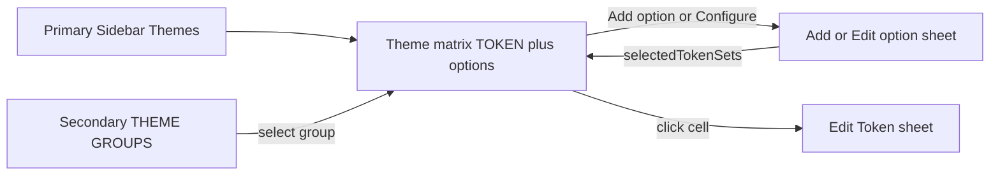

# Themes workspace upgrade (match recording)

Source: local gitignored file [`Themes - 2026-09-19 214352.mp4`](Themes%20-%202026-09-19%20214352.mp4) (~4:41). You asked for a **pixel-complete** match of that UI.

## What the video shows vs today

**Today:** Themes ([`app/page.tsx`](app/page.tsx)) renders [`ThemeConfigurationView.tsx`](components/ThemeConfigurationView.tsx) — a single option’s name/description plus Disabled/Source/Enabled token-set accordions and Figma key mapping. The secondary sidebar already lists theme groups/options ([`SecondarySidebar.tsx`](components/SecondarySidebar.tsx)).

**Video (target):** Selecting Themes opens a **matrix**: one `TOKEN` column and **one column per option in the selected group**. Cells show resolved values (color swatch + `oklch`, typography composites, purple `{alias}` refs). Group chrome: colored dots, group name, kebab, **Add option**. Column kebab: **Configure** / **More**. Click a cell → **Edit Token** right sheet. Add/Configure option is a **right sheet** with the token-set tree (not a center dialog).

We already have an unused [`ThemeMatrix.tsx`](components/ThemeMatrix.tsx) plus [`buildThemeMatrix`](utils/themeHelpers.ts) and [`EditTokenDrawer.tsx`](components/EditTokenDrawer.tsx). The matrix is **not routed**. Plan is to **route + restyle/extend** those, not start from a blank view.

## Phase 1 — Put the matrix on Themes

- In [`app/page.tsx`](app/page.tsx), render `ThemeMatrix` for `sidebarTab === "themes"` (keep secondary sidebar for tokens/themes).
- Keep [`ThemeConfigurationView.tsx`](components/ThemeConfigurationView.tsx) only as a source to lift token-set mapping UI into the option sheet; stop using it as the Themes page.
- Secondary sidebar: selecting a **group** sets `activeThemeGroupId` and drives **all option columns** (already how `ThemeMatrix` works). Keep option click for highlight/scroll to that column. Match video chrome: `THEME GROUPS` header, nested options, color dots.
- Header breadcrumb already labels Themes; keep `org / Themes / {group}`.

## Phase 2 — Matrix chrome to match the recording

Restyle [`ThemeMatrix.tsx`](components/ThemeMatrix.tsx) to the video, not the current extra toolbars:

- **Top bar:** option-color dots + group name + group kebab + **Add option** (right). Drop Git-sync banner, type chips, and grouping dropdown from the default Themes view (video does not show them).
- **Table header:** `TOKEN` | one column per option. Each option header: drag handle, uppercase name, kebab with **Configure** and **More** (rename/duplicate/delete via existing store actions).
- **Cells:** type-aware preview (color, alias chip, typography/shadow summary). Click opens Edit Token for that option’s underlying set/token.
- **Scale:** do not paint thousands of rows at once ([`AGENTS.md`](AGENTS.md) 13k+ tokens). Keep progressive loading (`INITIAL_BATCH_SIZE = 100`, increment 100) or equivalent virtualization even though the video looks like infinite scroll. `React.memo` row/cells.

Reuse `buildThemeMatrix`: rows from **enabled** sets; **source** sets resolve aliases only.

## Phase 3 — Add / Edit option as right sheets

Replace center [`AddThemeOptionModal.tsx`](components/AddThemeOptionModal.tsx) (and ThemeConfiguration mapping) with a right `Sheet` matching the video:

**Add theme option**

- Copy: “Create a new option for this theme group.”
- Fields: Name*, Description, **Selected Token Sets*** folder tree with Disabled / Source / Enabled.
- Block create unless at least one set is Enabled (warning copy from the video).
- Footer: Cancel / Create Option.
- Persist via existing `addThemeOption` + `selectedTokenSets`.

**Edit theme option** (column **Configure**)

- Same set tree; Name; **Delete option** (destructive left) / Cancel / Save changes.
- Persist via `updateThemeOption` / delete option actions already used in the secondary sidebar.

## Phase 4 — Pixel-complete Edit Token (video’s long second half)

Upgrade [`EditTokenDrawer.tsx`](components/EditTokenDrawer.tsx). Today: Token Name, short type list, value + references popover, description, set, category. Video also has:

- Tabs: **Token | Figma | History**.
- Full type list from the recording: Asset, Boolean, Border, Border Radius, Border Width, Color, Cubic Bezier, Dimension, Duration, Font Family, Font Size, Font Weight, Letter Spacing, Line Height, Number, Opacity, Shadow, Size, Space, Text, Text Case, Text Decoration, Typography.
- Value chrome: help, **References** / **Functions** (`color.mix`, `color.darken`, `adjust.*`, etc. — wire to existing alias/math in [`utils/transformTokens.ts`](utils/transformTokens.ts) where we already resolve them).
- Type editors: color (hex + channels + alpha + Add value), font family multi-value, typography **Structured | Reference** (font family/size/weight, line height, letter spacing, paragraph spacing, text case/decoration).
- **Mark as deprecated:** message, replacement token, severity, remove-after date. Extend token metadata in [`types/tokens.ts`](types/tokens.ts) (`$deprecated` / platform extensions) and persist through the store update path.
- Figma tab: collection/mode/variable key if present on the token/theme option (reuse fields already on theme options in ThemeConfigurationView).
- History tab: commit/sync history if we have it; otherwise an honest empty state, not fake data.
- Footer: Cancel / Update Token.

Widen `TokenType` so Tokens Studio labels map to stored `$type` without breaking existing sets (`color`, `dimension`, `typography`, `boxShadow` → `shadow`, etc.).

## Phase 5 — Verify

- Themes tab: group switch (`theme` vs `colorMode`) changes columns; cells resolve aliases vs literals.
- Add option sheet + Enable at least one set; new column appears.
- Configure option: remap sets, save, delete.
- Click cells across color / alias / typography; Edit Token save writes the correct set.
- 100+ token project: first paint stays batched; load-more or scroll fetch works.
- Secondary sidebar, Tokens tab, and Header breadcrumbs still consistent.
- `npx tsc --noEmit` and `npm run build`.

## Out of scope unless you add it later

- Rebuilding Tokens tab to this matrix (video is Themes-only).
- Committing the `.mp4` (gitignored `*.mp4`).
